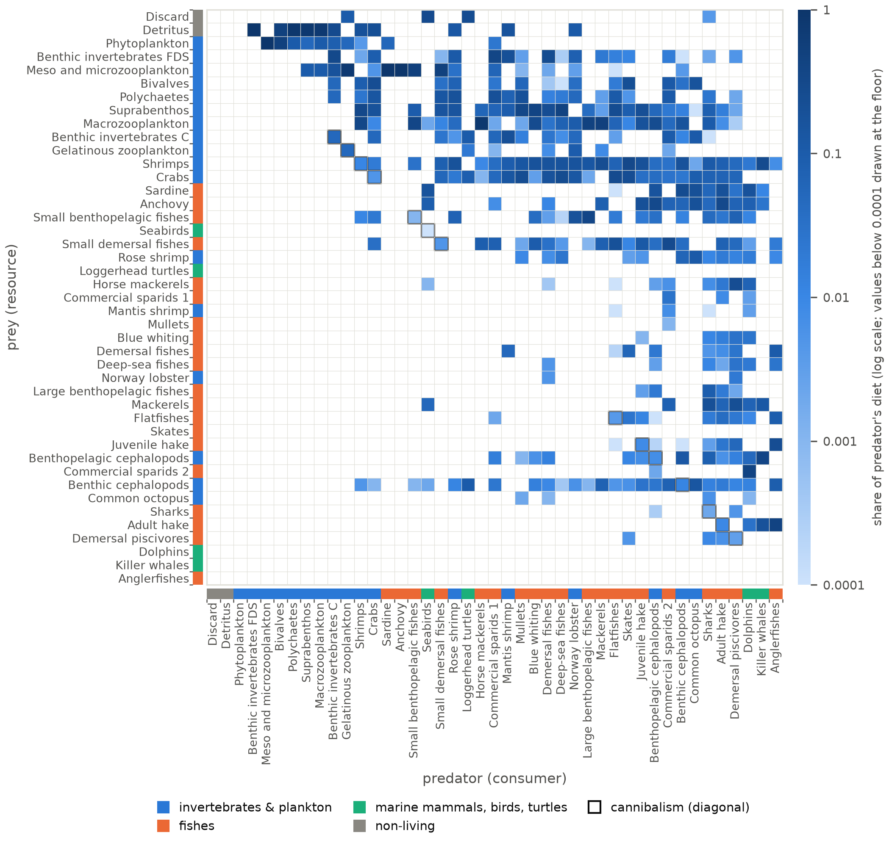
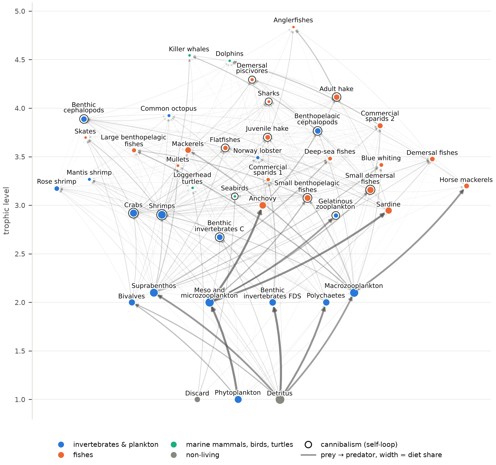

# The web itself

Generated by `code/write_docs.py`. The figures are drawn by the code, so if one needs changing, change the code and not the image. Notes on these results: [`notes/`](../../notes/README.md) (web).

**Chosen for the paper (★):** [`cadiz_foodweb`](cadiz_foodweb.png) (figure 1). Everything else in this folder is supporting material. The full line-up is in [`figures/README.md`](../README.md).

| figure | what it shows |
|---|---|
| [`cadiz_diet_matrix`](cadiz_diet_matrix.png) · [pdf](cadiz_diet_matrix.pdf) | The culled 43 × 43 diet matrix on a log colour scale, with both axes ordered by trophic level. **Full text width (7 in).** |
| ★ [`cadiz_foodweb`](cadiz_foodweb.png) · [pdf](cadiz_foodweb.pdf) | The food web drawn by trophic level (height). Colour = broad category; size = importance as prey; arrow width = diet share; ring = cannibalism. **Full text width (7 in).** **Paper figure 1.** The only picture of the system: trophic level, category, diet share and cannibalism in one panel. |

### cadiz_diet_matrix

### ★ cadiz_foodweb

The cleaned network, with all 43 functional groups placed by trophic level on the vertical axis. Color marks the broad category, node size is importance as prey, arrow width is the share of the predator's diet that link carries, and a ring marks the 14 groups that eat their own kind. It works as the orientation figure for the paper, as it shows the whole range of the web in one place, from three basal groups at trophic level 1 (Detritus, Discard, and Phytoplankton) up to Anglerfishes at 4.84. The thickest arrows all run off those three basal groups, and that is the structure every removal result later depends on, so it is worth showing before any of the statistics.
