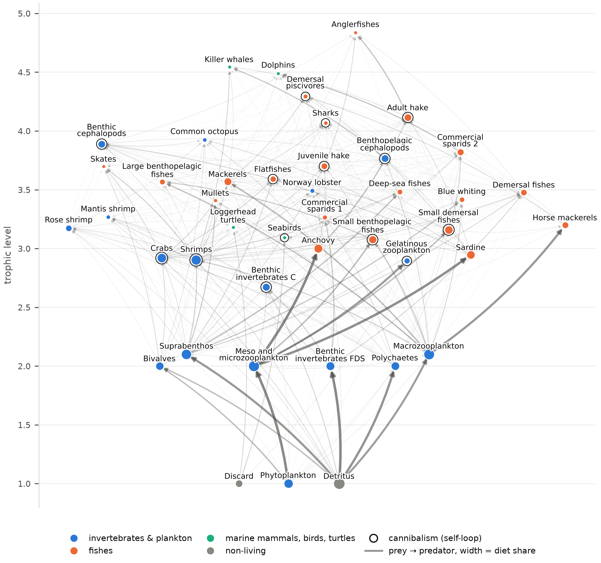

# The web

Script: [`code/build_network.py`](../../code/build_network.py). Results: [`notes/01_web.md`](../../notes/01_web.md).

| Figure | What it shows |
|---|---|
| [`diet_matrix`](diet_matrix.png) · [pdf](diet_matrix.pdf) | The culled 43 × 43 diet matrix on a log color scale, with both axes ordered by trophic level. |
| [`food_web`](food_web.png) · [pdf](food_web.pdf) | The food web, drawn by trophic level (height). Color shows the broad category, node size shows importance as prey, arrow width shows diet share, and a ring shows cannibalism. |

### diet_matrix

### food_web

