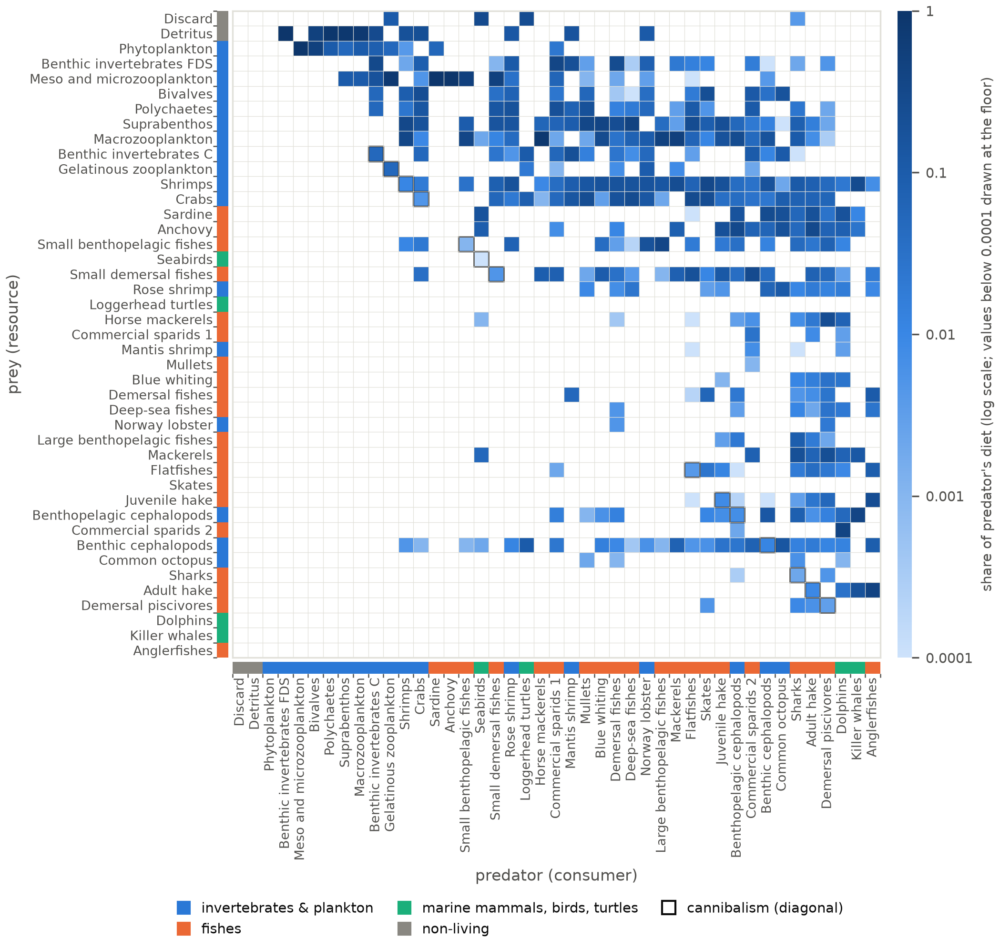

# The web itself

Drawn by [`code/build_network.py`](../../code/build_network.py). The numbers behind these figures are in [`notes/01_data_and_cleaning.md`](../../notes/01_data_and_cleaning.md).

| Figure | What it shows |
|---|---|
| [`cadiz_diet_matrix`](cadiz_diet_matrix.png) · [pdf](cadiz_diet_matrix.pdf) | The culled 43 × 43 diet matrix on a log color scale, with both axes ordered by trophic level. |
| [`cadiz_foodweb`](cadiz_foodweb.png) · [pdf](cadiz_foodweb.pdf) | The food web drawn by trophic level (height). Color = broad category; size = importance as prey; arrow width = diet share; ring = cannibalism. |

### cadiz_diet_matrix

### cadiz_foodweb

