# Distributions

Drawn by [`code/distributions.py`](../../code/distributions.py). The numbers behind these figures are in [`notes/02_distributions.md`](../../notes/02_distributions.md).

| Figure | What it shows |
|---|---|
| [`betweenness_histogram`](betweenness_histogram.png) · [pdf](betweenness_histogram.pdf) | Directed betweenness of each group. |
| [`clustering_histogram`](clustering_histogram.png) · [pdf](clustering_histogram.pdf) | Local clustering coefficient of each group. |
| [`degree_cumulative_distribution`](degree_cumulative_distribution.png) · [pdf](degree_cumulative_distribution.pdf) | Cumulative number of prey and number of predators, divided by link density, against an exponential (Camacho et al. 2002). |
| [`effective_prey_histogram`](effective_prey_histogram.png) · [pdf](effective_prey_histogram.pdf) | Diet diversity (effective number of prey) of each consumer. |
| [`out_strength_histogram`](out_strength_histogram.png) · [pdf](out_strength_histogram.pdf) | Summed share of predators' diets that each group supplies. |
| [`link_strength_histogram`](link_strength_histogram.png) · [pdf](link_strength_histogram.pdf) | Share of the predator's diet carried by each of the 397 feeding links (log scale). |
| [`n_predators_histogram`](n_predators_histogram.png) · [pdf](n_predators_histogram.pdf) | Number of predators per group, against the random-web expectation. |
| [`n_prey_histogram`](n_prey_histogram.png) · [pdf](n_prey_histogram.pdf) | Number of prey per group, against the random-web expectation. |
| [`omnivory_index_histogram`](omnivory_index_histogram.png) · [pdf](omnivory_index_histogram.pdf) | Omnivory index of each group. |
| [`total_degree_histogram`](total_degree_histogram.png) · [pdf](total_degree_histogram.pdf) | Total degree (prey + predators), against the random-web expectation. |
| [`trophic_level_histogram`](trophic_level_histogram.png) · [pdf](trophic_level_histogram.pdf) | Trophic levels of the 43 groups. |

### betweenness_histogram

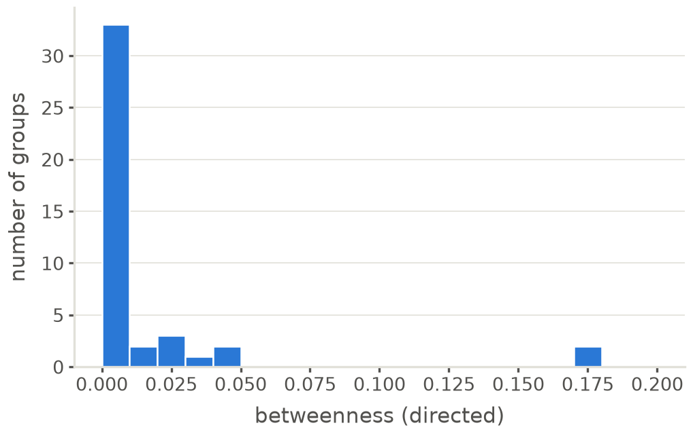

### clustering_histogram

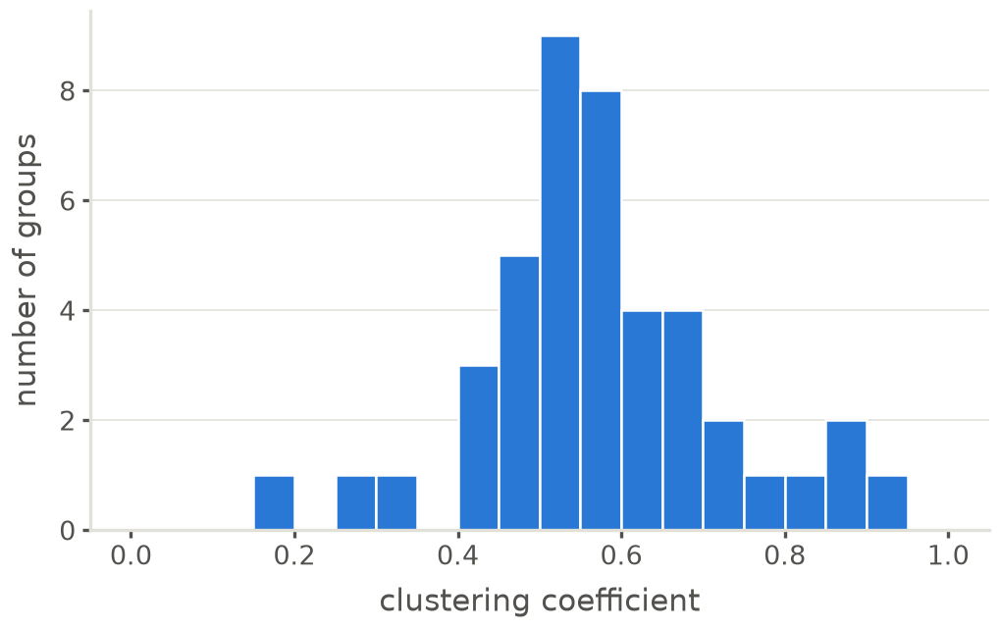

### degree_cumulative_distribution

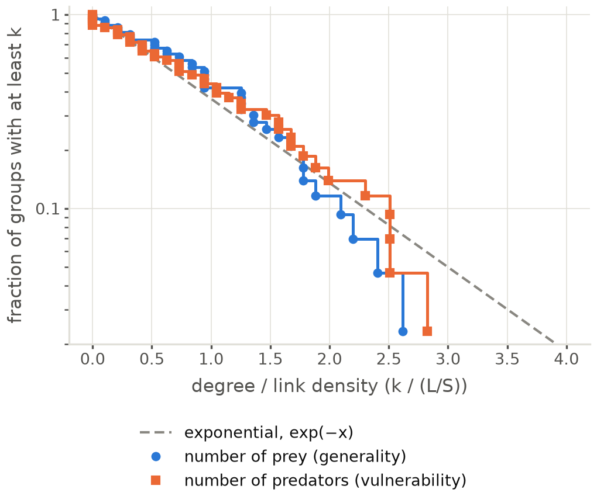

### effective_prey_histogram

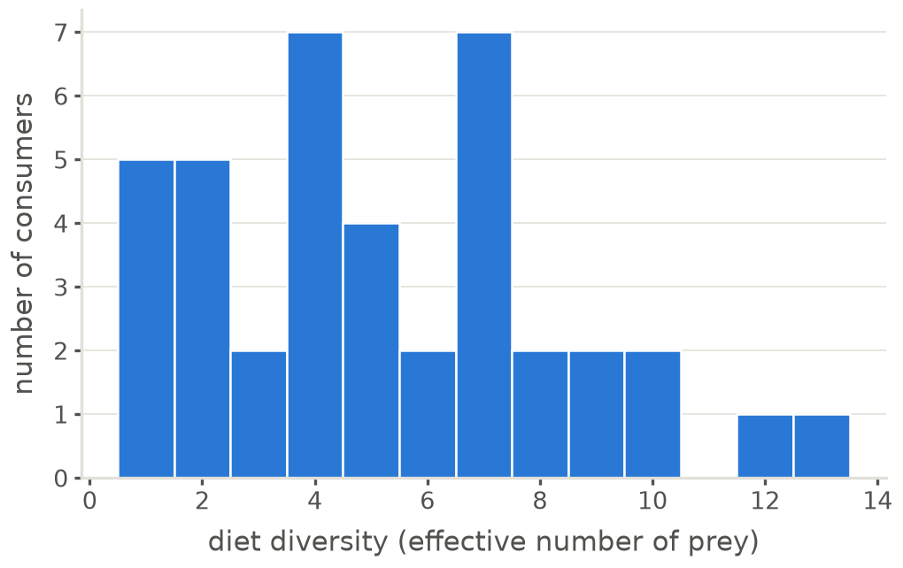

### out_strength_histogram

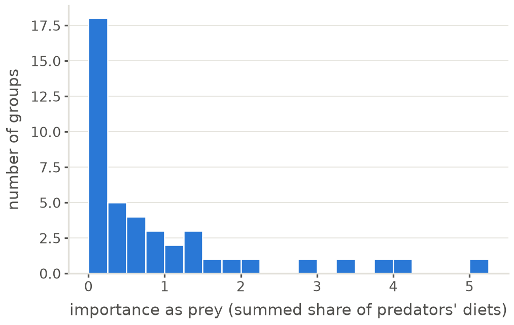

### link_strength_histogram

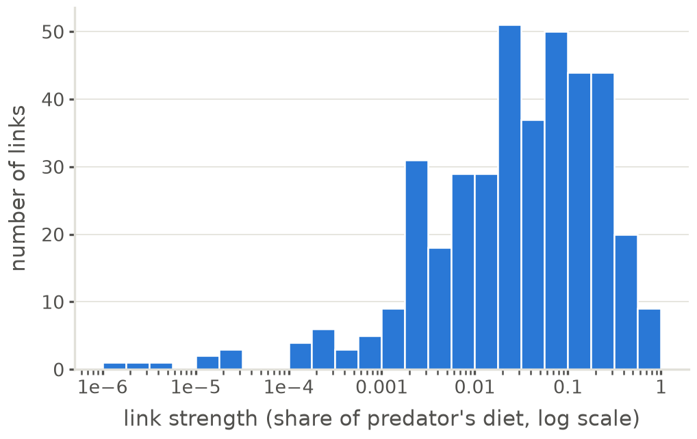

### n_predators_histogram

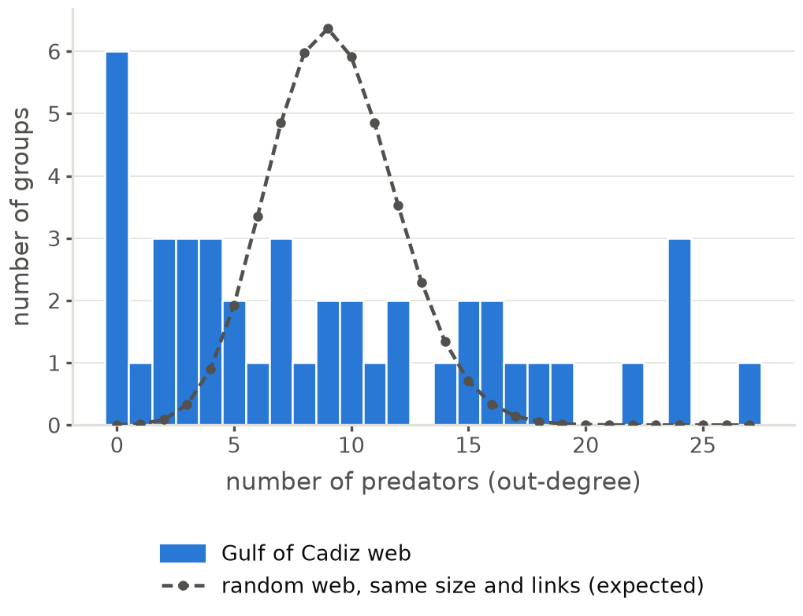

### n_prey_histogram

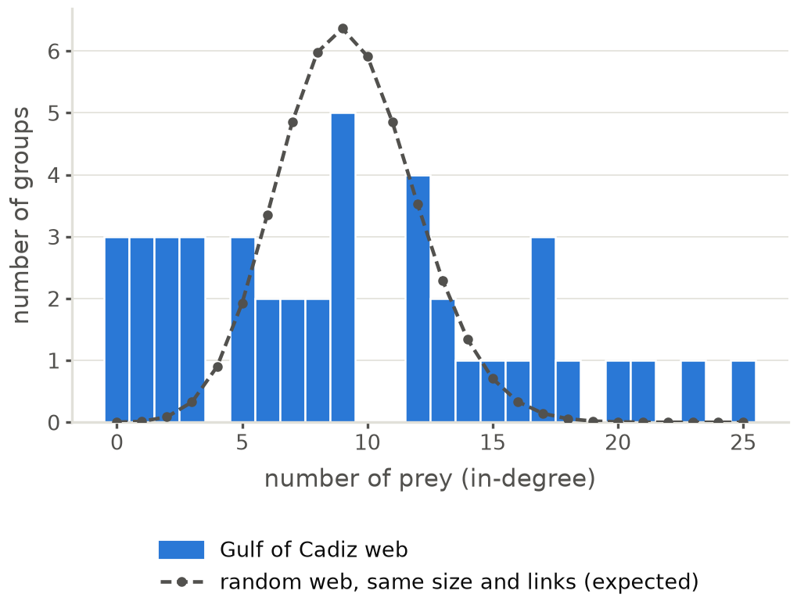

### omnivory_index_histogram

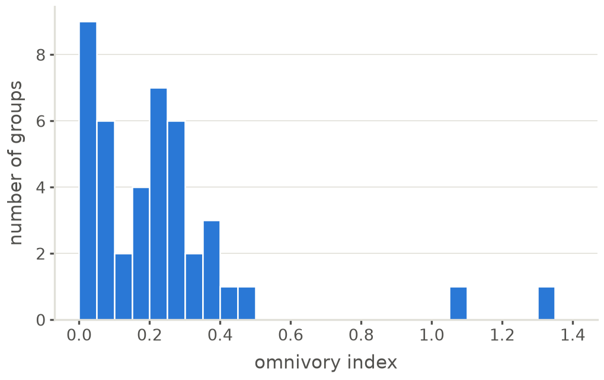

### total_degree_histogram

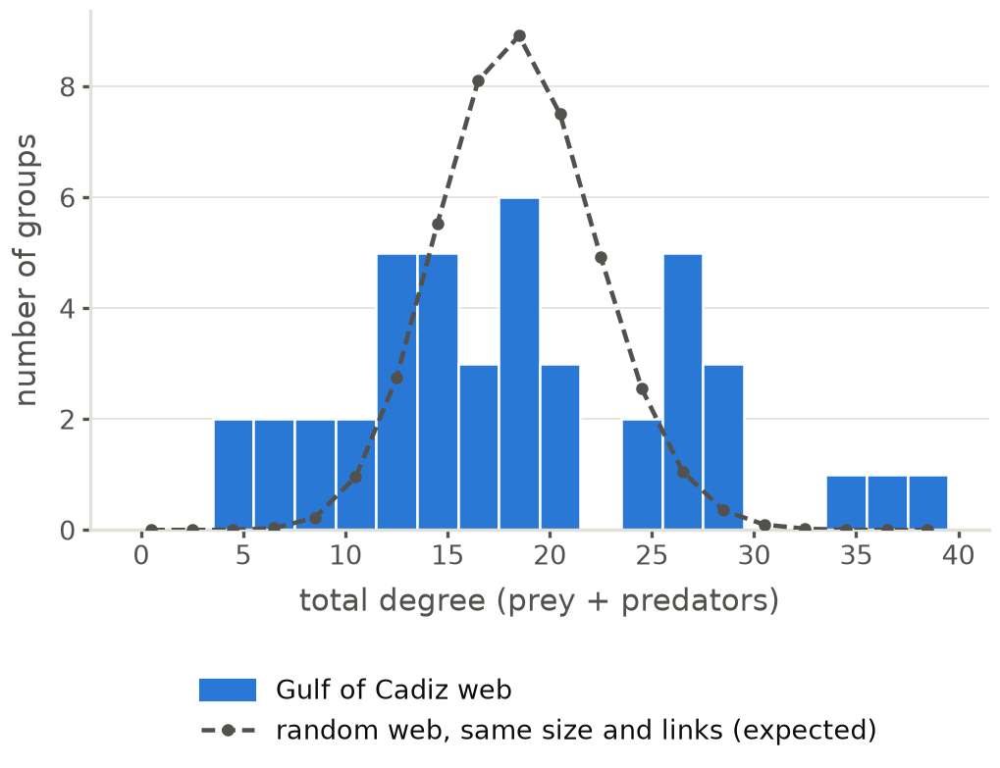

### trophic_level_histogram

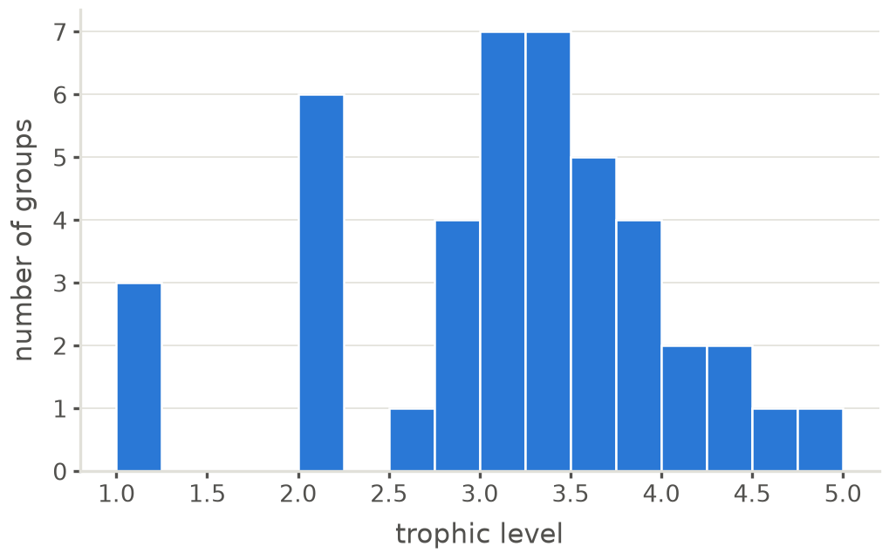
