# Distributions

Generated by `code/write_docs.py`. Figures are drawn by the code; edit the code, not the images. Notes on these results: [`notes/`](../../notes/README.md) (distributions).

**Chosen for the paper (★):** [`degree_cumulative_distribution`](degree_cumulative_distribution.png) (figure 2), [`link_strength_histogram`](link_strength_histogram.png) (figure 3). The rest of this folder is supporting material. Full line-up: [`figures/README.md`](../README.md).

| figure | what it shows |
|---|---|
| [`betweenness_histogram`](betweenness_histogram.png) · [pdf](betweenness_histogram.pdf) | Directed betweenness of each group. |
| [`clustering_histogram`](clustering_histogram.png) · [pdf](clustering_histogram.pdf) | Local clustering coefficient of each group. |
| ★ [`degree_cumulative_distribution`](degree_cumulative_distribution.png) · [pdf](degree_cumulative_distribution.pdf) | Cumulative number of prey and number of predators, divided by link density, against an exponential (Camacho et al. 2002). **Paper figure 2.** Prey and predator counts follow an exponential, not a power law — the reason a degree-targeted attack does no better than random. |
| [`diet_diversity_histogram`](diet_diversity_histogram.png) · [pdf](diet_diversity_histogram.pdf) | Diet diversity (effective number of prey) of each consumer. |
| [`importance_as_prey_histogram`](importance_as_prey_histogram.png) · [pdf](importance_as_prey_histogram.pdf) | Summed share of predators' diets that each group supplies. |
| ★ [`link_strength_histogram`](link_strength_histogram.png) · [pdf](link_strength_histogram.pdf) | Share of the predator's diet carried by each of the 397 feeding links (log scale). **Paper figure 3.** Most of the 397 links are weak; this is what sets up strong- vs weak-link cutting. |
| [`number_of_predators_histogram`](number_of_predators_histogram.png) · [pdf](number_of_predators_histogram.pdf) | Number of predators per group, against the random-web expectation. |
| [`number_of_prey_histogram`](number_of_prey_histogram.png) · [pdf](number_of_prey_histogram.pdf) | Number of prey per group, against the random-web expectation. |
| [`omnivory_index_histogram`](omnivory_index_histogram.png) · [pdf](omnivory_index_histogram.pdf) | Omnivory index of each group. |
| [`total_degree_histogram`](total_degree_histogram.png) · [pdf](total_degree_histogram.pdf) | Total degree (prey + predators), against the random-web expectation. |
| [`trophic_level_histogram`](trophic_level_histogram.png) · [pdf](trophic_level_histogram.pdf) | Trophic levels of the 43 groups. |

### betweenness_histogram

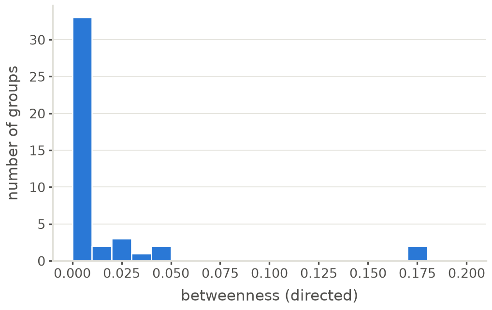

### clustering_histogram

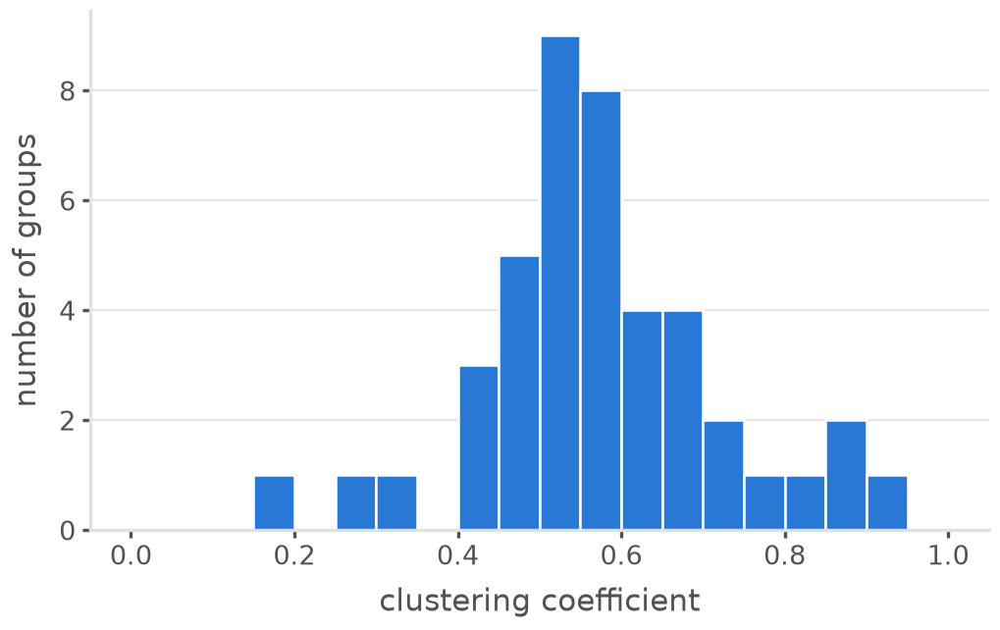

### ★ degree_cumulative_distribution

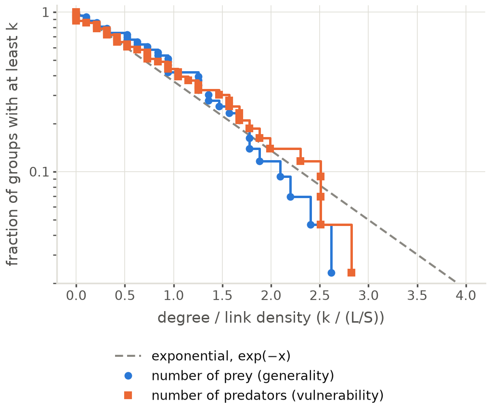

### diet_diversity_histogram

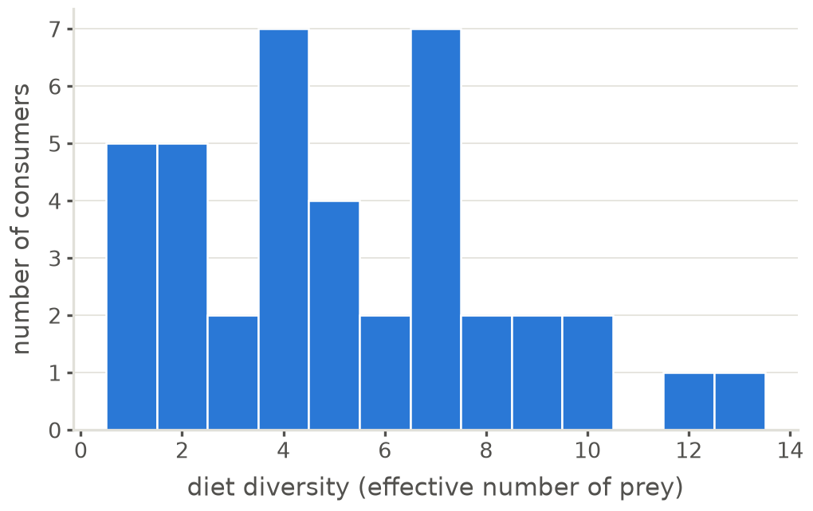

### importance_as_prey_histogram

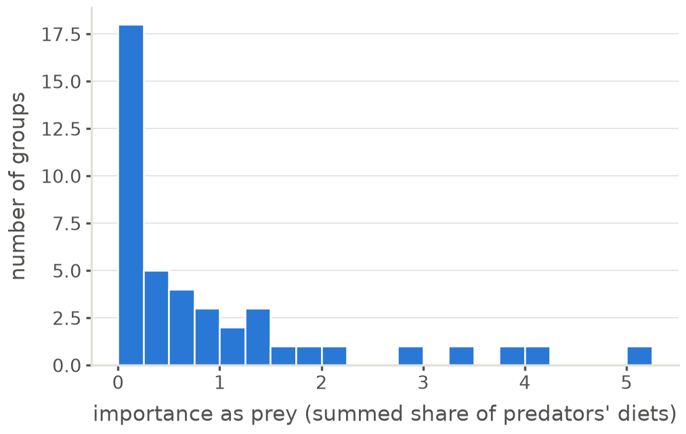

### ★ link_strength_histogram

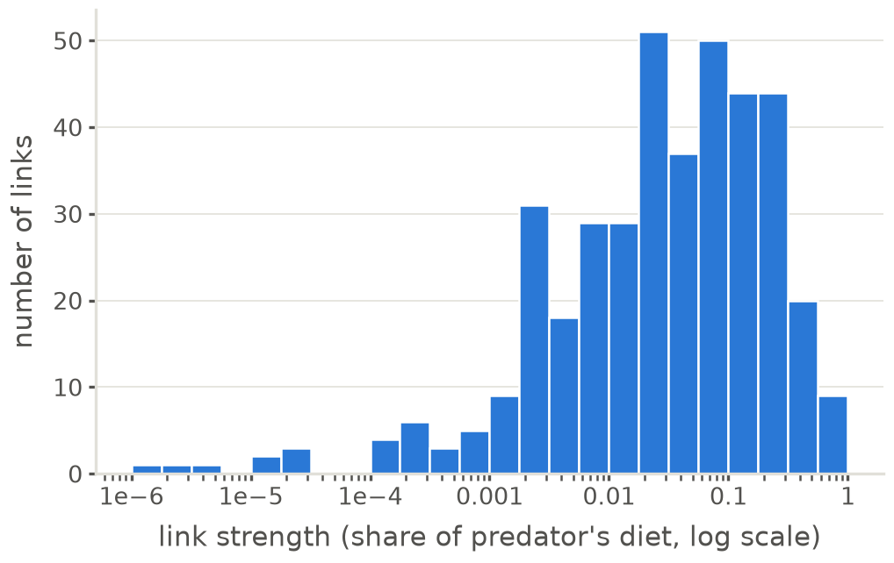

### number_of_predators_histogram

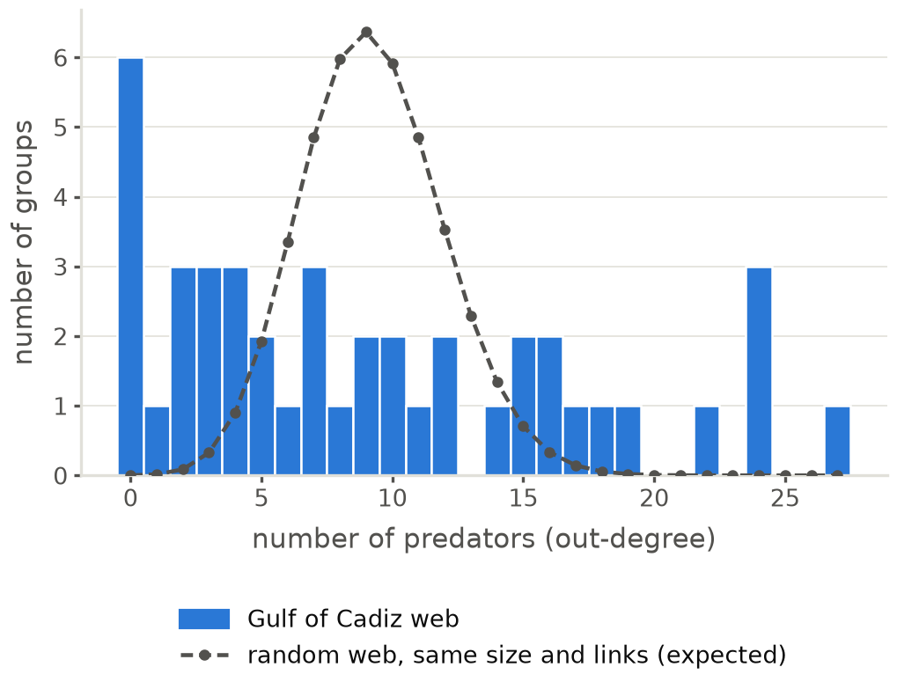

### number_of_prey_histogram

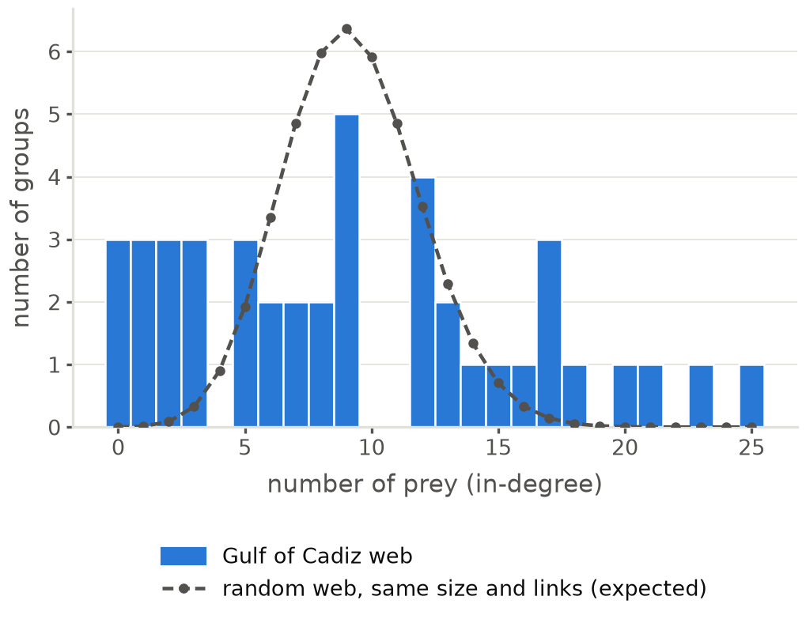

### omnivory_index_histogram

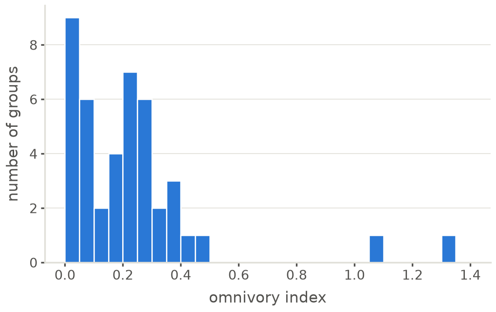

### total_degree_histogram

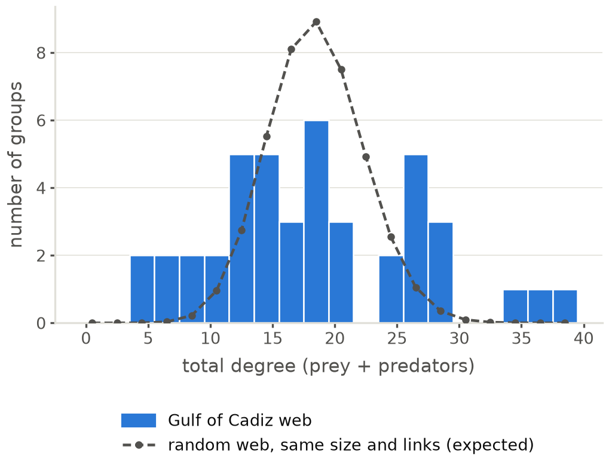

### trophic_level_histogram

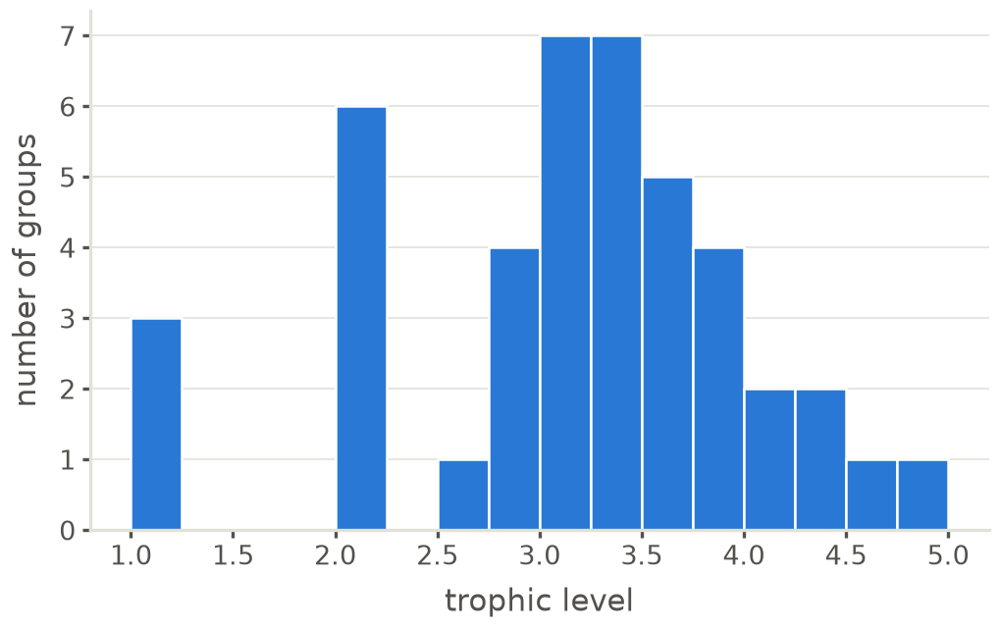
