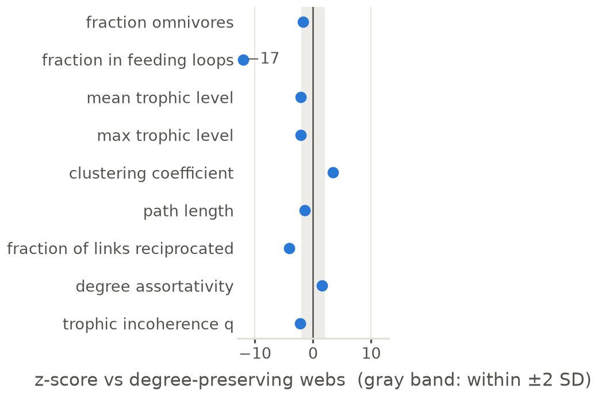
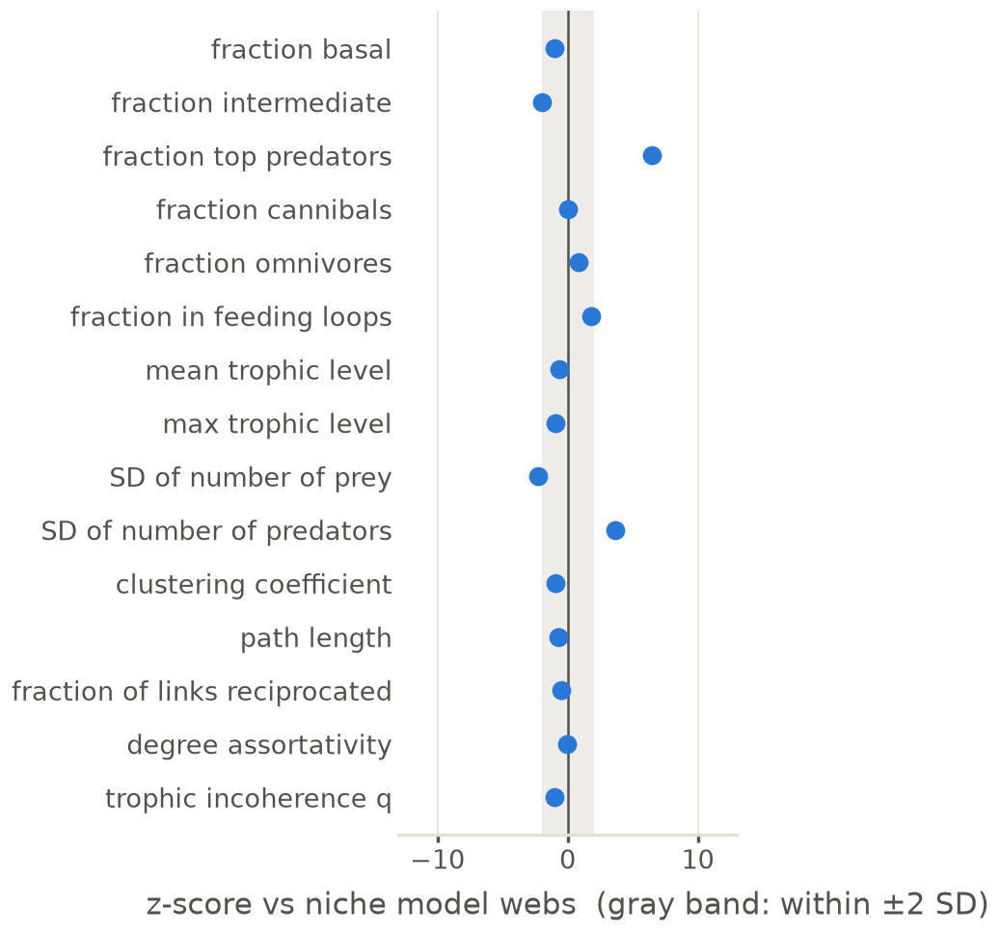
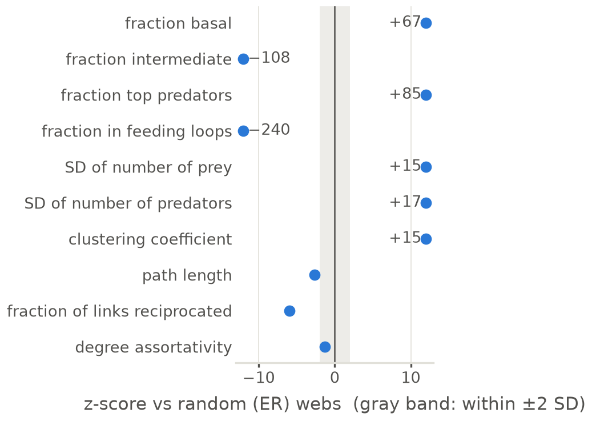

# Structure against null models

Generated by `code/write_docs.py`. The figures are drawn by the code, so if one needs changing, change the code and not the image. Notes on these results: [`notes/`](../../notes/README.md) (structure).

| figure | what it shows |
|---|---|
| [`vs_degree_preserving`](vs_degree_preserving.png) · [pdf](vs_degree_preserving.pdf) | z-scores against degree-preserving rewired webs. |
| [`vs_niche_model`](vs_niche_model.png) · [pdf](vs_niche_model.pdf) | z-scores against niche-model webs. |
| [`vs_random_er`](vs_random_er.png) · [pdf](vs_random_er.pdf) | z-score of each whole-web measure against random (ER) webs; the gray band is ±2 SD. |

### vs_degree_preserving

### vs_niche_model

### vs_random_er

