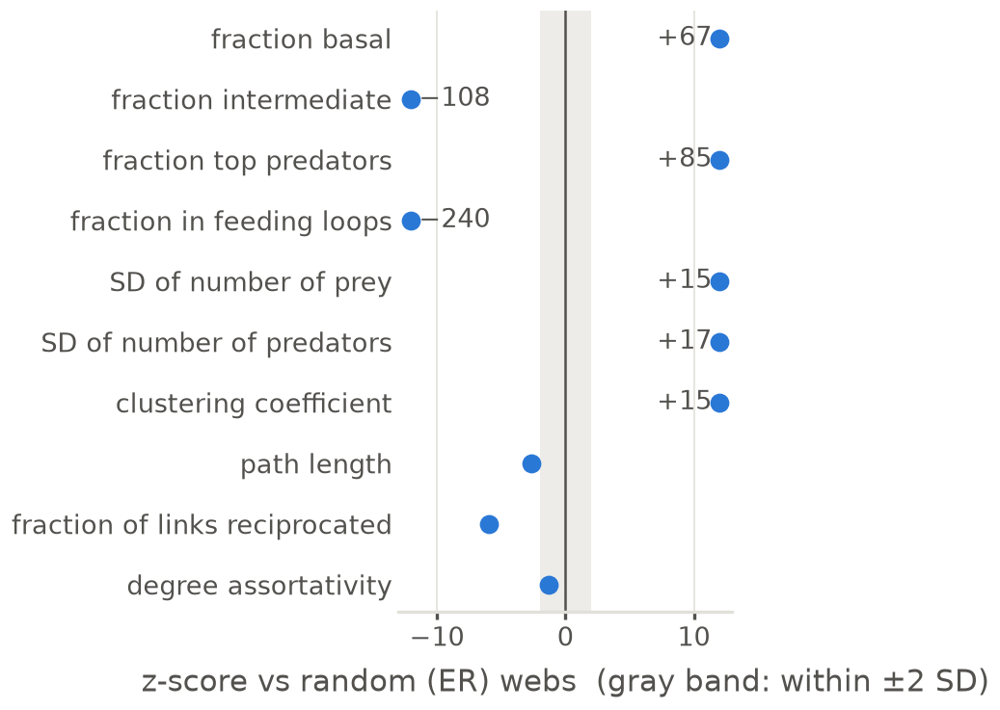

# Structure against null models

These figures are drawn by [`code/network_structure.py`](../../code/network_structure.py), and the results behind them are summarized in [`notes/03_structure.md`](../../notes/03_structure.md).

| Figure | What it shows |
|---|---|
| [`structure_vs_degree_preserving`](structure_vs_degree_preserving.png) · [pdf](structure_vs_degree_preserving.pdf) | z-score of each whole-web measure against 300 degree-preserving rewired webs, where the gray band is ±2 SD. |
| [`structure_vs_niche_model`](structure_vs_niche_model.png) · [pdf](structure_vs_niche_model.pdf) | z-score of each whole-web measure against 1000 niche-model webs, where the gray band is ±2 SD. |
| [`structure_vs_random`](structure_vs_random.png) · [pdf](structure_vs_random.pdf) | z-score of each whole-web measure against 1000 random (ER) webs, where the gray band is ±2 SD. |

### structure_vs_degree_preserving

### structure_vs_niche_model

### structure_vs_random

