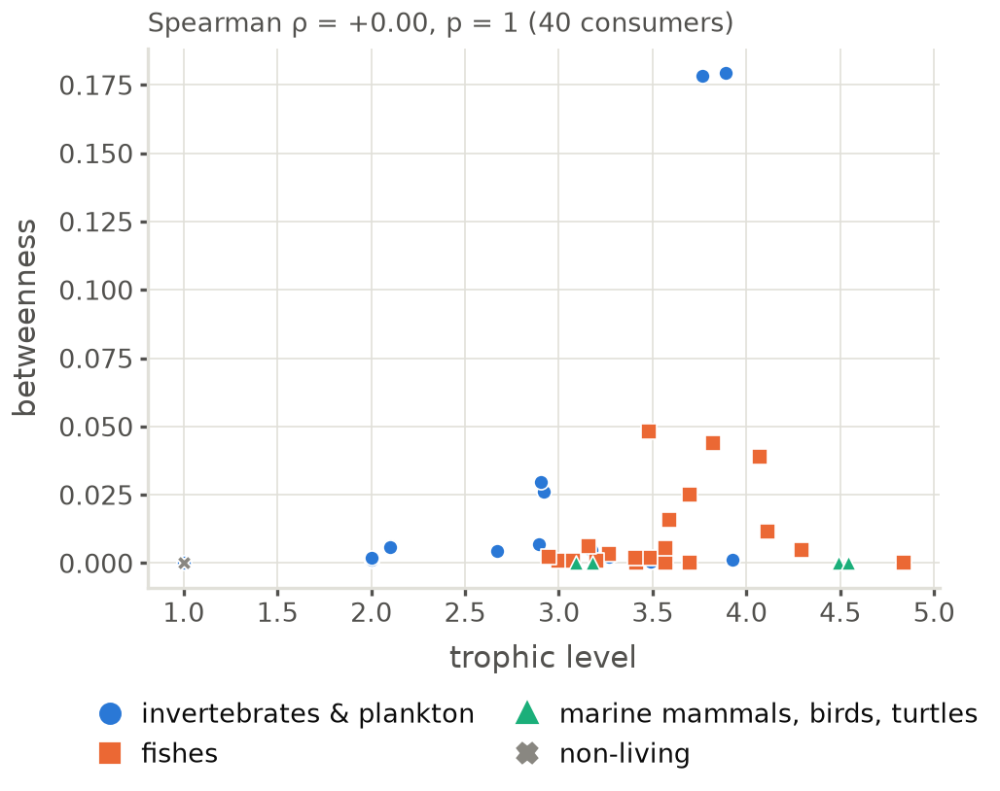
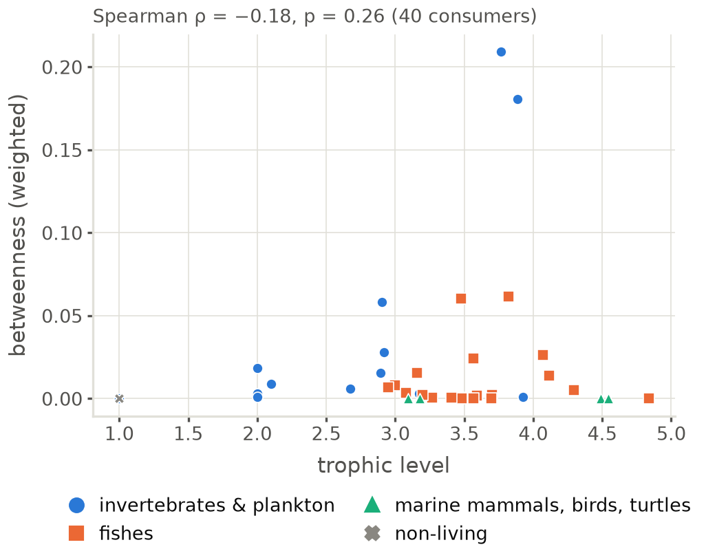
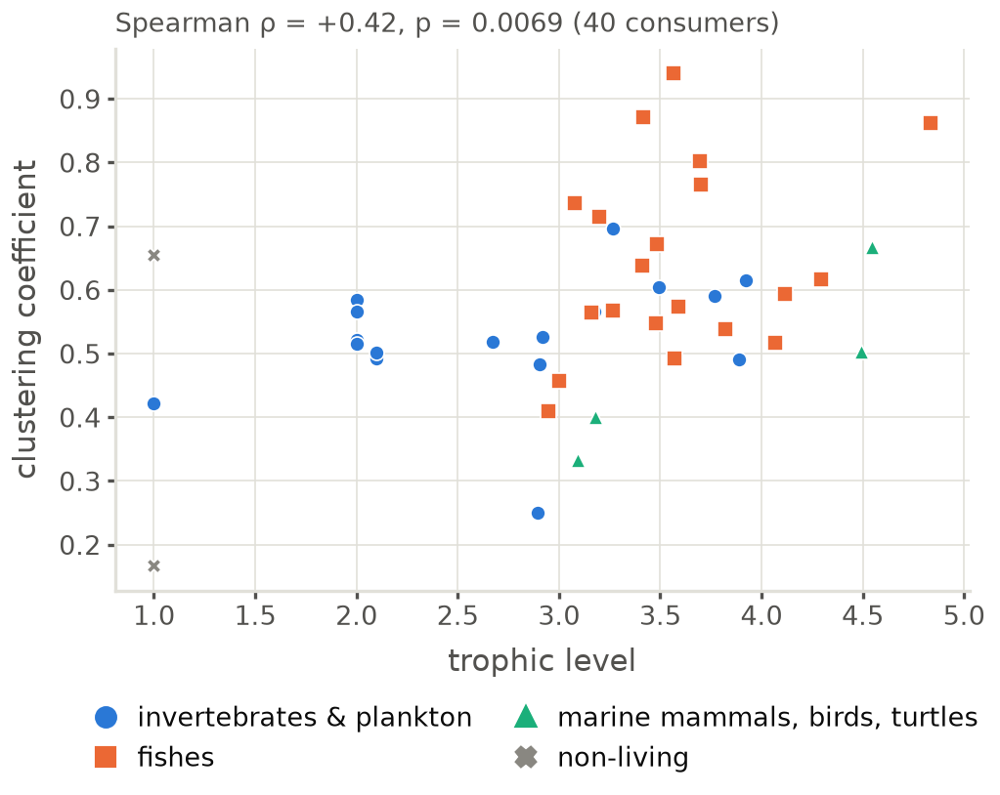
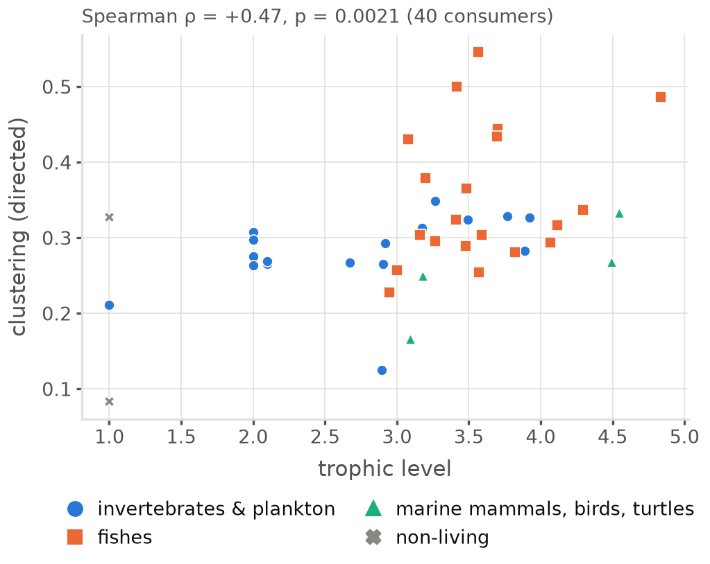
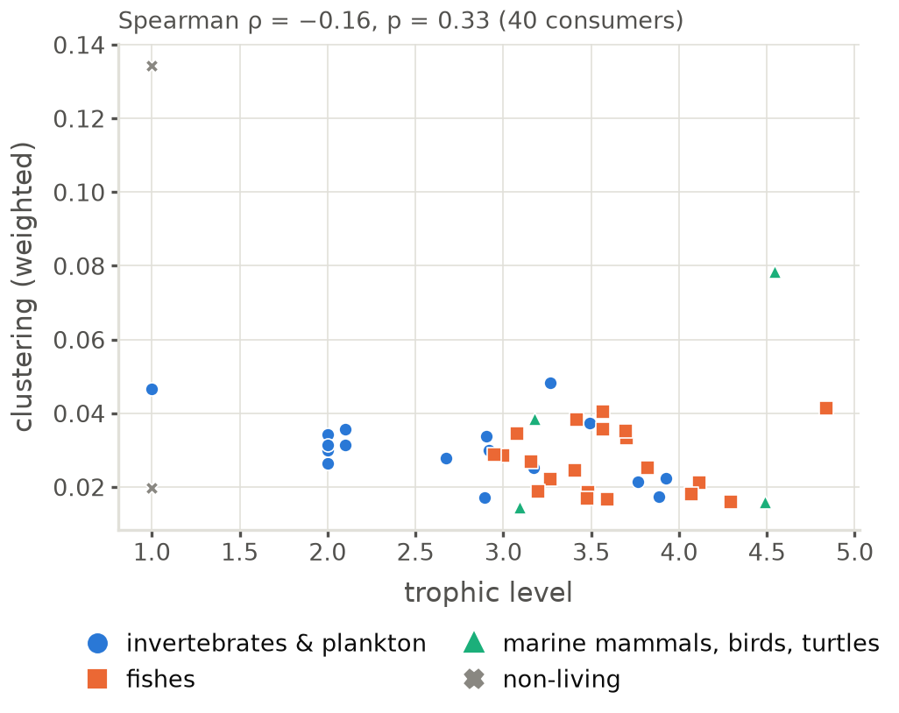
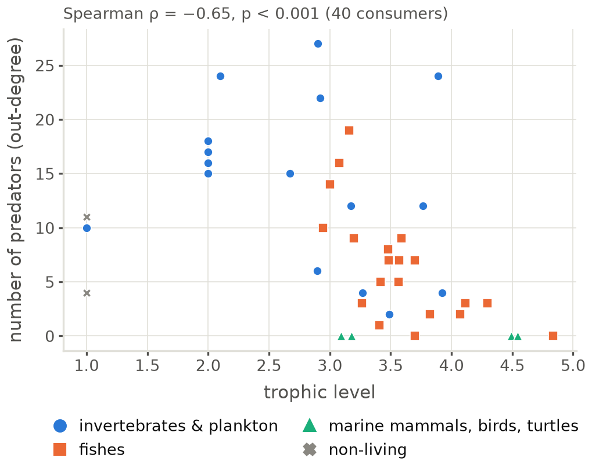
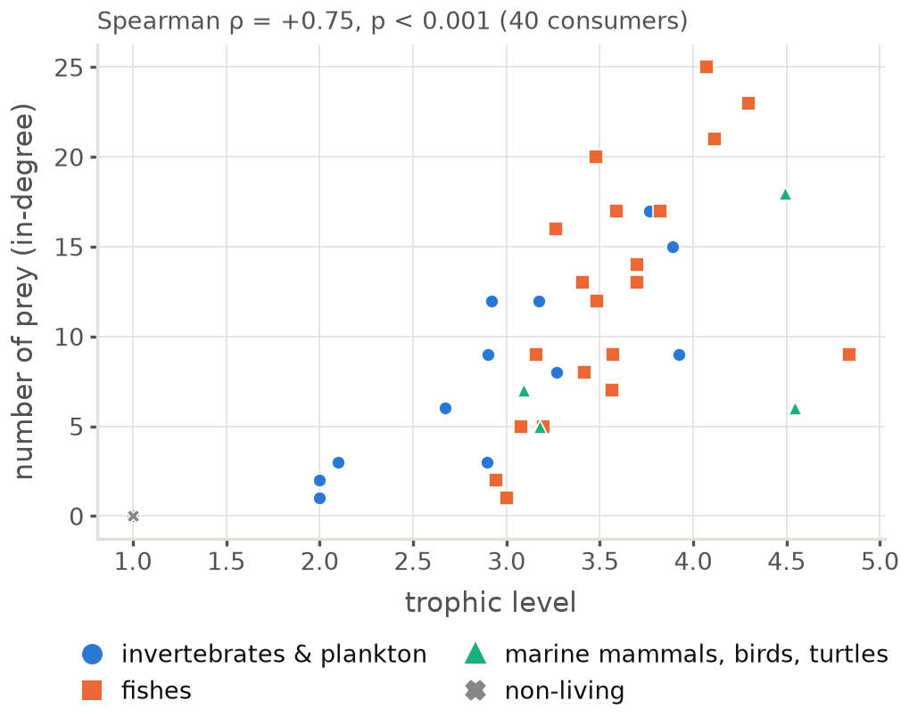
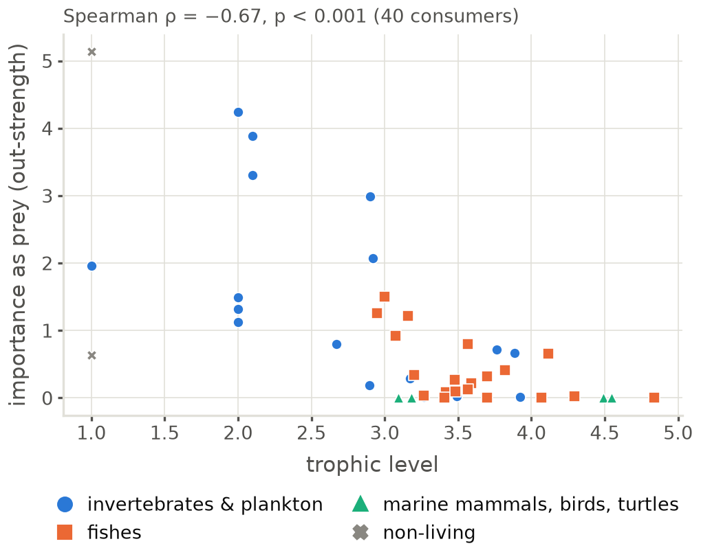
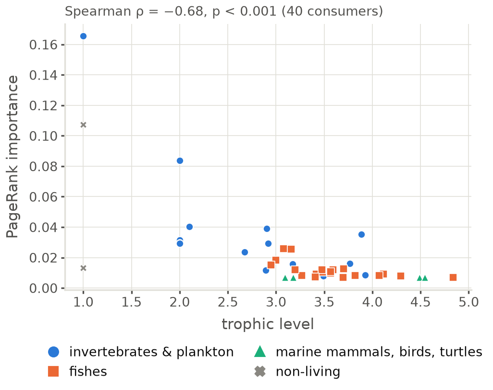
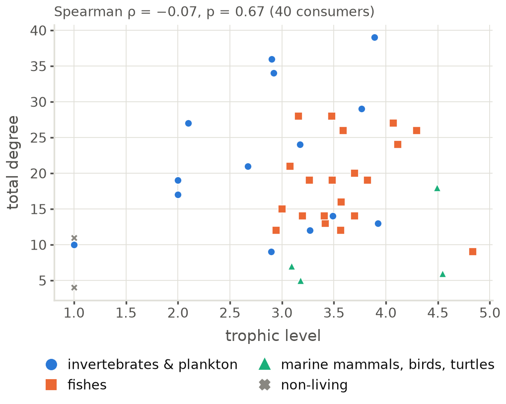

# Centrality against trophic level

Generated by `code/write_docs.py`. Figures are drawn by the code; edit the code, not the images. Notes on these results: [`notes/`](../../notes/README.md) (centrality).

| figure | what it shows |
|---|---|
| [`tl_vs_betweenness`](tl_vs_betweenness.png) · [pdf](tl_vs_betweenness.pdf) | Betweenness against trophic level, with Spearman ρ. |
| [`tl_vs_betweenness_weighted`](tl_vs_betweenness_weighted.png) · [pdf](tl_vs_betweenness_weighted.pdf) | Betweenness (weighted) against trophic level, with Spearman ρ. |
| [`tl_vs_clustering`](tl_vs_clustering.png) · [pdf](tl_vs_clustering.pdf) | Clustering coefficient against trophic level, with Spearman ρ. |
| [`tl_vs_clustering_directed`](tl_vs_clustering_directed.png) · [pdf](tl_vs_clustering_directed.pdf) | Clustering (directed) against trophic level, with Spearman ρ. |
| [`tl_vs_clustering_weighted`](tl_vs_clustering_weighted.png) · [pdf](tl_vs_clustering_weighted.pdf) | Clustering (weighted) against trophic level, with Spearman ρ. |
| [`tl_vs_n_predators`](tl_vs_n_predators.png) · [pdf](tl_vs_n_predators.pdf) | Number of predators (out-degree) against trophic level, with Spearman ρ. |
| [`tl_vs_n_prey`](tl_vs_n_prey.png) · [pdf](tl_vs_n_prey.pdf) | Number of prey (in-degree) against trophic level, with Spearman ρ. |
| [`tl_vs_out_strength`](tl_vs_out_strength.png) · [pdf](tl_vs_out_strength.pdf) | Importance as prey (out-strength) against trophic level, with Spearman ρ. |
| [`tl_vs_pagerank_importance`](tl_vs_pagerank_importance.png) · [pdf](tl_vs_pagerank_importance.pdf) | Pagerank importance against trophic level, with Spearman ρ. |
| [`tl_vs_total_degree`](tl_vs_total_degree.png) · [pdf](tl_vs_total_degree.pdf) | Total degree against trophic level, with Spearman ρ. |

### tl_vs_betweenness

### tl_vs_betweenness_weighted

### tl_vs_clustering

### tl_vs_clustering_directed

### tl_vs_clustering_weighted

### tl_vs_n_predators

### tl_vs_n_prey

### tl_vs_out_strength

### tl_vs_pagerank_importance

### tl_vs_total_degree

