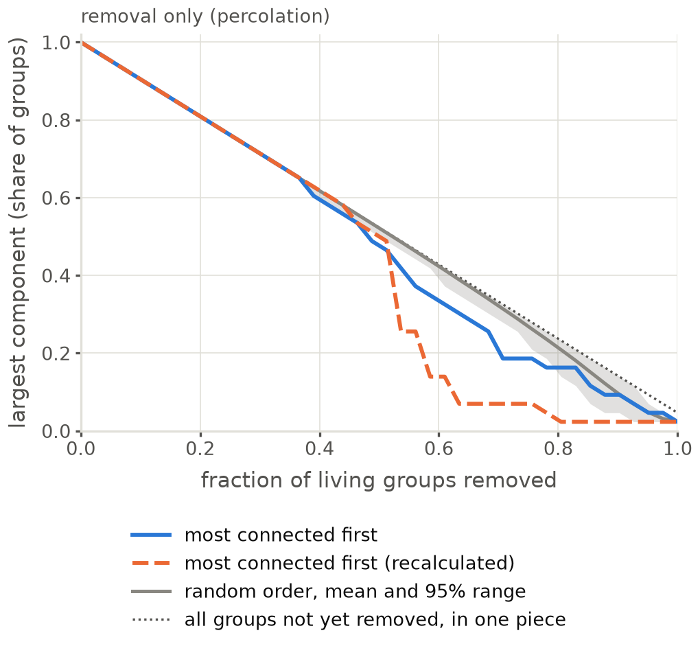
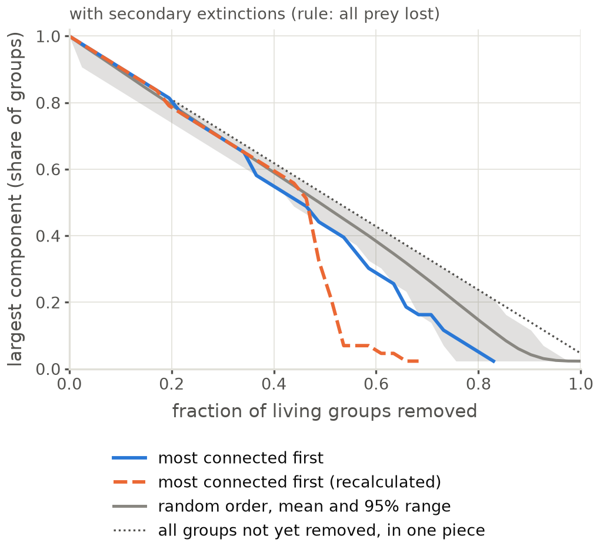
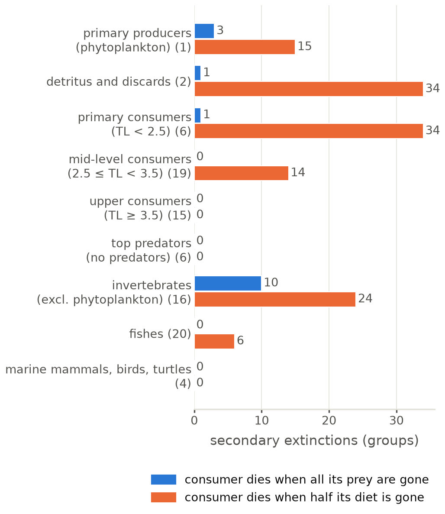
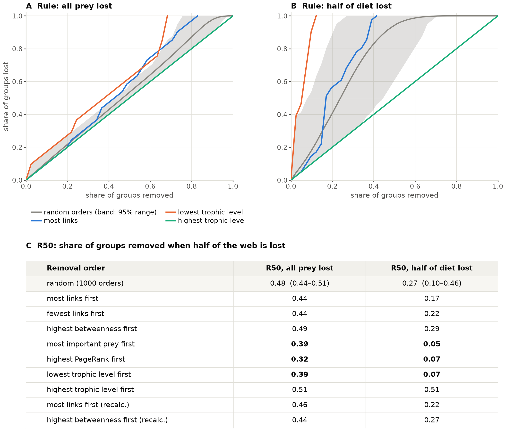
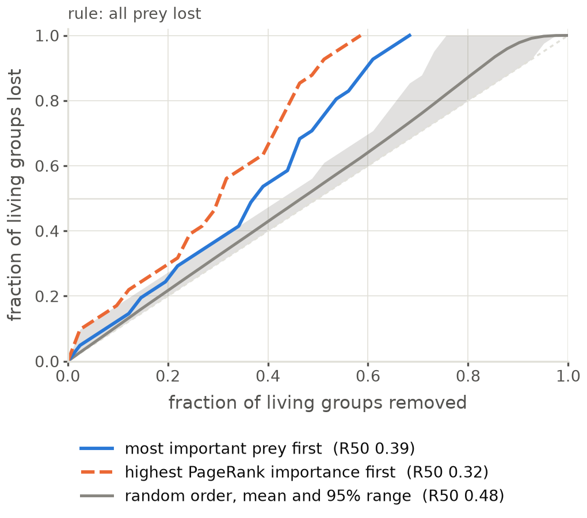
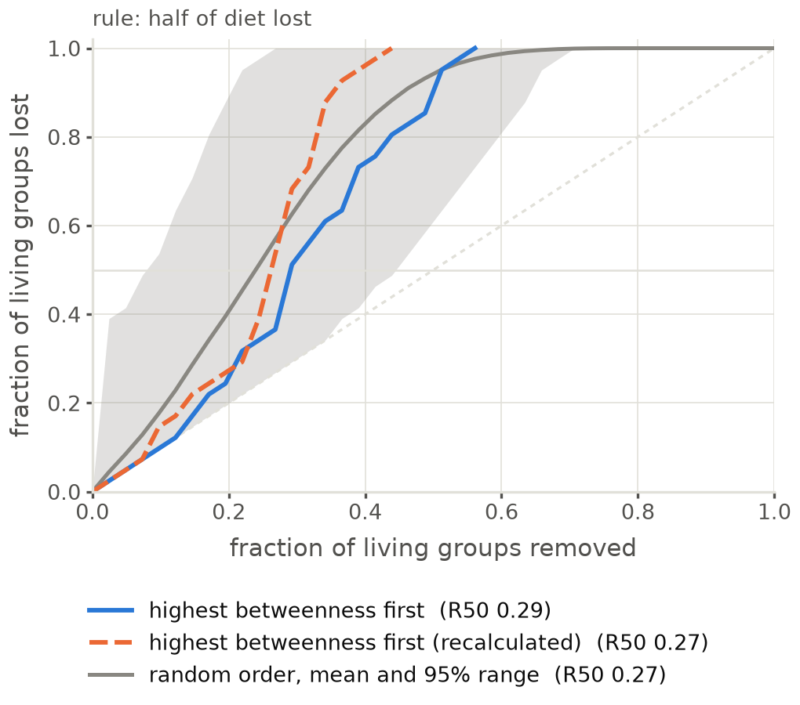
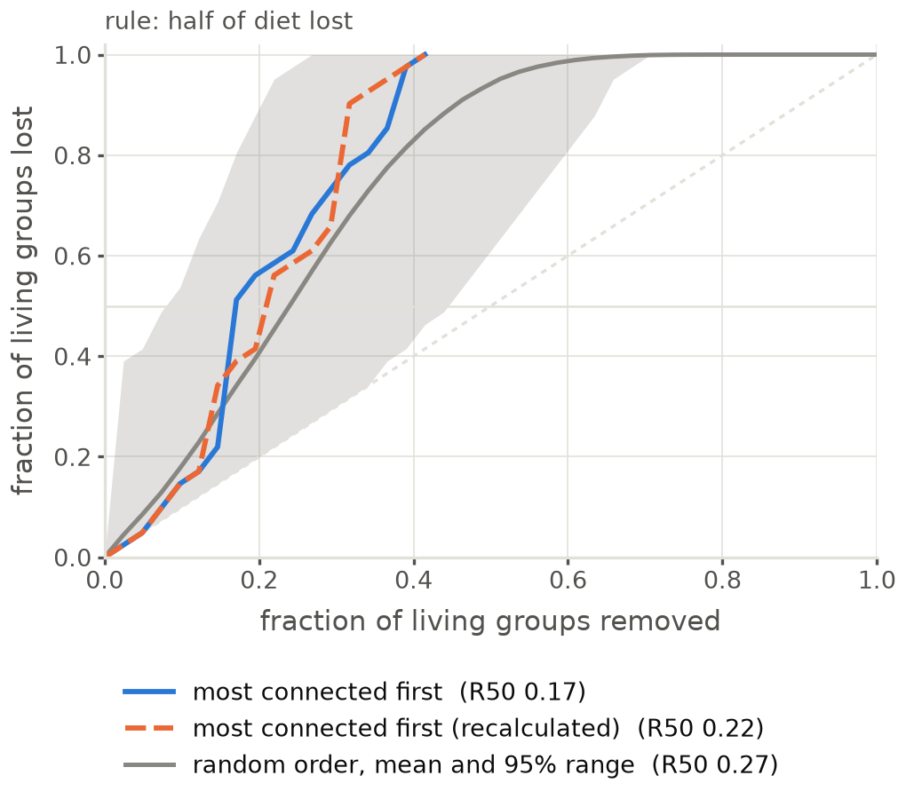
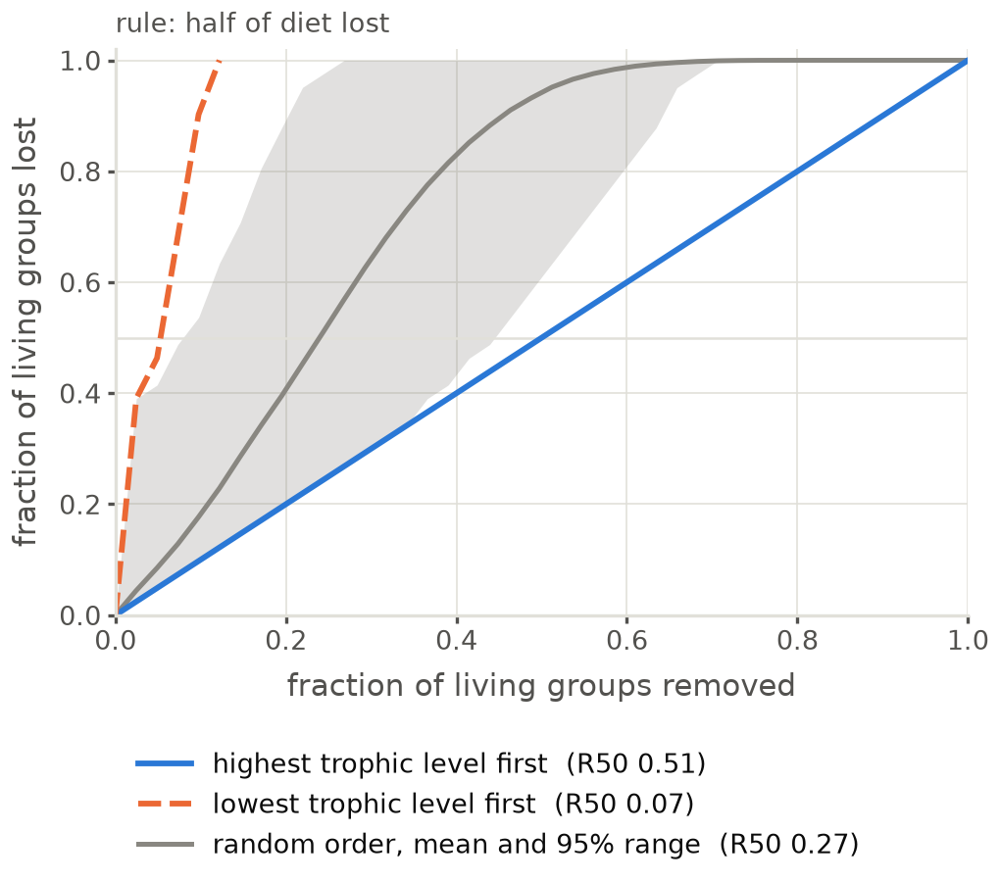
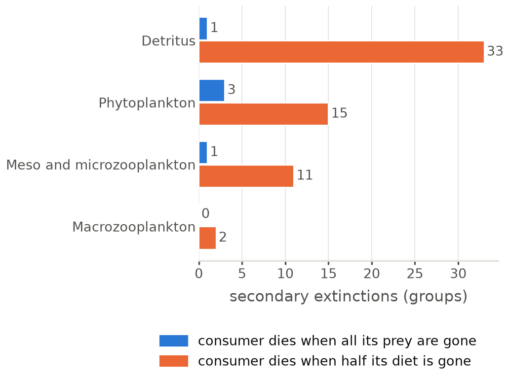

# Removing groups

Drawn by [`code/node_removal.py`](../../code/node_removal.py). The panel figure `node_removal_results` is drawn by [`code/node_removal_panels.py`](../../code/node_removal_panels.py). The numbers behind these figures are in [`notes/05_node_removal.md`](../../notes/05_node_removal.md).

| Figure | What it shows |
|---|---|
| [`node_giant_component_no_extinctions`](node_giant_component_no_extinctions.png) · [pdf](node_giant_component_no_extinctions.pdf) | Largest connected component as groups are removed, without secondary extinctions (percolation). |
| [`node_giant_component_with_extinctions`](node_giant_component_with_extinctions.png) · [pdf](node_giant_component_with_extinctions.pdf) | The same with secondary extinctions (all-prey rule). |
| [`guild_removal`](guild_removal.png) · [pdf](guild_removal.pdf) | Secondary extinctions after removing a whole guild. |
| [`node_removal_results`](node_removal_results.png) · [pdf](node_removal_results.pdf) | Fraction of living groups lost as groups are removed under both rules (A, B), and the R50 table (C). |
| [`r50_summary`](r50_summary.png) · [pdf](r50_summary.pdf) | R50 for random order and three targeted orders, under both rules, with the 95% range of random orders. Every order is in `cadiz_node_robustness_summary.csv`. |
| [`node_robustness_all_prey_connectivity`](node_robustness_all_prey_connectivity.png) · [pdf](node_robustness_all_prey_connectivity.pdf) | Fraction of living groups lost as groups are removed: most vs least connected first, all-prey rule; gray = random orders. |
| [`node_robustness_all_prey_importance`](node_robustness_all_prey_importance.png) · [pdf](node_robustness_all_prey_importance.pdf) | Fraction of living groups lost as groups are removed: most important prey vs PageRank importance first, all-prey rule; gray = random orders. |
| [`node_robustness_all_prey_recalculated_betweenness`](node_robustness_all_prey_recalculated_betweenness.png) · [pdf](node_robustness_all_prey_recalculated_betweenness.pdf) | Fraction of living groups lost as groups are removed: highest betweenness first, static vs recalculated, all-prey rule; gray = random orders. |
| [`node_robustness_all_prey_recalculated_degree`](node_robustness_all_prey_recalculated_degree.png) · [pdf](node_robustness_all_prey_recalculated_degree.pdf) | Fraction of living groups lost as groups are removed: most connected first, static vs recalculated, all-prey rule; gray = random orders. |
| [`node_robustness_all_prey_trophic_position`](node_robustness_all_prey_trophic_position.png) · [pdf](node_robustness_all_prey_trophic_position.pdf) | Fraction of living groups lost as groups are removed: by trophic position, all-prey rule; gray = random orders. |
| [`node_robustness_half_diet_connectivity`](node_robustness_half_diet_connectivity.png) · [pdf](node_robustness_half_diet_connectivity.pdf) | Fraction of living groups lost as groups are removed: most vs least connected first, half-diet rule; gray = random orders. |
| [`node_robustness_half_diet_importance`](node_robustness_half_diet_importance.png) · [pdf](node_robustness_half_diet_importance.pdf) | Fraction of living groups lost as groups are removed: most important prey vs PageRank importance first, half-diet rule; gray = random orders. |
| [`node_robustness_half_diet_recalculated_betweenness`](node_robustness_half_diet_recalculated_betweenness.png) · [pdf](node_robustness_half_diet_recalculated_betweenness.pdf) | Fraction of living groups lost as groups are removed: highest betweenness first, static vs recalculated, half-diet rule; gray = random orders. |
| [`node_robustness_half_diet_recalculated_degree`](node_robustness_half_diet_recalculated_degree.png) · [pdf](node_robustness_half_diet_recalculated_degree.pdf) | Fraction of living groups lost as groups are removed: most connected first, static vs recalculated, half-diet rule; gray = random orders. |
| [`node_robustness_half_diet_trophic_position`](node_robustness_half_diet_trophic_position.png) · [pdf](node_robustness_half_diet_trophic_position.pdf) | Fraction of living groups lost as groups are removed: by trophic position, half-diet rule; gray = random orders. |
| [`node_knockouts`](node_knockouts.png) · [pdf](node_knockouts.pdf) | Secondary extinctions after removing each group alone; only groups whose loss causes any are shown. |

### node_giant_component_no_extinctions

### node_giant_component_with_extinctions

### guild_removal

### node_removal_results

### r50_summary

### node_robustness_all_prey_connectivity

### node_robustness_all_prey_importance

### node_robustness_all_prey_recalculated_betweenness

### node_robustness_all_prey_recalculated_degree

### node_robustness_all_prey_trophic_position

### node_robustness_half_diet_connectivity

### node_robustness_half_diet_importance

### node_robustness_half_diet_recalculated_betweenness

### node_robustness_half_diet_recalculated_degree

### node_robustness_half_diet_trophic_position

### node_knockouts

