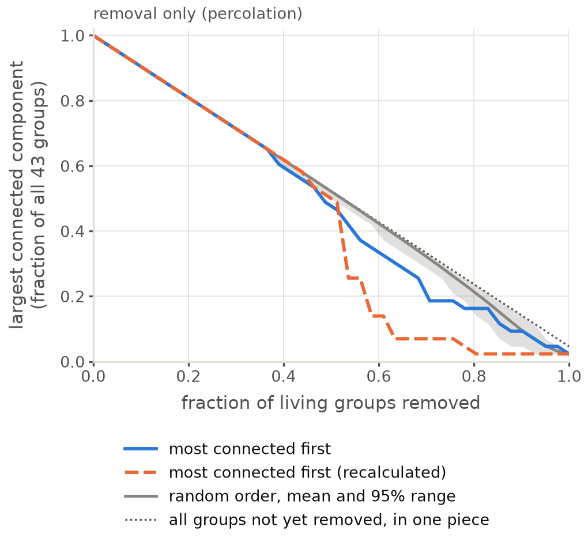
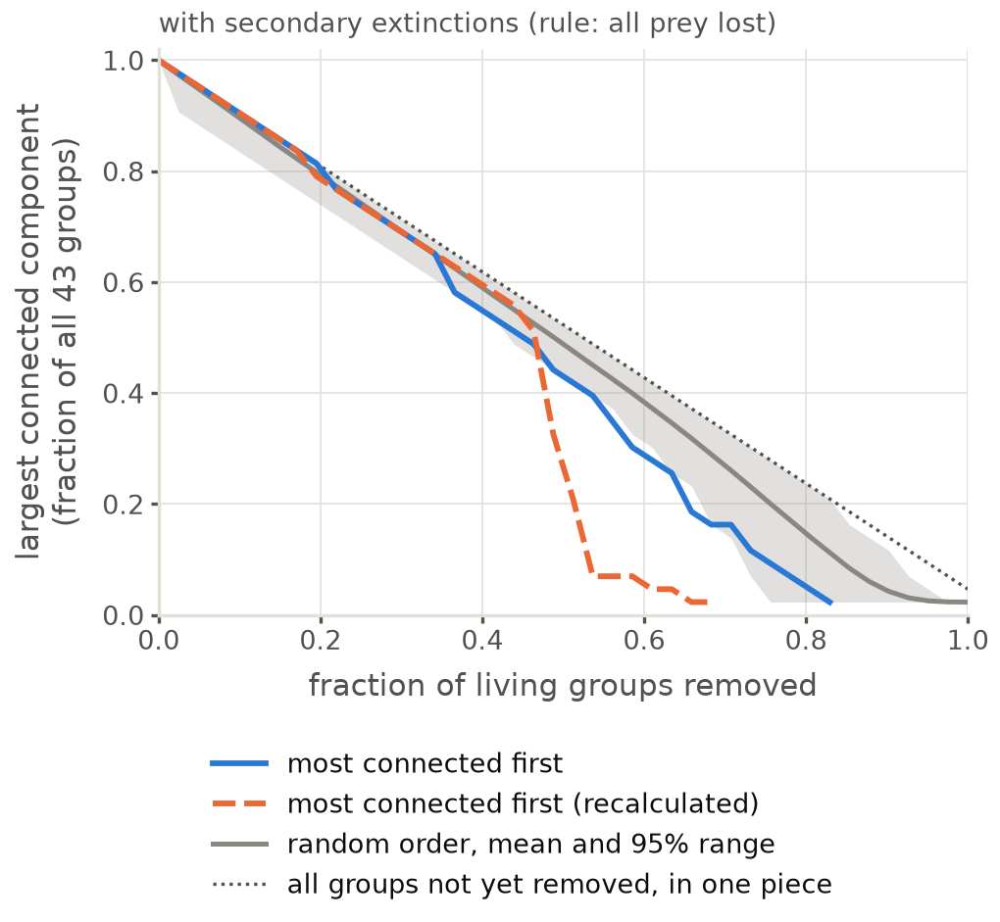
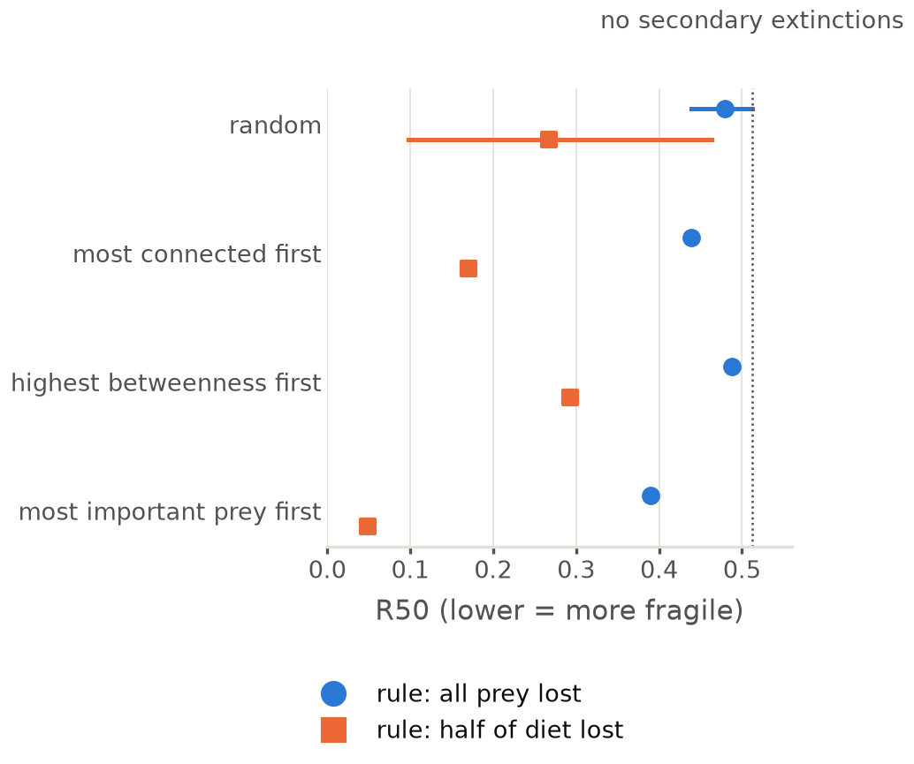
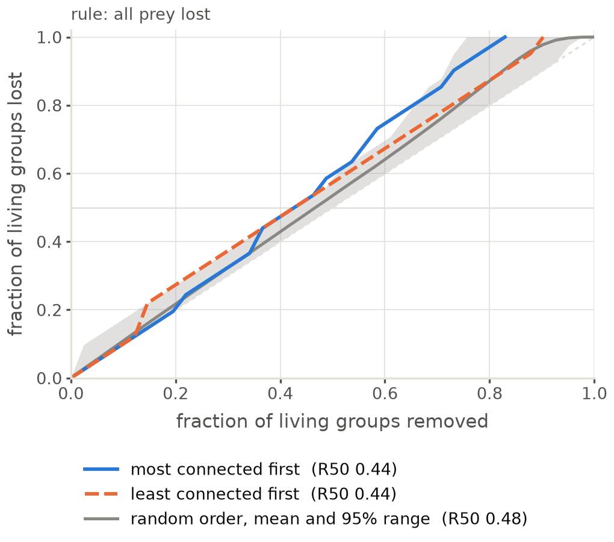
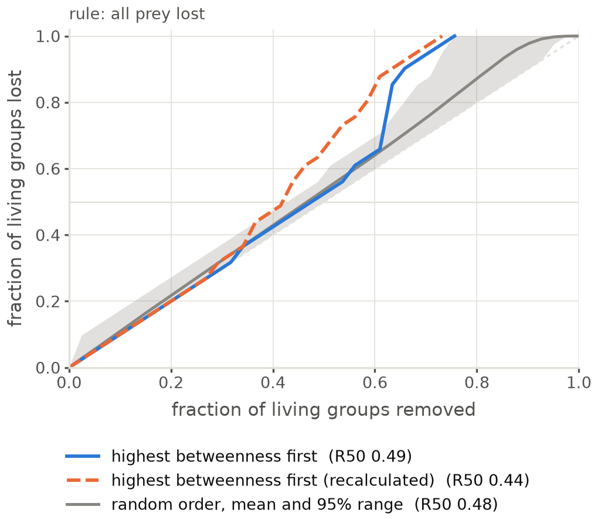
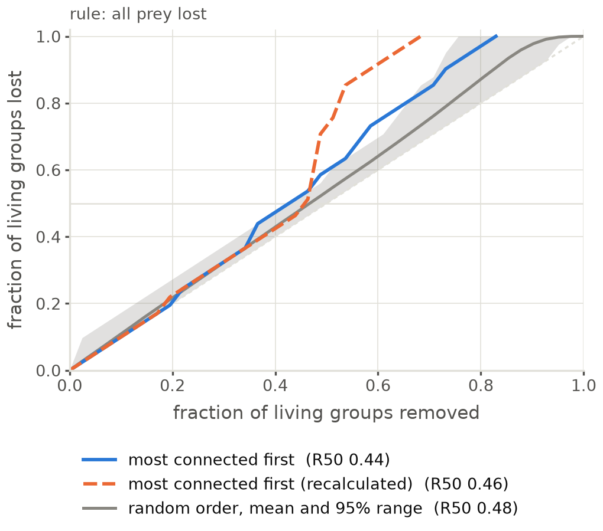
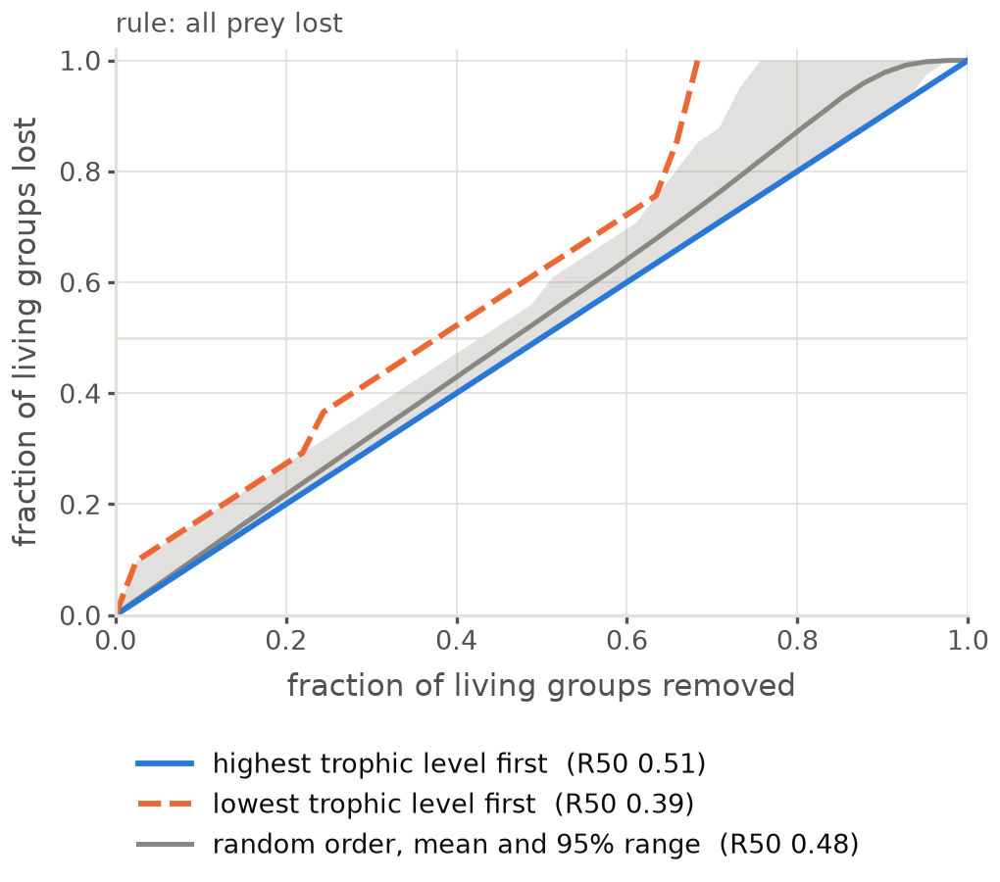
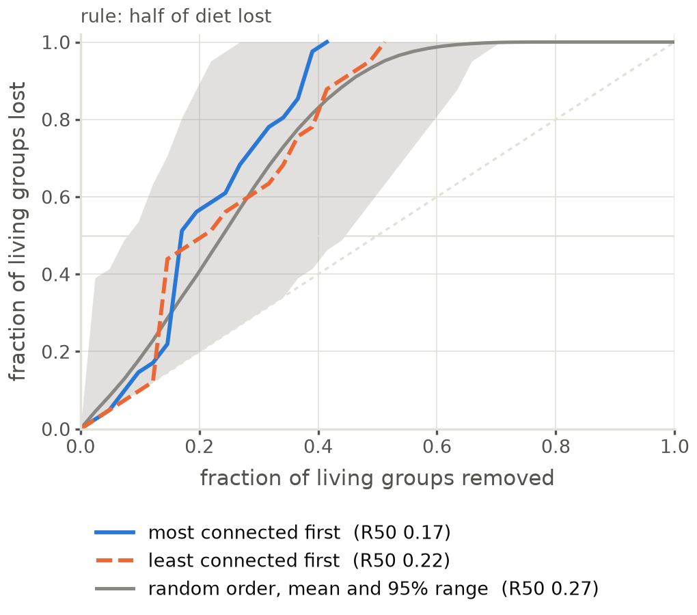
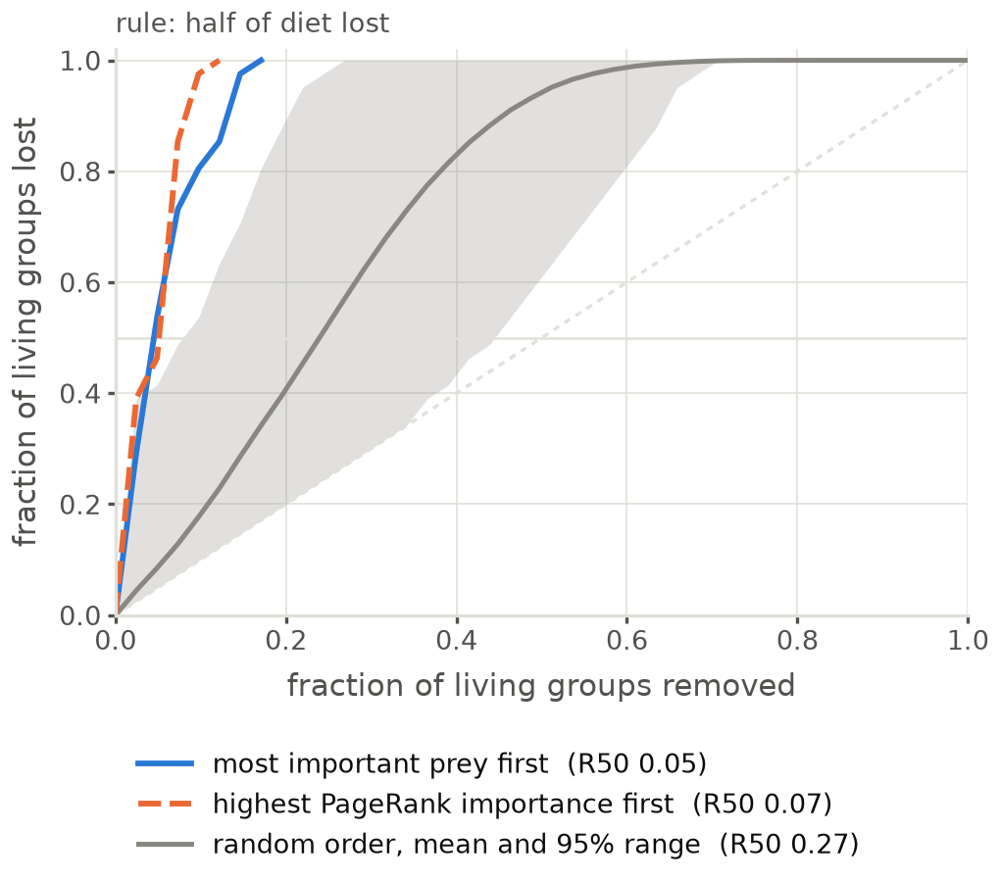

# Removing groups

Drawn by [`code/node_removal.py`](../../code/node_removal.py). The panel figure `node_removal_results` is drawn by [`node_removal_panels.py`](node_removal_panels.py) in this folder. The numbers behind these figures are in [`notes/05_node_removal.md`](../../notes/05_node_removal.md).

| Figure | What it shows |
|---|---|
| [`giant_component_removal_only`](giant_component_removal_only.png) · [pdf](giant_component_removal_only.pdf) | Largest connected component as groups are removed, without secondary extinctions (percolation). |
| [`giant_component_with_extinctions`](giant_component_with_extinctions.png) · [pdf](giant_component_with_extinctions.pdf) | The same with secondary extinctions (all-prey rule). |
| [`guild_removal`](guild_removal.png) · [pdf](guild_removal.pdf) | Secondary extinctions after removing a whole guild. |
| [`node_removal_results`](node_removal_results.png) · [pdf](node_removal_results.pdf) | Fraction of living groups lost as groups are removed under both rules (A, B), and the R50 table (C). |
| [`r50_summary`](r50_summary.png) · [pdf](r50_summary.pdf) | R50 for random order and three targeted orders, under both rules, with the 95% range of random orders. Every order is in `cadiz_node_robustness_summary.csv`. |
| [`robustness_all_prey_rule_connectivity`](robustness_all_prey_rule_connectivity.png) · [pdf](robustness_all_prey_rule_connectivity.pdf) | Fraction of living groups lost as groups are removed: most vs least connected first, all-prey rule; gray = random orders. |
| [`robustness_all_prey_rule_importance`](robustness_all_prey_rule_importance.png) · [pdf](robustness_all_prey_rule_importance.pdf) | Fraction of living groups lost as groups are removed: most important prey vs PageRank importance first, all-prey rule; gray = random orders. |
| [`robustness_all_prey_rule_recalculated_betweenness`](robustness_all_prey_rule_recalculated_betweenness.png) · [pdf](robustness_all_prey_rule_recalculated_betweenness.pdf) | Fraction of living groups lost as groups are removed: highest betweenness first, static vs recalculated, all-prey rule; gray = random orders. |
| [`robustness_all_prey_rule_recalculated_degree`](robustness_all_prey_rule_recalculated_degree.png) · [pdf](robustness_all_prey_rule_recalculated_degree.pdf) | Fraction of living groups lost as groups are removed: most connected first, static vs recalculated, all-prey rule; gray = random orders. |
| [`robustness_all_prey_rule_trophic_position`](robustness_all_prey_rule_trophic_position.png) · [pdf](robustness_all_prey_rule_trophic_position.pdf) | Fraction of living groups lost as groups are removed: by trophic position, all-prey rule; gray = random orders. |
| [`robustness_half_diet_rule_connectivity`](robustness_half_diet_rule_connectivity.png) · [pdf](robustness_half_diet_rule_connectivity.pdf) | Fraction of living groups lost as groups are removed: most vs least connected first, half-diet rule; gray = random orders. |
| [`robustness_half_diet_rule_importance`](robustness_half_diet_rule_importance.png) · [pdf](robustness_half_diet_rule_importance.pdf) | Fraction of living groups lost as groups are removed: most important prey vs PageRank importance first, half-diet rule; gray = random orders. |
| [`robustness_half_diet_rule_recalculated_betweenness`](robustness_half_diet_rule_recalculated_betweenness.png) · [pdf](robustness_half_diet_rule_recalculated_betweenness.pdf) | Fraction of living groups lost as groups are removed: highest betweenness first, static vs recalculated, half-diet rule; gray = random orders. |
| [`robustness_half_diet_rule_recalculated_degree`](robustness_half_diet_rule_recalculated_degree.png) · [pdf](robustness_half_diet_rule_recalculated_degree.pdf) | Fraction of living groups lost as groups are removed: most connected first, static vs recalculated, half-diet rule; gray = random orders. |
| [`robustness_half_diet_rule_trophic_position`](robustness_half_diet_rule_trophic_position.png) · [pdf](robustness_half_diet_rule_trophic_position.pdf) | Fraction of living groups lost as groups are removed: by trophic position, half-diet rule; gray = random orders. |
| [`single_group_knockouts`](single_group_knockouts.png) · [pdf](single_group_knockouts.pdf) | Secondary extinctions after removing each group alone; only groups whose loss causes any are shown. |

### giant_component_removal_only

### giant_component_with_extinctions

### guild_removal

### node_removal_results

### r50_summary

### robustness_all_prey_rule_connectivity

### robustness_all_prey_rule_importance

### robustness_all_prey_rule_recalculated_betweenness

### robustness_all_prey_rule_recalculated_degree

### robustness_all_prey_rule_trophic_position

### robustness_half_diet_rule_connectivity

### robustness_half_diet_rule_importance

### robustness_half_diet_rule_recalculated_betweenness

### robustness_half_diet_rule_recalculated_degree

### robustness_half_diet_rule_trophic_position

### single_group_knockouts

