# Cutting links

Drawn by [`code/edge_removal.py`](../../code/edge_removal.py). The panel figure `link_removal_results` is drawn by [`link_removal_panels.py`](link_removal_panels.py) in this folder. The numbers behind these figures are in [`notes/06_edge_removal.md`](../../notes/06_edge_removal.md).

| Figure | What it shows |
|---|---|
| [`critical_single_links`](critical_single_links.png) · [pdf](critical_single_links.pdf) | Links whose loss alone causes an extinction. |
| [`edge_betweenness_vs_link_strength`](edge_betweenness_vs_link_strength.png) · [pdf](edge_betweenness_vs_link_strength.pdf) | Edge betweenness against link strength for all 397 links. |
| [`giant_component_links_cut_only`](giant_component_links_cut_only.png) · [pdf](giant_component_links_cut_only.pdf) | Largest connected component as links are cut, without starvation (bond percolation). |
| [`giant_component_links_with_extinctions`](giant_component_links_with_extinctions.png) · [pdf](giant_component_links_with_extinctions.pdf) | The same with starvation (all-prey rule). |
| [`l50_summary`](l50_summary.png) · [pdf](l50_summary.pdf) | L50 for random order, edge betweenness and weakest-links-first, under both rules, with the 95% range of random orders. Every order is in `cadiz_link_robustness_summary.csv`. |
| [`link_removal_results`](link_removal_results.png) · [pdf](link_removal_results.pdf) | Fraction of living groups lost as links are cut under both rules (A, B), and the L50 table (C). |
| [`link_robustness_all_prey_rule_betweenness`](link_robustness_all_prey_rule_betweenness.png) · [pdf](link_robustness_all_prey_rule_betweenness.pdf) | Fraction of living groups lost as links are cut: highest edge betweenness first, static vs recalculated, all-prey rule; gray = random orders. |
| [`link_robustness_all_prey_rule_strength`](link_robustness_all_prey_rule_strength.png) · [pdf](link_robustness_all_prey_rule_strength.pdf) | Fraction of living groups lost as links are cut: strongest vs weakest links first, all-prey rule; gray = random orders. |
| [`link_robustness_all_prey_rule_trophic_position`](link_robustness_all_prey_rule_trophic_position.png) · [pdf](link_robustness_all_prey_rule_trophic_position.pdf) | Fraction of living groups lost as links are cut: by trophic position, all-prey rule; gray = random orders. |
| [`link_robustness_half_diet_rule_betweenness`](link_robustness_half_diet_rule_betweenness.png) · [pdf](link_robustness_half_diet_rule_betweenness.pdf) | Fraction of living groups lost as links are cut: highest edge betweenness first, static vs recalculated, half-diet rule; gray = random orders. |
| [`link_robustness_half_diet_rule_strength`](link_robustness_half_diet_rule_strength.png) · [pdf](link_robustness_half_diet_rule_strength.pdf) | Fraction of living groups lost as links are cut: strongest vs weakest links first, half-diet rule; gray = random orders. |
| [`link_robustness_half_diet_rule_trophic_position`](link_robustness_half_diet_rule_trophic_position.png) · [pdf](link_robustness_half_diet_rule_trophic_position.pdf) | Fraction of living groups lost as links are cut: by trophic position, half-diet rule; gray = random orders. |

### critical_single_links

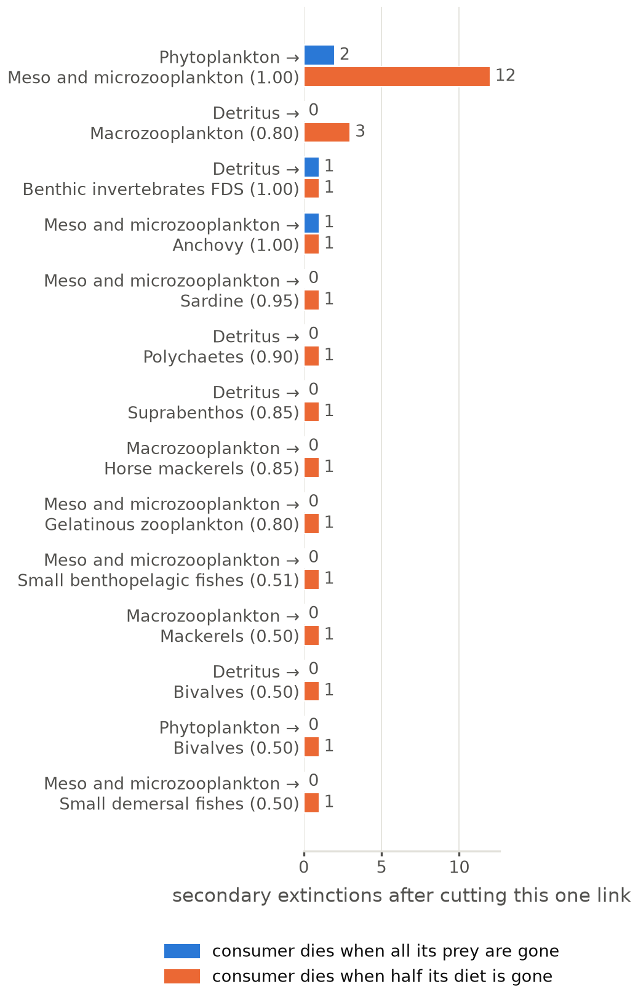

### edge_betweenness_vs_link_strength

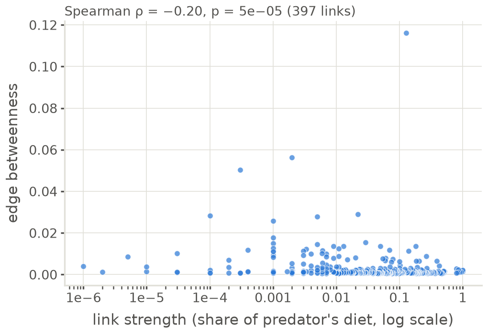

### giant_component_links_cut_only

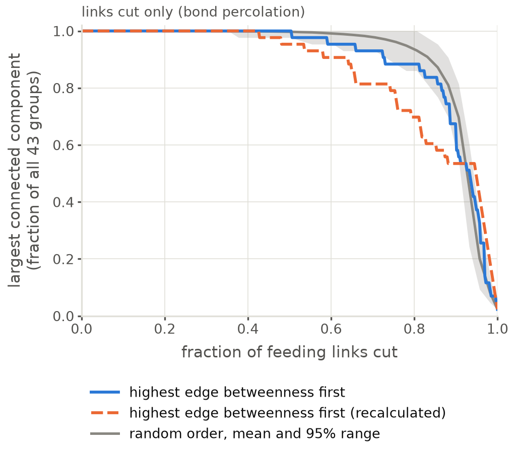

### giant_component_links_with_extinctions

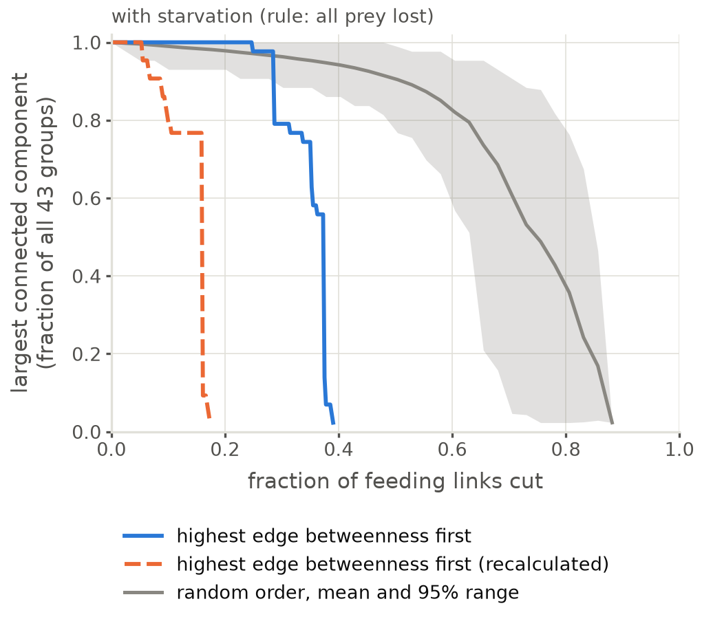

### l50_summary

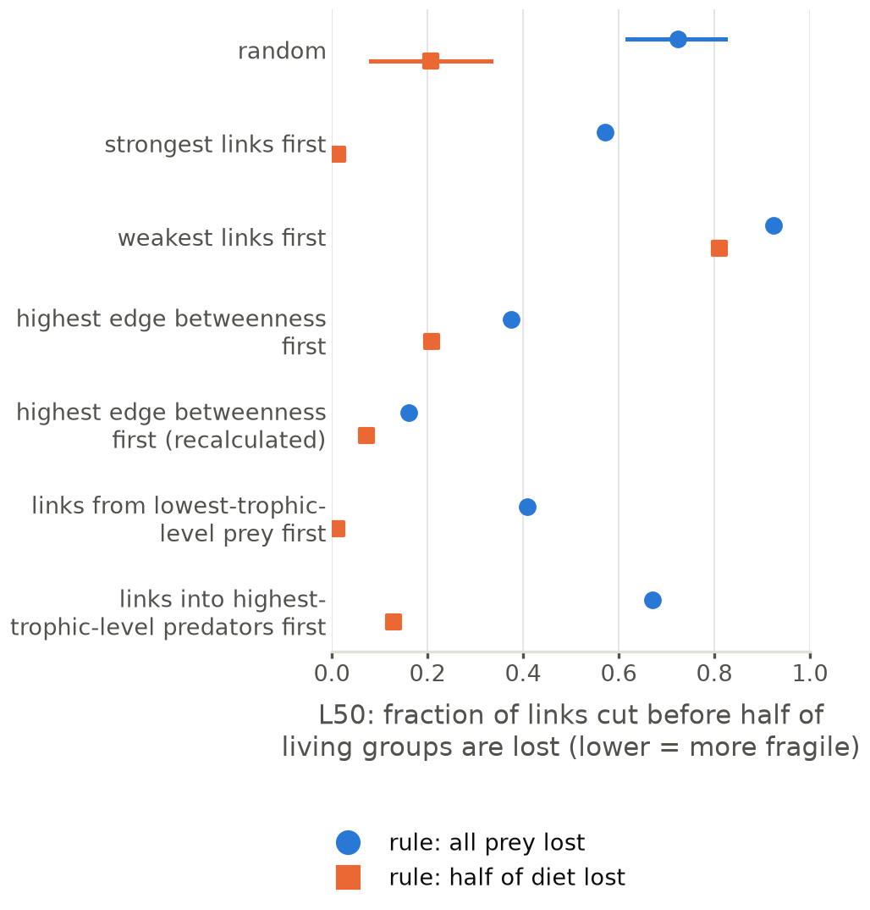

### link_removal_results

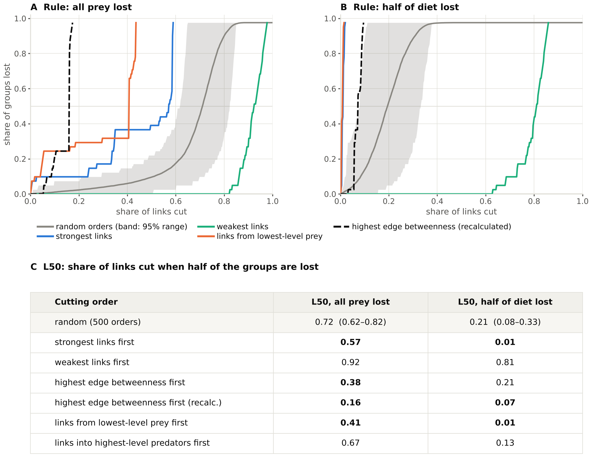

### link_robustness_all_prey_rule_betweenness

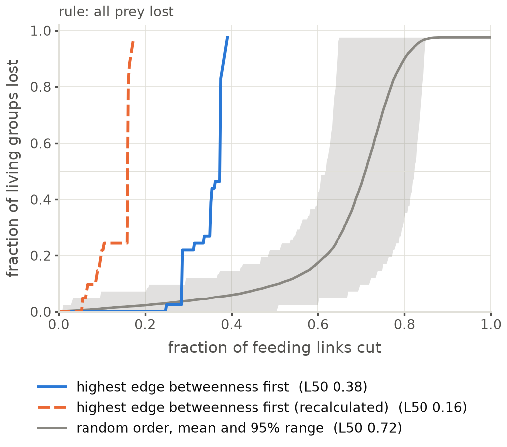

### link_robustness_all_prey_rule_strength

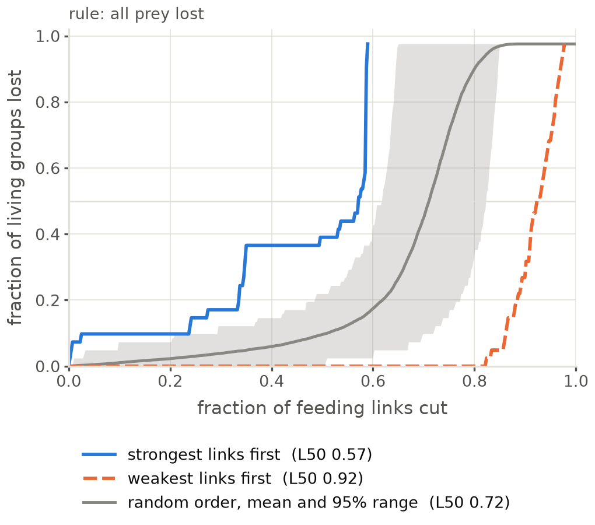

### link_robustness_all_prey_rule_trophic_position

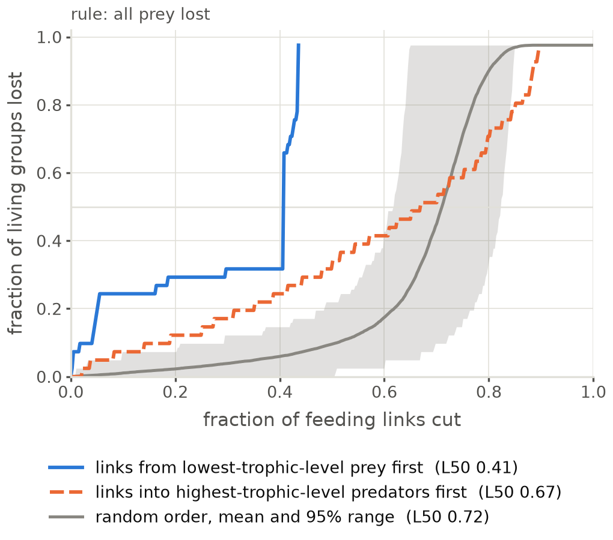

### link_robustness_half_diet_rule_betweenness

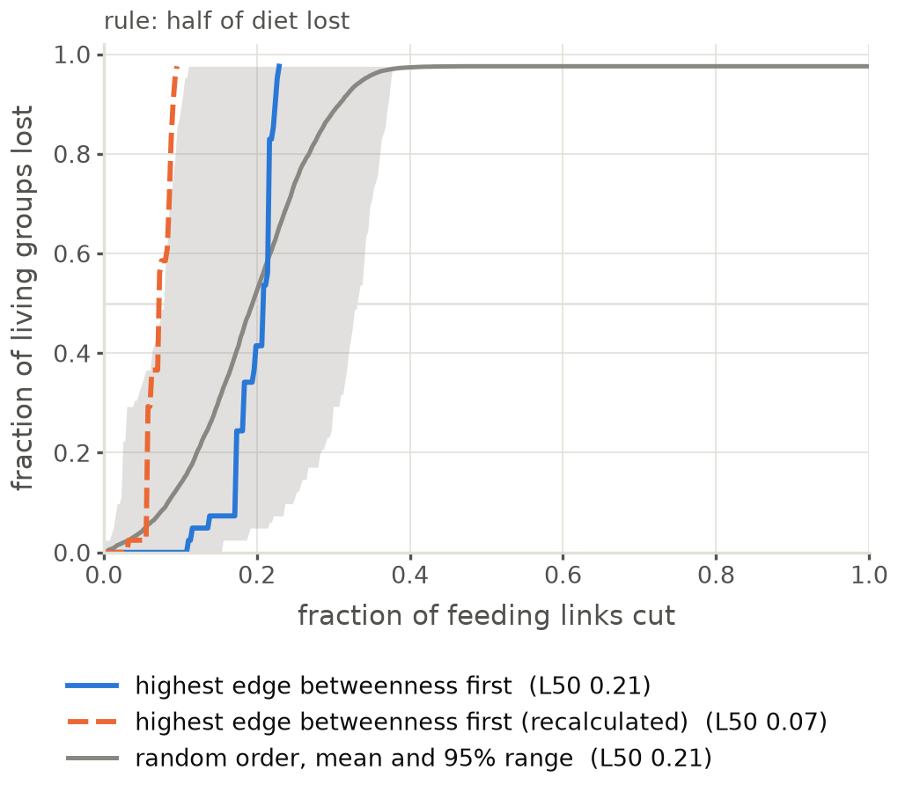

### link_robustness_half_diet_rule_strength

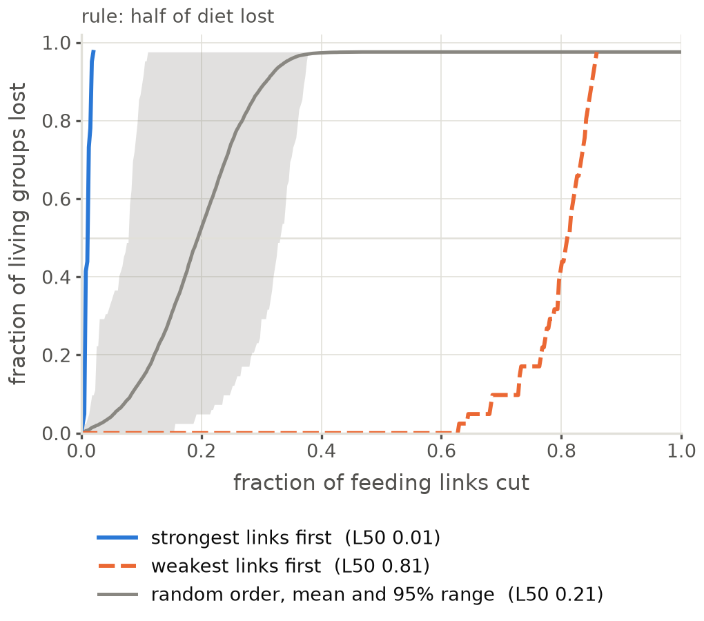

### link_robustness_half_diet_rule_trophic_position

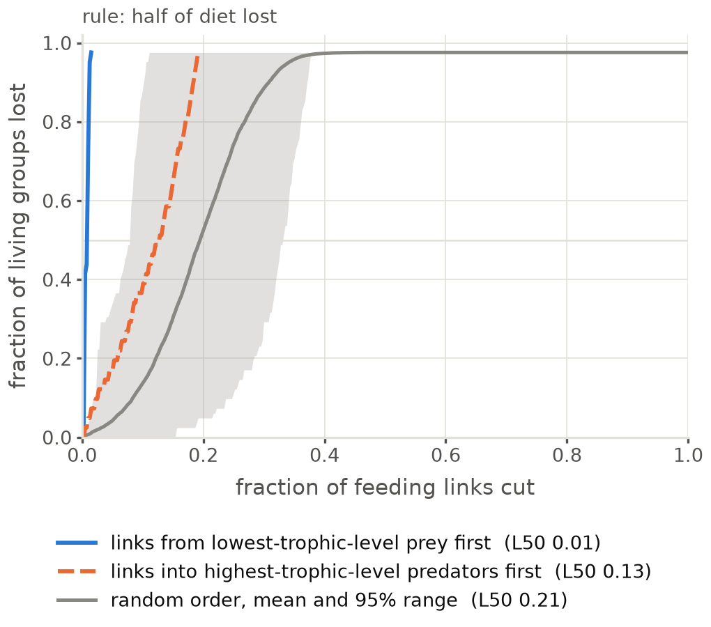
