# Cutting links

These figures are drawn by [`code/link_removal.py`](../../code/link_removal.py), except the panel figure `link_removal_results`, which is drawn by [`code/link_removal_panels.py`](../../code/link_removal_panels.py). The numbers behind them are in [`notes/06_link_removal.md`](../../notes/06_link_removal.md).

| Figure | What it shows |
|---|---|
| [`link_knockouts`](link_knockouts.png) · [pdf](link_knockouts.pdf) | The feeding links whose loss by itself causes an extinction. |
| [`edge_betweenness_vs_link_strength`](edge_betweenness_vs_link_strength.png) · [pdf](edge_betweenness_vs_link_strength.pdf) | Edge betweenness against link strength for all 397 links. |
| [`link_giant_component_no_extinctions`](link_giant_component_no_extinctions.png) · [pdf](link_giant_component_no_extinctions.pdf) | Largest connected component as links are cut, without starvation (bond percolation). |
| [`link_giant_component_with_extinctions`](link_giant_component_with_extinctions.png) · [pdf](link_giant_component_with_extinctions.pdf) | The same, but with starvation (all-prey rule). |
| [`l50_summary`](l50_summary.png) · [pdf](l50_summary.pdf) | L50 for random order, edge betweenness and weakest-links-first, under both rules, with the 95% range of random orders. The rest of the orders are in `cadiz_link_robustness_summary.csv`. |
| [`link_removal_results`](link_removal_results.png) · [pdf](link_removal_results.pdf) | Fraction of living groups lost as links are cut under both rules (A, B), and the L50 table (C). |
| [`link_robustness_all_prey_betweenness`](link_robustness_all_prey_betweenness.png) · [pdf](link_robustness_all_prey_betweenness.pdf) | Fraction of living groups lost as links are cut, highest edge betweenness first, static vs. recalculated, under the all-prey rule. The gray band is the random orders. |
| [`link_robustness_all_prey_strength`](link_robustness_all_prey_strength.png) · [pdf](link_robustness_all_prey_strength.pdf) | Fraction of living groups lost as links are cut, strongest vs. weakest links first, under the all-prey rule. The gray band is the random orders. |
| [`link_robustness_all_prey_trophic_position`](link_robustness_all_prey_trophic_position.png) · [pdf](link_robustness_all_prey_trophic_position.pdf) | Fraction of living groups lost as links are cut, by trophic position, under the all-prey rule. The gray band is the random orders. |
| [`link_robustness_half_diet_betweenness`](link_robustness_half_diet_betweenness.png) · [pdf](link_robustness_half_diet_betweenness.pdf) | Fraction of living groups lost as links are cut, highest edge betweenness first, static vs. recalculated, under the half-diet rule. The gray band is the random orders. |
| [`link_robustness_half_diet_strength`](link_robustness_half_diet_strength.png) · [pdf](link_robustness_half_diet_strength.pdf) | Fraction of living groups lost as links are cut, strongest vs. weakest links first, under the half-diet rule. The gray band is the random orders. |
| [`link_robustness_half_diet_trophic_position`](link_robustness_half_diet_trophic_position.png) · [pdf](link_robustness_half_diet_trophic_position.pdf) | Fraction of living groups lost as links are cut, by trophic position, under the half-diet rule. The gray band is the random orders. |

### link_knockouts

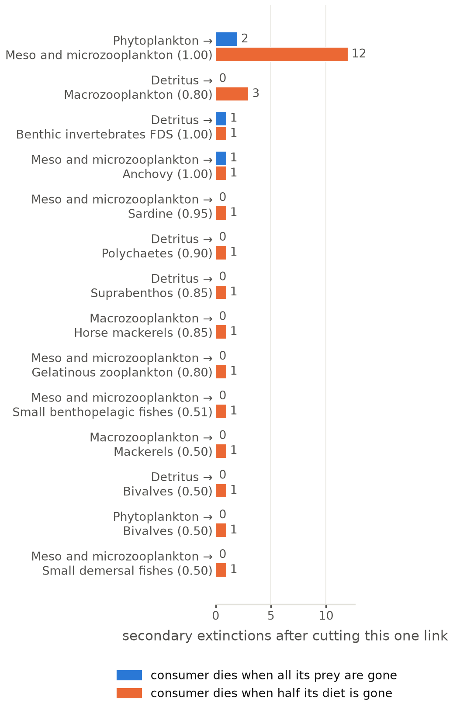

### edge_betweenness_vs_link_strength

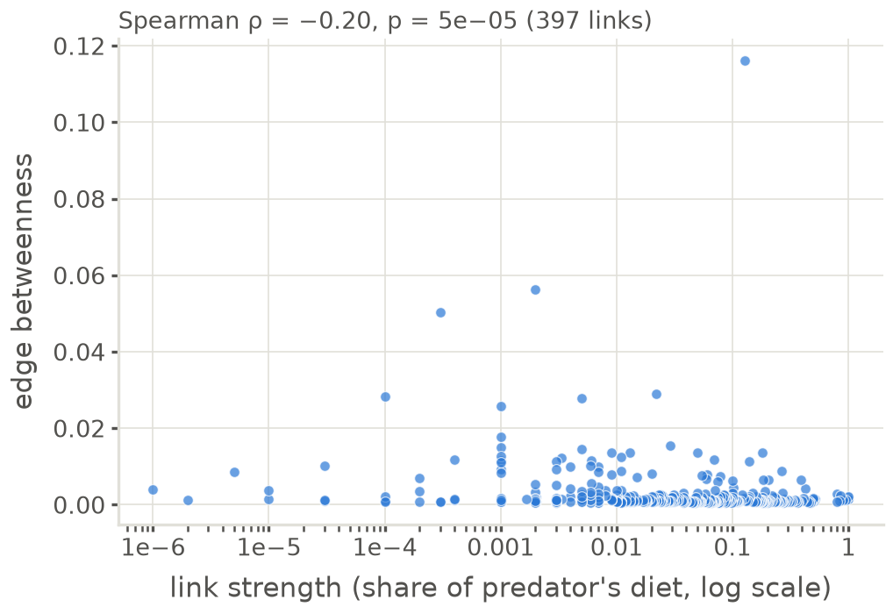

### link_giant_component_no_extinctions

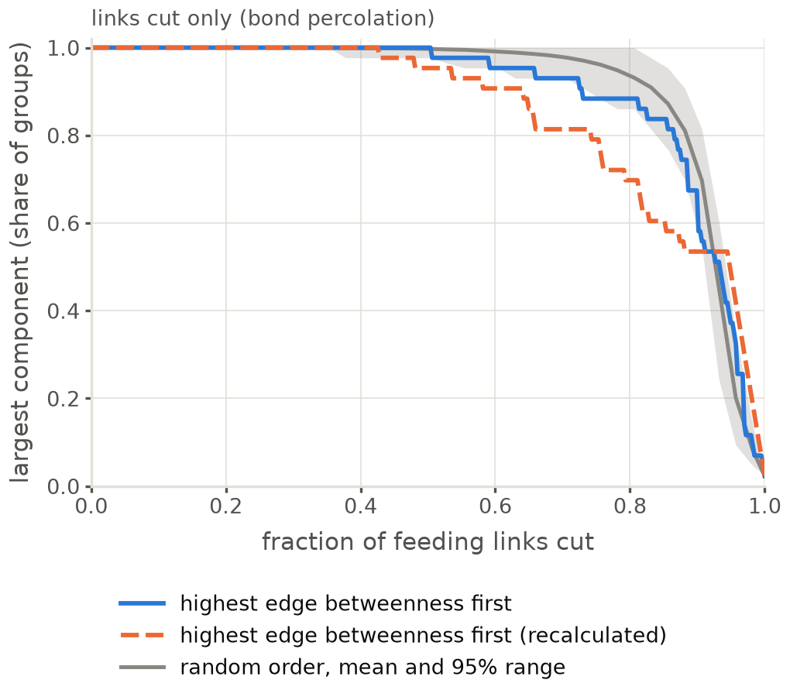

### link_giant_component_with_extinctions

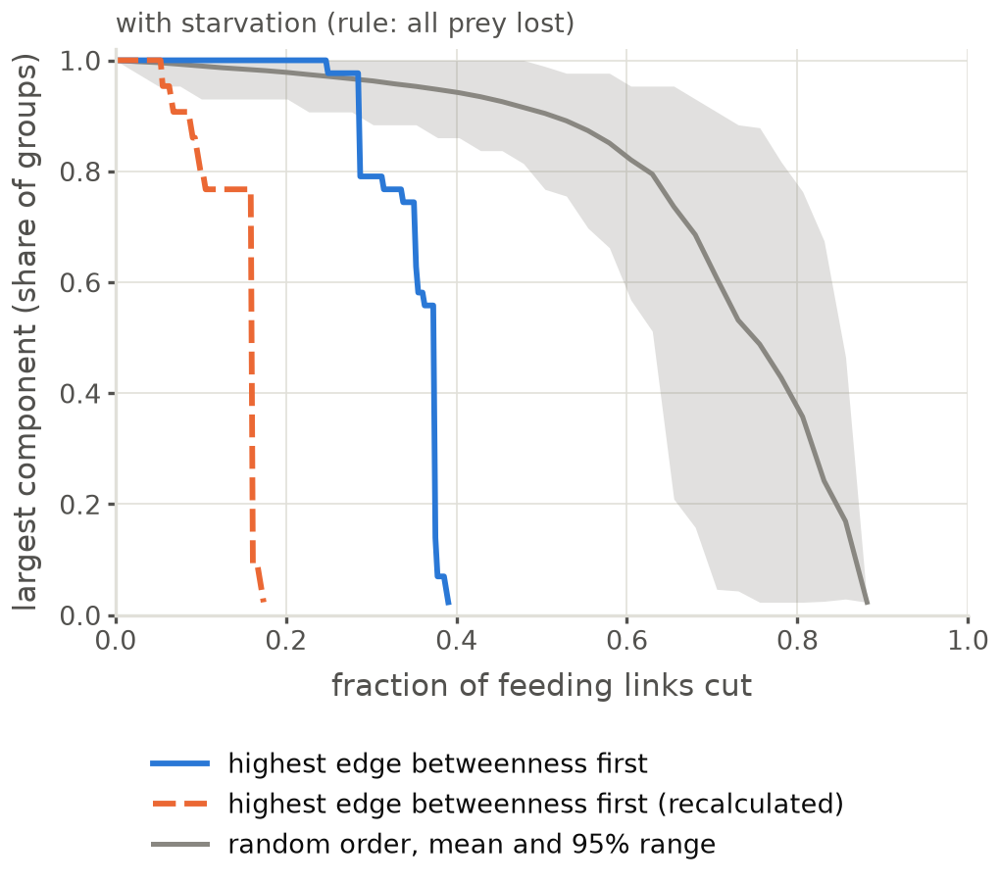

### l50_summary

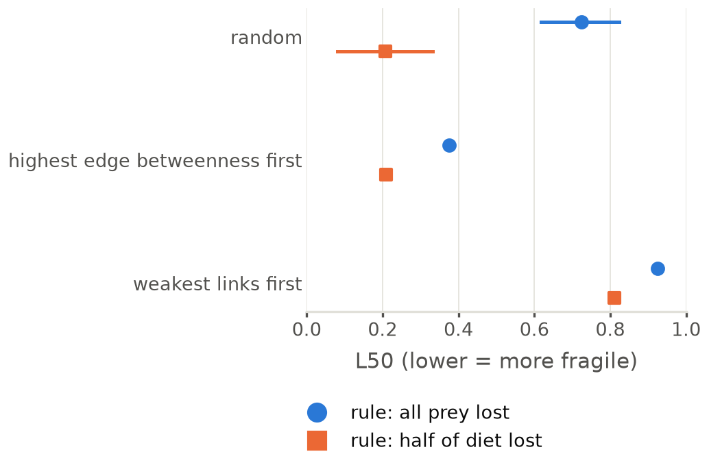

### link_removal_results

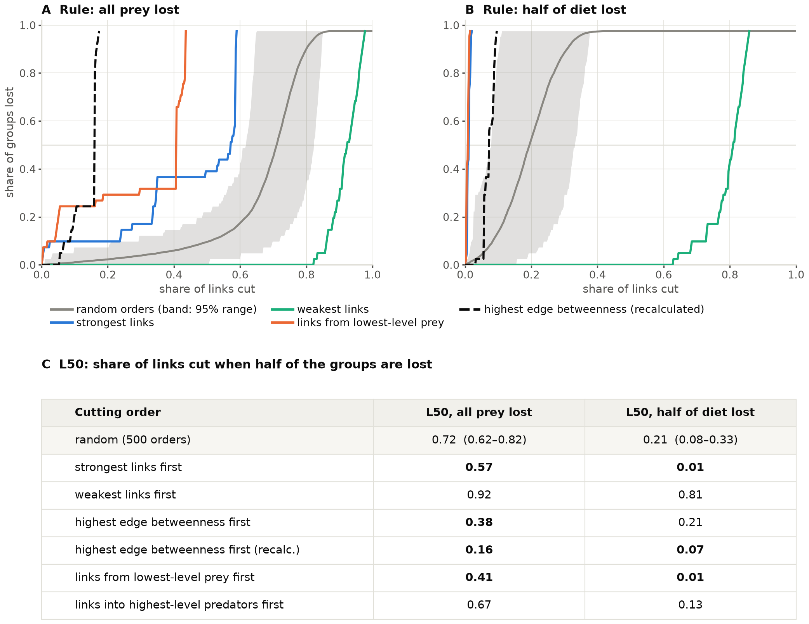

### link_robustness_all_prey_betweenness

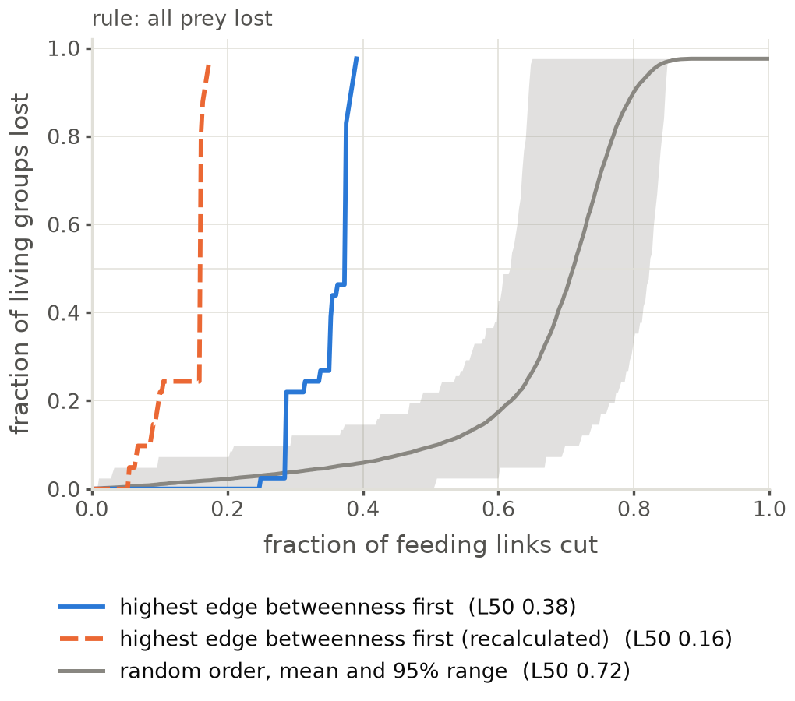

### link_robustness_all_prey_strength

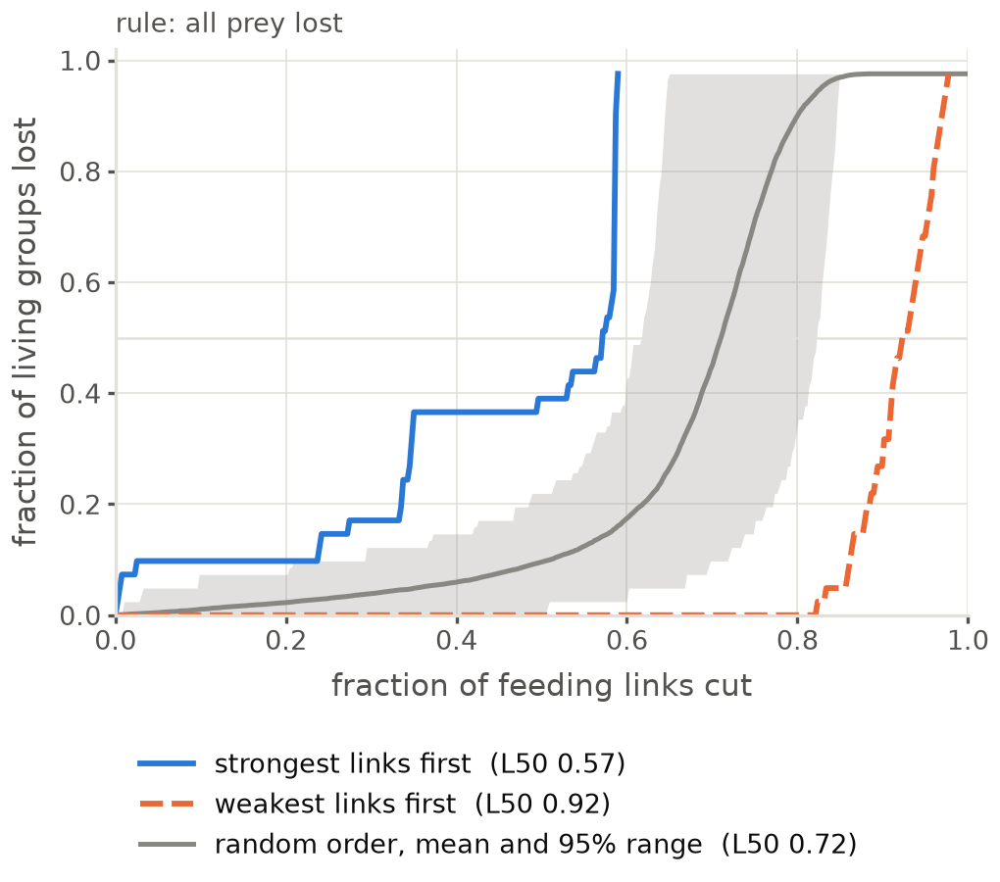

### link_robustness_all_prey_trophic_position

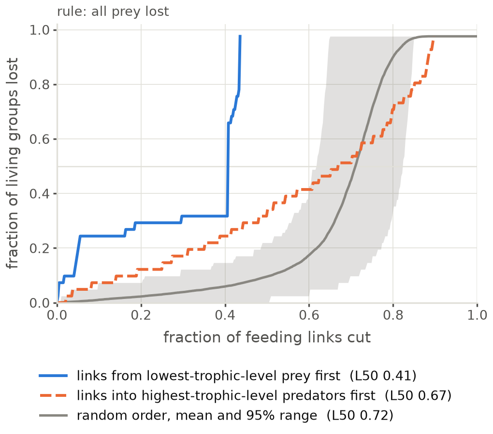

### link_robustness_half_diet_betweenness

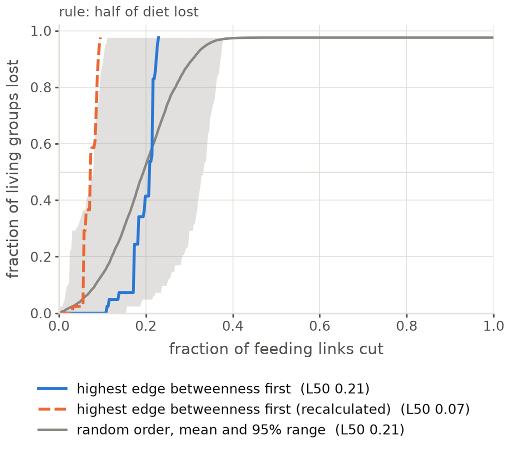

### link_robustness_half_diet_strength

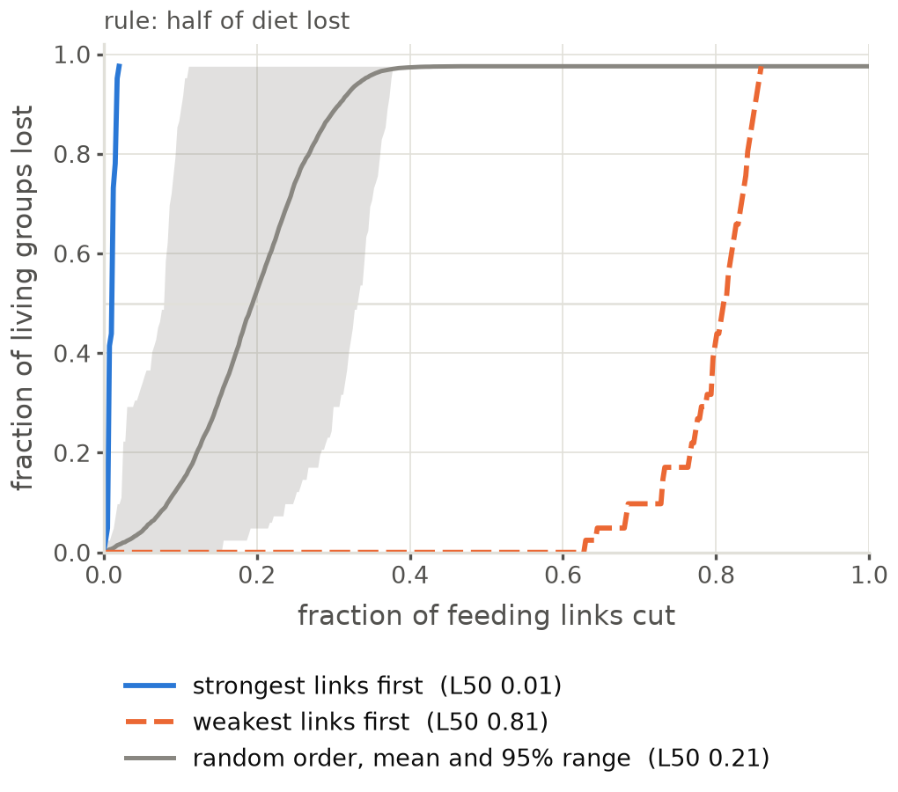

### link_robustness_half_diet_trophic_position

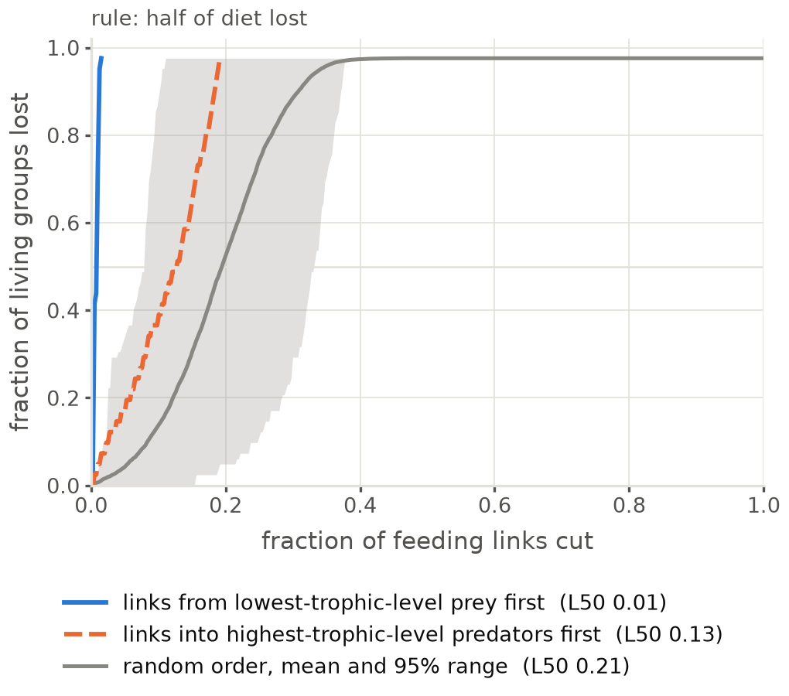
