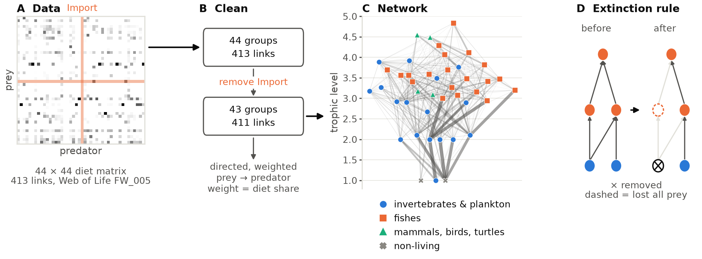

# The explainer figure

Drawn by [`code/explainer.py`](../../code/explainer.py) at the full text width (7 in).

| Figure | What it shows |
|---|---|
| [`explainer`](explainer.png) · [pdf](explainer.pdf) | The methods in four panels: the raw 44 × 44 diet matrix with the `Import` row and column marked (A), the cleaning step down to 43 groups and 411 links (B), the network drawn by trophic level (C) and the extinction rule (D). |

### explainer

