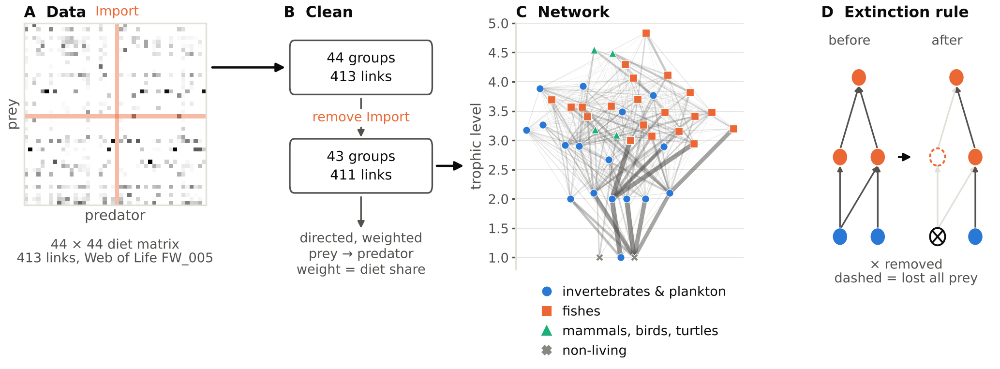

# The explainer figure

Generated by `code/write_docs.py`. The figures are drawn by the code, so if one needs changing, change the code and not the image. Notes on these results: [`notes/`](../../notes/README.md) (data and cleaning).

| figure | what it shows |
|---|---|
| [`explainer_figure`](explainer_figure.png) · [pdf](explainer_figure.pdf) | The methods explainer in four panels: the raw 44 × 44 diet matrix with the `Import` row and column marked (A), the cleaning step down to 43 groups and 411 links (B), the network drawn by trophic level (C) and the extinction rule (D). Drawn by [`make_explainer.py`](make_explainer.py) in this folder, not by the analysis scripts. **Full text width (7 in).** Required by the methods rubric; it is not one of the ten results figures. |

### explainer_figure

