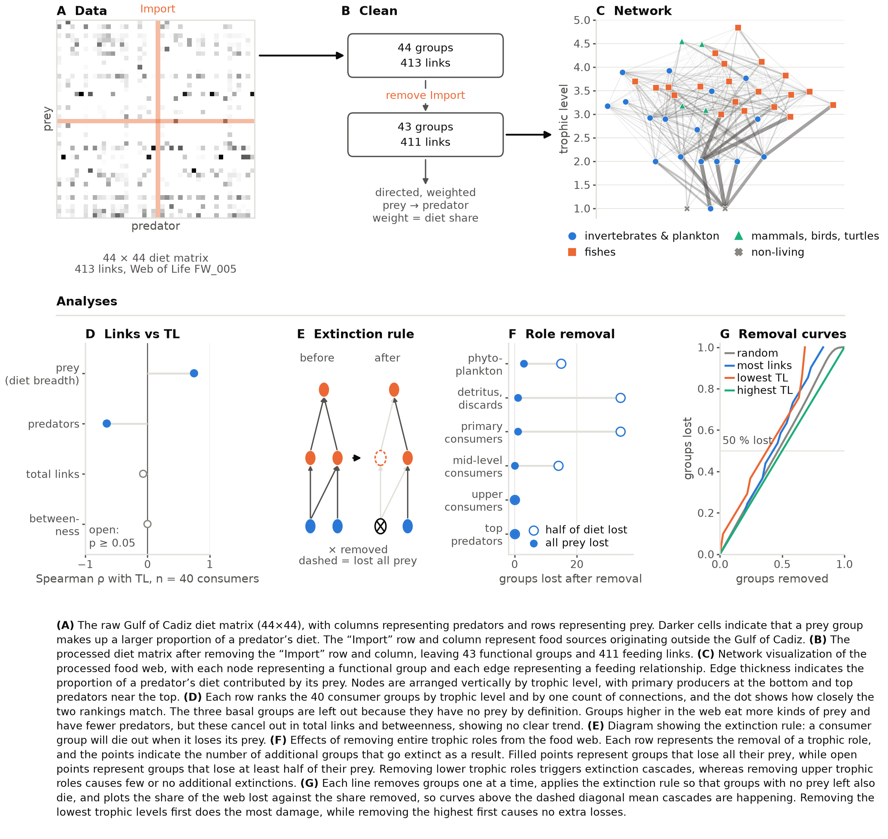

# The explainer figure

Generated by `code/write_docs.py`. The figures are drawn by the code, so if one needs changing, change the code and not the image. Notes on these results: [`notes/`](../../notes/README.md) (data and cleaning).

| figure | what it shows |
|---|---|
| [`explainer_figure`](explainer_figure.png) · [pdf](explainer_figure.pdf) | The methods explainer: raw diet matrix → cleaning → network, then the four analyses (centrality vs trophic level, the extinction rule, role removal, removal curves). Drawn by `code/explainer_figure.py`, not by the analysis scripts. **Full text width (7 in).** Required by the methods rubric; it is not one of the ten results figures. |

### explainer_figure

