# Other ecosystems

Generated by `code/write_docs.py`. The figures are drawn by the code, so if one needs changing, change the code and not the image. Notes on these results: [`notes/`](../../notes/README.md) (cross-ecosystem).

## All five webs

Drawn by `code/compare_webs.py`: the Gulf of Cadiz beside the Angolan shelf, Alvarado lagoon, St Marks seagrass and Mondego estuary.

| figure | what it shows |
|---|---|
| [`compare_centrality_vs_tl`](compare_centrality_vs_tl.png) · [pdf](compare_centrality_vs_tl.pdf) | **Answers paper figures 4 and 5 across the five webs.** Spearman correlation between trophic level and five measures of a group's position. **Full text width (7 in).** |
| [`compare_clustering_vs_density`](compare_clustering_vs_density.png) · [pdf](compare_clustering_vs_density.pdf) | Supporting. Average clustering against what a random web of the same density alone would give; the ratio is printed above each pair. |
| [`compare_degree_unevenness`](compare_degree_unevenness.png) · [pdf](compare_degree_unevenness.pdf) | **Answers paper figure 2.** Dispersion (variance/mean) of total degree, number of prey and number of predators, against what a random web of the same size and density gives. |
| [`compare_diet_concentration`](compare_diet_concentration.png) · [pdf](compare_diet_concentration.pdf) | Supporting. Cumulative distribution of the share of a consumer's diet carried by its single largest prey; 1 = a single-prey diet. The cleanest separator between the webs. |
| [`compare_diet_diversity`](compare_diet_diversity.png) · [pdf](compare_diet_diversity.pdf) | Supporting. Cumulative distribution of diet diversity (effective number of prey), consumers only. |
| [`compare_fragmentation`](compare_fragmentation.png) · [pdf](compare_fragmentation.pdf) | Supporting. Share of groups removed before the web breaks into more than one piece, random vs targeted orders, with no secondary extinctions. |
| [`compare_global_structure`](compare_global_structure.png) · [pdf](compare_global_structure.pdf) | Supporting. Where the Gulf of Cadiz sits among the five webs on six whole-web measures. |
| [`compare_guild_removal`](compare_guild_removal.png) · [pdf](compare_guild_removal.pdf) | Supporting. Secondary extinctions after removing a whole trophic band, half-of-diet rule. Removing upper consumers or top predators causes none in any web. |
| [`compare_knockouts`](compare_knockouts.png) · [pdf](compare_knockouts.pdf) | **Answers paper figure 6.** The worst single-group loss in each web, and how many groups cause any secondary extinction at all. |
| [`compare_l50_link_strength`](compare_l50_link_strength.png) · [pdf](compare_l50_link_strength.pdf) | **Answers paper figures 9 and 10.** L50 for cutting the strongest, random and weakest links first, half-of-diet rule. |
| [`compare_link_strength`](compare_link_strength.png) · [pdf](compare_link_strength.pdf) | **Answers paper figure 3.** Cumulative distribution of link strength (share of the predator's diet), log axis. |
| [`compare_r50_all`](compare_r50_all.png) · [pdf](compare_r50_all.pdf) | **Answers paper figures 7 and 8.** R50 by removal order, all-prey rule. |
| [`compare_r50_half`](compare_r50_half.png) · [pdf](compare_r50_half.pdf) | **Answers paper figures 7 and 8.** R50 by removal order, half-of-diet rule. |
| [`compare_trophic_level`](compare_trophic_level.png) · [pdf](compare_trophic_level.pdf) | Supporting. Cumulative distribution of trophic level in all five webs. |

## The three webs the paper keeps, with intervals and tests

Drawn by `code/significance.py` for the Gulf of Cadiz, Angolan shelf and Mondego estuary. Every one of these is one column wide (3.4 in). In all of them a filled marker means the result is different from random (or the interval excludes 0) and an open marker means it is not, so you can read off what is and is not significant without the table. The four to look at first are `compare_rho_intervals`, `compare_area_intervals_all_prey`, `compare_area_intervals_half_diet` and `compare_centralization_vs_random`, as each one puts the three webs side by side. Unfortunately, only node removal is covered so far, not link removal.

| figure | what it shows |
|---|---|
| [`compare_area_intervals_all_prey`](compare_area_intervals_all_prey.png) · [pdf](compare_area_intervals_all_prey.pdf) | **Three webs.** Area under the share-lost curve for each removal order in the three webs, under the rule “all prey lost”. The thick bar on the random row is the 95% range of 1000 random orders, and a thin bar is the range over the 200 tie-breaks. A filled marker means the order is different from random (p < 0.05). Different from random: Gulf of Cadiz (most important prey first, lowest trophic level first and highest trophic level first); Angolan shelf (most connected first, highest betweenness first, most important prey first and lowest trophic level first); Mondego estuary (none). |
| [`compare_area_intervals_half_diet`](compare_area_intervals_half_diet.png) · [pdf](compare_area_intervals_half_diet.pdf) | **Three webs.** Area under the share-lost curve for each removal order in the three webs, under the rule “half of diet lost”. The thick bar on the random row is the 95% range of 1000 random orders, and a thin bar is the range over the 200 tie-breaks. A filled marker means the order is different from random (p < 0.05). Different from random: Gulf of Cadiz (most important prey first, lowest trophic level first and highest trophic level first); Angolan shelf (lowest trophic level first and highest trophic level first); Mondego estuary (highest betweenness first, most important prey first, lowest trophic level first and highest trophic level first). |
| [`compare_centralization_vs_random`](compare_centralization_vs_random.png) · [pdf](compare_centralization_vs_random.pdf) | **Three webs.** Degree and betweenness centralization of each web (marker) against the 95% range of 1000 random directed graphs with the same nodes and links (bar). Degree centralization is 0.40 in the Gulf of Cadiz, 0.25 in the Angolan shelf and 0.53 in the Mondego estuary, against 0.17 to 0.19 on average for the random graphs. |
| [`compare_fit_angolan_betweenness`](compare_fit_angolan_betweenness.png) · [pdf](compare_fit_angolan_betweenness.pdf) | **Angolan shelf.** Betweenness centrality against trophic level for the 26 consumers. ρ = −0.02 (95% interval −0.48 to +0.45, permutation p = 0.93). The line changes by +0.00335 per trophic level (−0.00197 to +0.00948). |
| [`compare_fit_angolan_effective_prey`](compare_fit_angolan_effective_prey.png) · [pdf](compare_fit_angolan_effective_prey.pdf) | **Angolan shelf.** Effective number of prey against trophic level for the 26 consumers. ρ = +0.87 (95% interval +0.69 to +0.94, permutation p < 0.001). The line changes by +2.50 per trophic level (+1.86 to +3.13). |
| [`compare_fit_angolan_n_predators`](compare_fit_angolan_n_predators.png) · [pdf](compare_fit_angolan_n_predators.pdf) | **Angolan shelf.** Number of predators against trophic level for the 26 consumers. ρ = −0.61 (95% interval −0.84 to −0.27, permutation p = 0.001). The line changes by −3.69 per trophic level (−6.23 to −1.58). |
| [`compare_fit_angolan_n_prey`](compare_fit_angolan_n_prey.png) · [pdf](compare_fit_angolan_n_prey.pdf) | **Angolan shelf.** Number of prey against trophic level for the 26 consumers. ρ = +0.82 (95% interval +0.61 to +0.93, permutation p < 0.001). The line changes by +2.73 per trophic level (+1.91 to +3.52). |
| [`compare_fit_angolan_total_degree`](compare_fit_angolan_total_degree.png) · [pdf](compare_fit_angolan_total_degree.pdf) | **Angolan shelf.** Total degree against trophic level for the 26 consumers. ρ = −0.13 (95% interval −0.60 to +0.35, permutation p = 0.52). The line changes by −0.96 per trophic level (−3.85 to +1.54). |
| [`compare_fit_cadiz_betweenness`](compare_fit_cadiz_betweenness.png) · [pdf](compare_fit_cadiz_betweenness.pdf) | **Gulf of Cadiz.** Betweenness centrality against trophic level for the 40 consumers. ρ = +0.00 (95% interval −0.34 to +0.35, permutation p = 1.00). The line changes by +0.0112 per trophic level (+0.000443 to +0.0292). |
| [`compare_fit_cadiz_effective_prey`](compare_fit_cadiz_effective_prey.png) · [pdf](compare_fit_cadiz_effective_prey.pdf) | **Gulf of Cadiz.** Effective number of prey against trophic level for the 40 consumers. ρ = +0.69 (95% interval +0.46 to +0.83, permutation p < 0.001). The line changes by +2.87 per trophic level (+1.83 to +4.15). |
| [`compare_fit_cadiz_n_predators`](compare_fit_cadiz_n_predators.png) · [pdf](compare_fit_cadiz_n_predators.pdf) | **Gulf of Cadiz.** Number of predators against trophic level for the 40 consumers. ρ = −0.65 (95% interval −0.83 to −0.39, permutation p < 0.001). The line changes by −7.34 per trophic level (−9.43 to −5.30). |
| [`compare_fit_cadiz_n_prey`](compare_fit_cadiz_n_prey.png) · [pdf](compare_fit_cadiz_n_prey.pdf) | **Gulf of Cadiz.** Number of prey against trophic level for the 40 consumers. ρ = +0.75 (95% interval +0.53 to +0.88, permutation p < 0.001). The line changes by +6.20 per trophic level (+3.91 to +8.87). |
| [`compare_fit_cadiz_total_degree`](compare_fit_cadiz_total_degree.png) · [pdf](compare_fit_cadiz_total_degree.pdf) | **Gulf of Cadiz.** Total degree against trophic level for the 40 consumers. ρ = −0.07 (95% interval −0.38 to +0.25, permutation p = 0.67). The line changes by −1.14 per trophic level (−4.11 to +2.39). |
| [`compare_fit_mondego_betweenness`](compare_fit_mondego_betweenness.png) · [pdf](compare_fit_mondego_betweenness.pdf) | **Mondego estuary.** Betweenness centrality against trophic level for the 31 consumers. ρ = +0.66 (95% interval +0.39 to +0.83, permutation p < 0.001). The line changes by +0.0156 per trophic level (+0.00525 to +0.0281). |
| [`compare_fit_mondego_effective_prey`](compare_fit_mondego_effective_prey.png) · [pdf](compare_fit_mondego_effective_prey.pdf) | **Mondego estuary.** Effective number of prey against trophic level for the 31 consumers. ρ = +0.80 (95% interval +0.55 to +0.92, permutation p < 0.001). The line changes by +9.26 per trophic level (+6.54 to +11.29). |
| [`compare_fit_mondego_n_predators`](compare_fit_mondego_n_predators.png) · [pdf](compare_fit_mondego_n_predators.pdf) | **Mondego estuary.** Number of predators against trophic level for the 31 consumers. ρ = −0.36 (95% interval −0.65 to −0.01, permutation p = 0.051). The line changes by −2.87 per trophic level (−5.00 to −0.11). |
| [`compare_fit_mondego_n_prey`](compare_fit_mondego_n_prey.png) · [pdf](compare_fit_mondego_n_prey.pdf) | **Mondego estuary.** Number of prey against trophic level for the 31 consumers. ρ = +0.79 (95% interval +0.57 to +0.89, permutation p < 0.001). The line changes by +21.47 per trophic level (+13.19 to +31.94). |
| [`compare_fit_mondego_total_degree`](compare_fit_mondego_total_degree.png) · [pdf](compare_fit_mondego_total_degree.pdf) | **Mondego estuary.** Total degree against trophic level for the 31 consumers. ρ = +0.70 (95% interval +0.41 to +0.87, permutation p < 0.001). The line changes by +18.60 per trophic level (+10.11 to +30.14). |
| [`compare_groups_cadiz_effective_prey_by_category`](compare_groups_cadiz_effective_prey_by_category.png) · [pdf](compare_groups_cadiz_effective_prey_by_category.pdf) | **Gulf of Cadiz.** Effective number of prey of the Gulf of Cadiz consumers by taxonomic category, with the median and the quartiles. Kruskal–Wallis H = 0.9, p = 0.64. No pair differs after the Holm correction. |
| [`compare_groups_cadiz_n_predators_by_category`](compare_groups_cadiz_n_predators_by_category.png) · [pdf](compare_groups_cadiz_n_predators_by_category.pdf) | **Gulf of Cadiz.** Number of predators of the Gulf of Cadiz consumers by taxonomic category, with the median and the quartiles. Kruskal–Wallis H = 17.4, p < 0.001. Pairs that differ after the Holm correction: fishes vs invertebrates & plankton, fishes vs marine mammals, birds, turtles and invertebrates & plankton vs marine mammals, birds, turtles. |
| [`compare_groups_cadiz_n_prey_by_category`](compare_groups_cadiz_n_prey_by_category.png) · [pdf](compare_groups_cadiz_n_prey_by_category.pdf) | **Gulf of Cadiz.** Number of prey of the Gulf of Cadiz consumers by taxonomic category, with the median and the quartiles. Kruskal–Wallis H = 5.1, p = 0.077. No pair differs after the Holm correction. |
| [`compare_groups_cadiz_total_degree_by_category`](compare_groups_cadiz_total_degree_by_category.png) · [pdf](compare_groups_cadiz_total_degree_by_category.pdf) | **Gulf of Cadiz.** Total degree of the Gulf of Cadiz consumers by taxonomic category, with the median and the quartiles. Kruskal–Wallis H = 7.6, p = 0.022. Pairs that differ after the Holm correction: fishes vs marine mammals, birds, turtles and invertebrates & plankton vs marine mammals, birds, turtles. |
| [`compare_r50_intervals_all_prey`](compare_r50_intervals_all_prey.png) · [pdf](compare_r50_intervals_all_prey.pdf) | **Three webs.** The same plot for R50, under the rule “all prey lost”. R50 moves in steps, so lots of random orders tie with a targeted order and the area version is the safer one to read. Different from random: Gulf of Cadiz (most important prey first and lowest trophic level first); Angolan shelf (most connected first, most important prey first and lowest trophic level first); Mondego estuary (none). |
| [`compare_r50_intervals_half_diet`](compare_r50_intervals_half_diet.png) · [pdf](compare_r50_intervals_half_diet.pdf) | **Three webs.** The same plot for R50, under the rule “half of diet lost”. R50 moves in steps, so lots of random orders tie with a targeted order and the area version is the safer one to read. Different from random: Gulf of Cadiz (most important prey first, lowest trophic level first and highest trophic level first); Angolan shelf (highest trophic level first); Mondego estuary (most important prey first). |
| [`compare_removal_angolan_all_prey_centrality`](compare_removal_angolan_all_prey_centrality.png) · [pdf](compare_removal_angolan_all_prey_centrality.pdf) | **Angolan shelf.** Rule “all prey lost”. Share of living groups lost as groups are removed, with most connected first in blue and highest betweenness first in orange (dashed), against 1000 random orders in gray (mean and 95% range). The colored bands are the range over the 200 tie-breaks, so no band means the ties do not matter. Against random orders: most connected first p = 0.004, highest betweenness first p = 0.026. |
| [`compare_removal_angolan_all_prey_trophic`](compare_removal_angolan_all_prey_trophic.png) · [pdf](compare_removal_angolan_all_prey_trophic.pdf) | **Angolan shelf.** Rule “all prey lost”. Share of living groups lost as groups are removed, with lowest trophic level first in blue and highest trophic level first in orange (dashed), against 1000 random orders in gray (mean and 95% range). The colored bands are the range over the 200 tie-breaks, so no band means the ties do not matter. Against random orders: lowest trophic level first p = 0.002, highest trophic level first p = 0.14. |
| [`compare_removal_angolan_half_diet_centrality`](compare_removal_angolan_half_diet_centrality.png) · [pdf](compare_removal_angolan_half_diet_centrality.pdf) | **Angolan shelf.** Rule “half of diet lost”. Share of living groups lost as groups are removed, with most connected first in blue and highest betweenness first in orange (dashed), against 1000 random orders in gray (mean and 95% range). The colored bands are the range over the 200 tie-breaks, so no band means the ties do not matter. Against random orders: most connected first p = 0.47, highest betweenness first p = 0.52. |
| [`compare_removal_angolan_half_diet_trophic`](compare_removal_angolan_half_diet_trophic.png) · [pdf](compare_removal_angolan_half_diet_trophic.pdf) | **Angolan shelf.** Rule “half of diet lost”. Share of living groups lost as groups are removed, with lowest trophic level first in blue and highest trophic level first in orange (dashed), against 1000 random orders in gray (mean and 95% range). The colored bands are the range over the 200 tie-breaks, so no band means the ties do not matter. Against random orders: lowest trophic level first p = 0.030, highest trophic level first p = 0.002. |
| [`compare_removal_cadiz_all_prey_centrality`](compare_removal_cadiz_all_prey_centrality.png) · [pdf](compare_removal_cadiz_all_prey_centrality.pdf) | **Gulf of Cadiz.** Rule “all prey lost”. Share of living groups lost as groups are removed, with most connected first in blue and highest betweenness first in orange (dashed), against 1000 random orders in gray (mean and 95% range). The colored bands are the range over the 200 tie-breaks, so no band means the ties do not matter. Against random orders: most connected first p = 0.11, highest betweenness first p = 0.19. |
| [`compare_removal_cadiz_all_prey_trophic`](compare_removal_cadiz_all_prey_trophic.png) · [pdf](compare_removal_cadiz_all_prey_trophic.pdf) | **Gulf of Cadiz.** Rule “all prey lost”. Share of living groups lost as groups are removed, with lowest trophic level first in blue and highest trophic level first in orange (dashed), against 1000 random orders in gray (mean and 95% range). The colored bands are the range over the 200 tie-breaks, so no band means the ties do not matter. Against random orders: lowest trophic level first p = 0.002, highest trophic level first p = 0.030. |
| [`compare_removal_cadiz_half_diet_centrality`](compare_removal_cadiz_half_diet_centrality.png) · [pdf](compare_removal_cadiz_half_diet_centrality.pdf) | **Gulf of Cadiz.** Rule “half of diet lost”. Share of living groups lost as groups are removed, with most connected first in blue and highest betweenness first in orange (dashed), against 1000 random orders in gray (mean and 95% range). The colored bands are the range over the 200 tie-breaks, so no band means the ties do not matter. Against random orders: most connected first p = 0.71, highest betweenness first p = 0.60. |
| [`compare_removal_cadiz_half_diet_trophic`](compare_removal_cadiz_half_diet_trophic.png) · [pdf](compare_removal_cadiz_half_diet_trophic.pdf) | **Gulf of Cadiz.** Rule “half of diet lost”. Share of living groups lost as groups are removed, with lowest trophic level first in blue and highest trophic level first in orange (dashed), against 1000 random orders in gray (mean and 95% range). The colored bands are the range over the 200 tie-breaks, so no band means the ties do not matter. Against random orders: lowest trophic level first p = 0.002, highest trophic level first p = 0.002. |
| [`compare_removal_mondego_all_prey_centrality`](compare_removal_mondego_all_prey_centrality.png) · [pdf](compare_removal_mondego_all_prey_centrality.pdf) | **Mondego estuary.** Rule “all prey lost”. Share of living groups lost as groups are removed, with most connected first in blue and highest betweenness first in orange (dashed), against 1000 random orders in gray (mean and 95% range). The colored bands are the range over the 200 tie-breaks, so no band means the ties do not matter. Against random orders: most connected first p = 0.91, highest betweenness first p = 1.00. |
| [`compare_removal_mondego_all_prey_trophic`](compare_removal_mondego_all_prey_trophic.png) · [pdf](compare_removal_mondego_all_prey_trophic.pdf) | **Mondego estuary.** Rule “all prey lost”. Share of living groups lost as groups are removed, with lowest trophic level first in blue and highest trophic level first in orange (dashed), against 1000 random orders in gray (mean and 95% range). The colored bands are the range over the 200 tie-breaks, so no band means the ties do not matter. Against random orders: lowest trophic level first p = 0.16, highest trophic level first p = 1.00. |
| [`compare_removal_mondego_half_diet_centrality`](compare_removal_mondego_half_diet_centrality.png) · [pdf](compare_removal_mondego_half_diet_centrality.pdf) | **Mondego estuary.** Rule “half of diet lost”. Share of living groups lost as groups are removed, with most connected first in blue and highest betweenness first in orange (dashed), against 1000 random orders in gray (mean and 95% range). The colored bands are the range over the 200 tie-breaks, so no band means the ties do not matter. Against random orders: most connected first p = 0.65, highest betweenness first p = 0.016. |
| [`compare_removal_mondego_half_diet_trophic`](compare_removal_mondego_half_diet_trophic.png) · [pdf](compare_removal_mondego_half_diet_trophic.pdf) | **Mondego estuary.** Rule “half of diet lost”. Share of living groups lost as groups are removed, with lowest trophic level first in blue and highest trophic level first in orange (dashed), against 1000 random orders in gray (mean and 95% range). The colored bands are the range over the 200 tie-breaks, so no band means the ties do not matter. Against random orders: lowest trophic level first p = 0.002, highest trophic level first p = 0.016. |
| [`compare_rho_intervals`](compare_rho_intervals.png) · [pdf](compare_rho_intervals.pdf) | **Three webs.** Spearman ρ of each measure with trophic level for the three webs, with its bootstrap 95% interval. A filled marker means the interval excludes 0. That is the case in all three webs for number of prey, effective number of prey and number of predators. For total degree, the interval includes 0 in the Gulf of Cadiz and Angolan shelf. For betweenness centrality, the interval includes 0 in the Gulf of Cadiz and Angolan shelf. |

## Previews

### compare_centrality_vs_tl

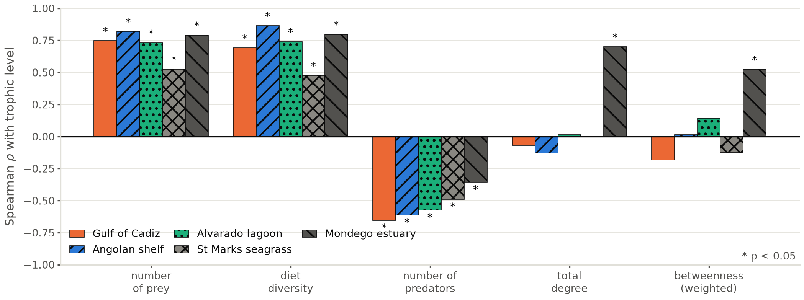

### compare_clustering_vs_density

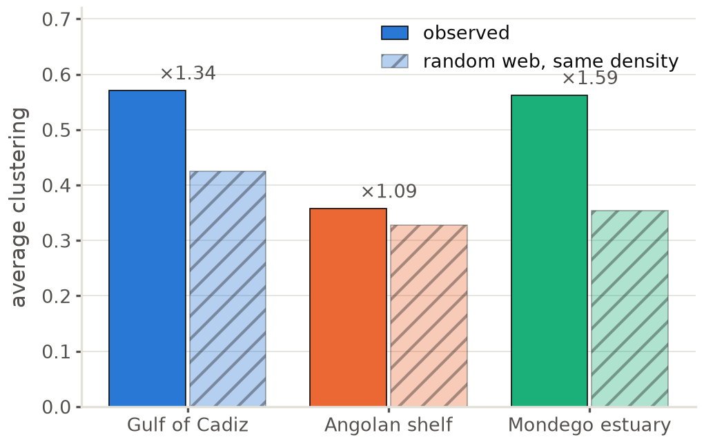

### compare_degree_unevenness

### compare_diet_concentration

### compare_diet_diversity

### compare_fragmentation

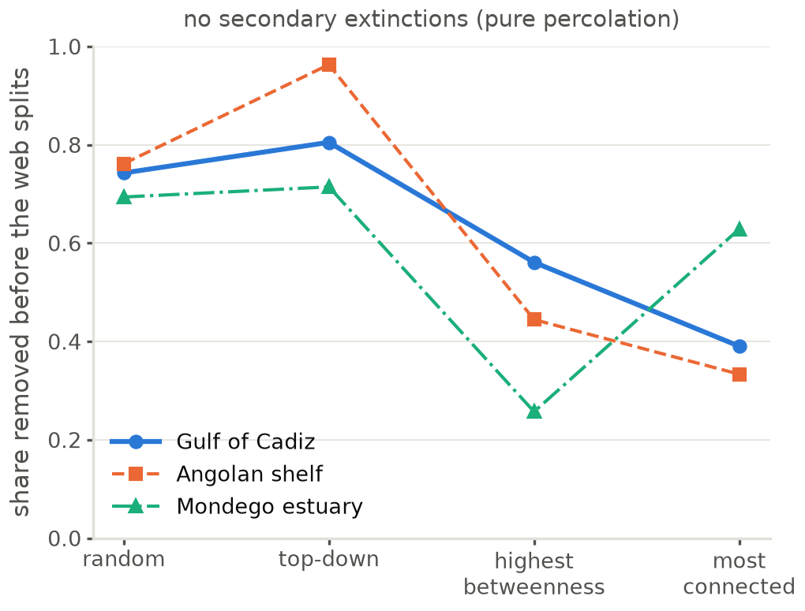

### compare_global_structure

### compare_guild_removal

### compare_knockouts

### compare_l50_link_strength

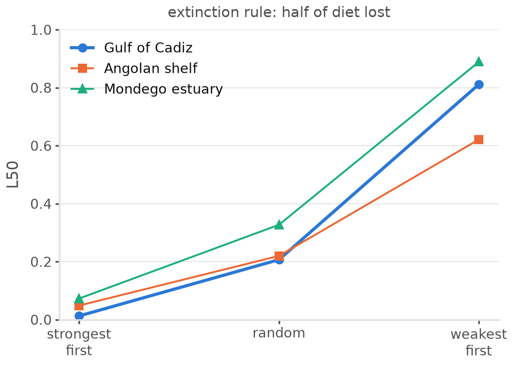

### compare_link_strength

### compare_r50_all

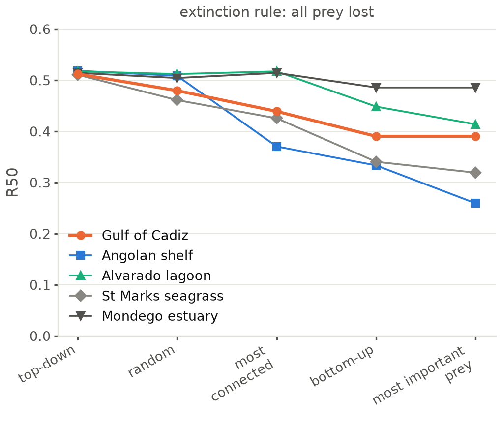

### compare_r50_half

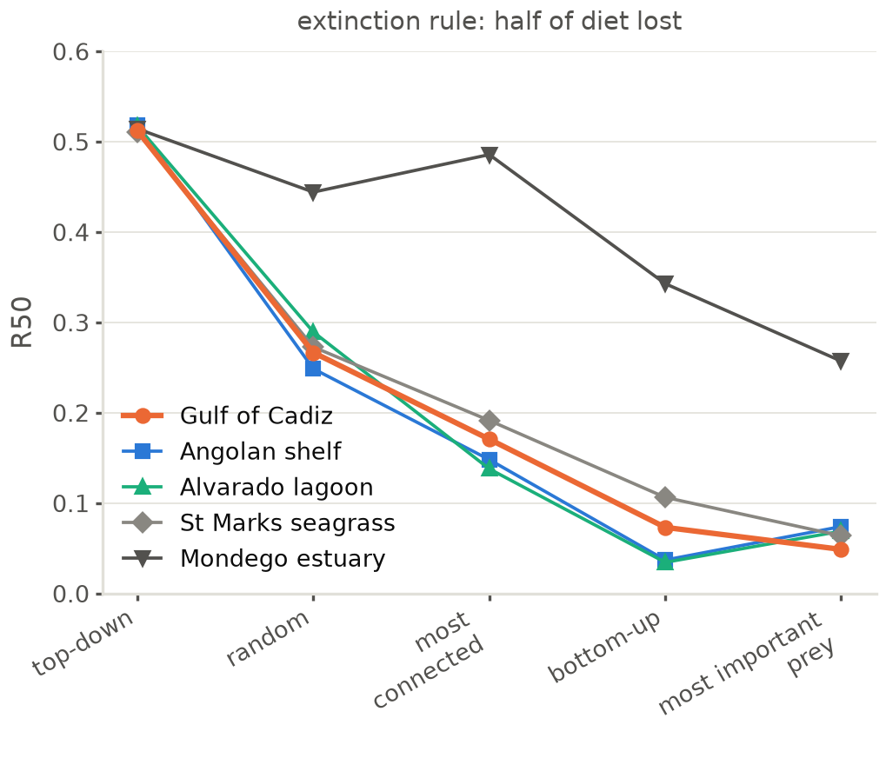

### compare_trophic_level

### compare_area_intervals_all_prey

### compare_area_intervals_half_diet

### compare_centralization_vs_random

### compare_fit_angolan_betweenness

### compare_fit_angolan_effective_prey

### compare_fit_angolan_n_predators

### compare_fit_angolan_n_prey

### compare_fit_angolan_total_degree

### compare_fit_cadiz_betweenness

### compare_fit_cadiz_effective_prey

### compare_fit_cadiz_n_predators

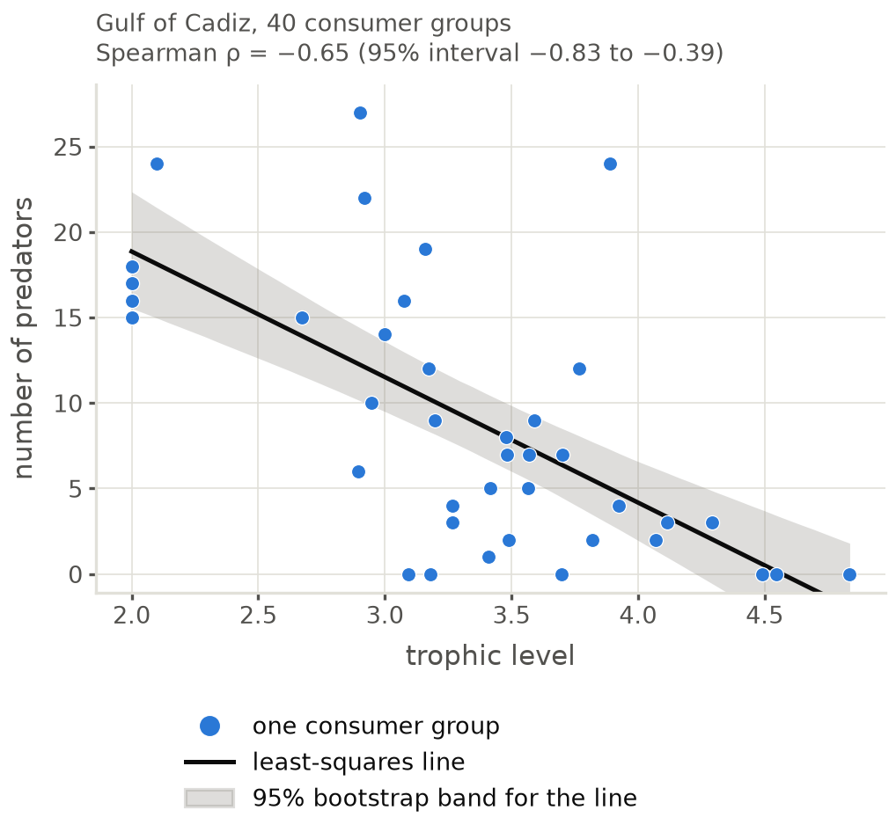

### compare_fit_cadiz_n_prey

### compare_fit_cadiz_total_degree

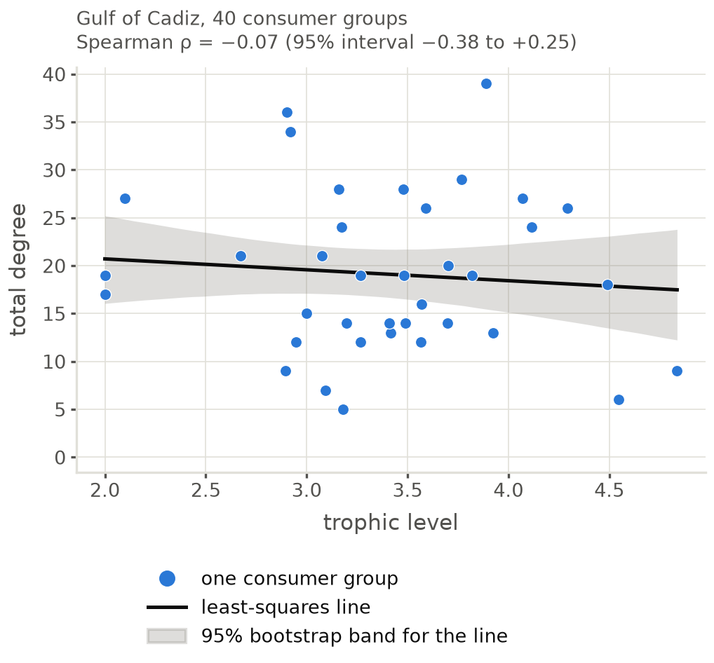

### compare_fit_mondego_betweenness

### compare_fit_mondego_effective_prey

### compare_fit_mondego_n_predators

### compare_fit_mondego_n_prey

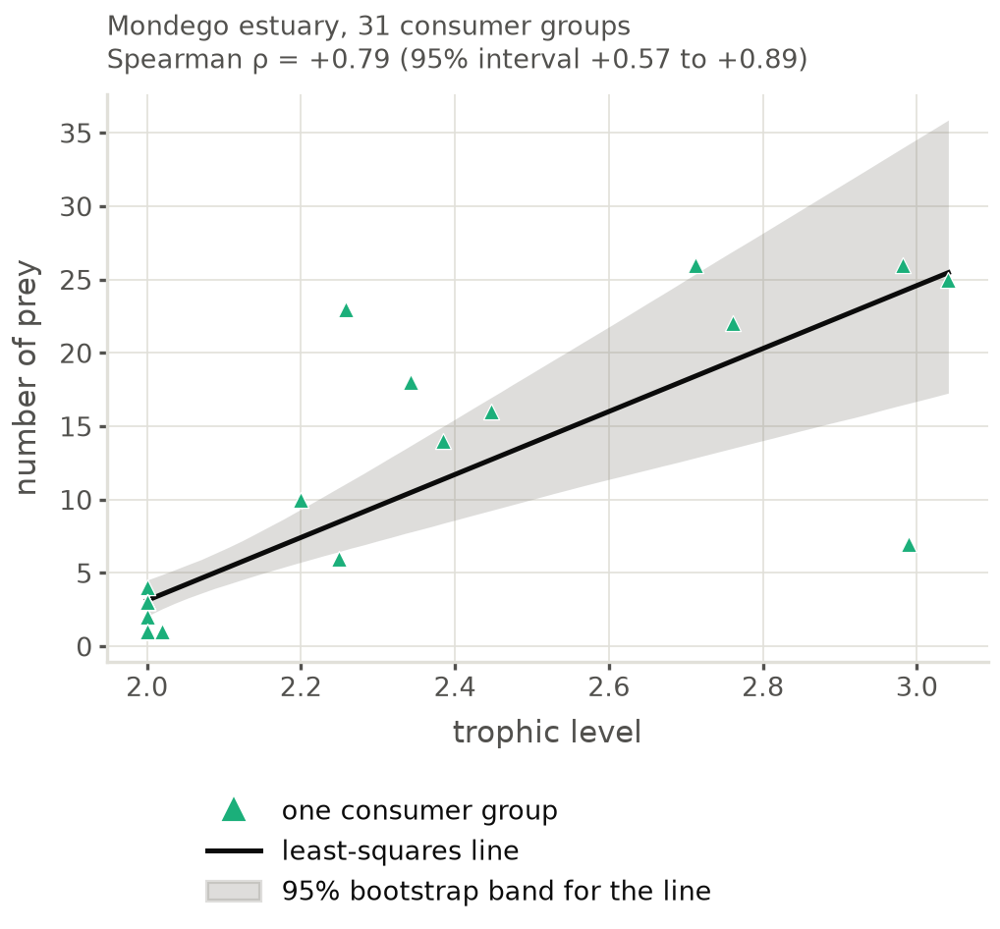

### compare_fit_mondego_total_degree

### compare_groups_cadiz_effective_prey_by_category

### compare_groups_cadiz_n_predators_by_category

### compare_groups_cadiz_n_prey_by_category

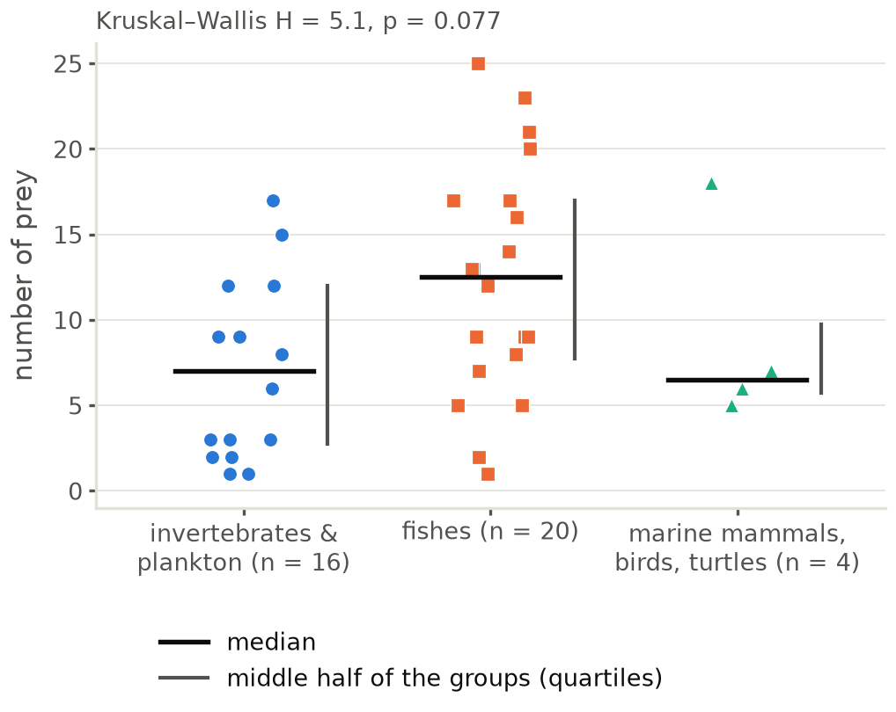

### compare_groups_cadiz_total_degree_by_category

### compare_r50_intervals_all_prey

### compare_r50_intervals_half_diet

### compare_removal_angolan_all_prey_centrality

### compare_removal_angolan_all_prey_trophic

### compare_removal_angolan_half_diet_centrality

### compare_removal_angolan_half_diet_trophic

### compare_removal_cadiz_all_prey_centrality

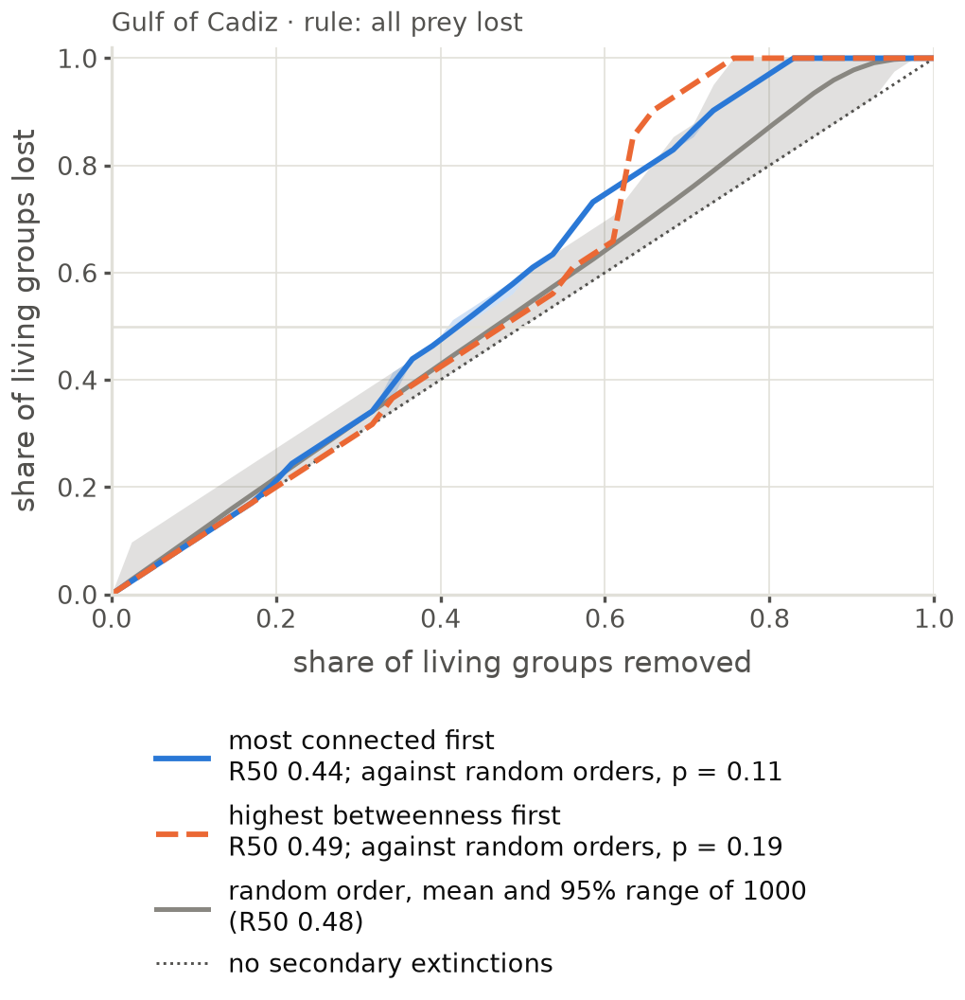

### compare_removal_cadiz_all_prey_trophic

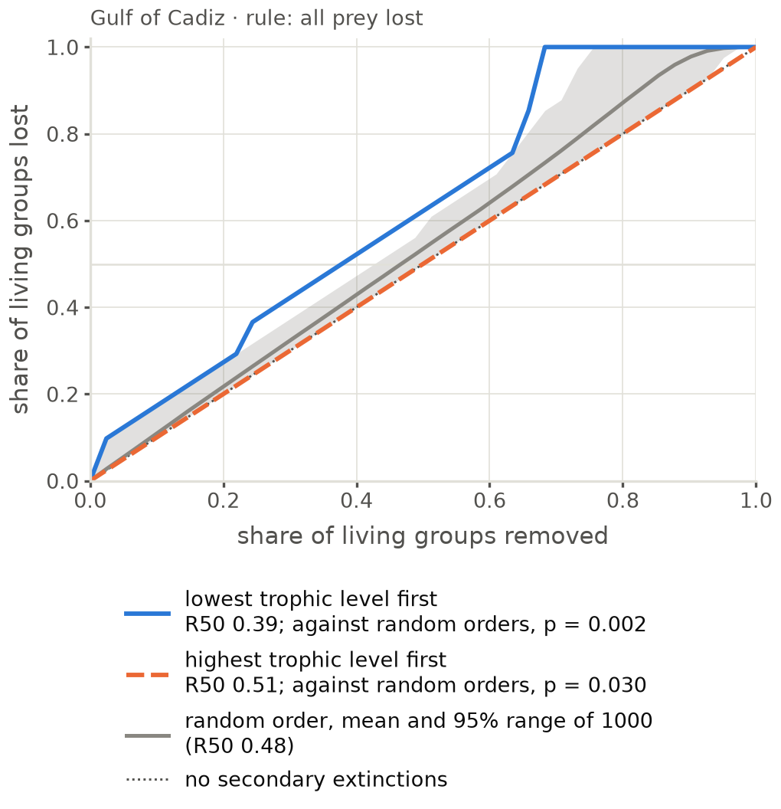

### compare_removal_cadiz_half_diet_centrality

### compare_removal_cadiz_half_diet_trophic

### compare_removal_mondego_all_prey_centrality

### compare_removal_mondego_all_prey_trophic

### compare_removal_mondego_half_diet_centrality

### compare_removal_mondego_half_diet_trophic

### compare_rho_intervals

