# Other ecosystems

Generated by `code/write_docs.py`. The figures are drawn by the code, so if one needs changing, change the code and not the image. Notes on these results: [`notes/`](../../notes/README.md) (cross-ecosystem).

| figure | what it shows |
|---|---|
| [`compare_centrality_vs_tl`](compare_centrality_vs_tl.png) · [pdf](compare_centrality_vs_tl.pdf) | Spearman correlation between trophic level and five measures of a group's position, in all five webs. **Full text width (7 in).** |
| [`compare_clustering_vs_density`](compare_clustering_vs_density.png) · [pdf](compare_clustering_vs_density.pdf) | Average clustering against what a random web of the same density alone would give. The ratio is printed above each pair. |
| [`compare_degree_unevenness`](compare_degree_unevenness.png) · [pdf](compare_degree_unevenness.pdf) | Dispersion (variance/mean) of the number of prey and of predators, against what a random web of the same size and density gives. |
| [`compare_diet_concentration`](compare_diet_concentration.png) · [pdf](compare_diet_concentration.pdf) | Cumulative distribution of the share of a consumer's diet carried by its single largest prey. 1 = a single-prey diet. |
| [`compare_diet_diversity`](compare_diet_diversity.png) · [pdf](compare_diet_diversity.pdf) | Cumulative distribution of diet diversity (effective number of prey), consumers only. |
| [`compare_fragmentation`](compare_fragmentation.png) · [pdf](compare_fragmentation.pdf) | Share of groups removed before the web breaks into more than one piece, random vs targeted orders, with no secondary extinctions. |
| [`compare_global_structure`](compare_global_structure.png) · [pdf](compare_global_structure.pdf) | Where the Gulf of Cadiz sits among the five webs on six whole-web measures. |
| [`compare_guild_removal`](compare_guild_removal.png) · [pdf](compare_guild_removal.pdf) | Secondary extinctions after removing a whole trophic band, half-of-diet rule. Removing upper consumers or top predators causes none in any web. |
| [`compare_l50_link_strength`](compare_l50_link_strength.png) · [pdf](compare_l50_link_strength.pdf) | L50 for cutting the strongest, random and weakest links first, in all five webs, half-of-diet rule. |
| [`compare_link_strength`](compare_link_strength.png) · [pdf](compare_link_strength.pdf) | Cumulative distribution of link strength (share of the predator's diet), log axis. |
| [`compare_r50_all`](compare_r50_all.png) · [pdf](compare_r50_all.pdf) | R50 by removal order in all five webs, all-prey rule. |
| [`compare_r50_half`](compare_r50_half.png) · [pdf](compare_r50_half.pdf) | R50 by removal order in all five webs, half-of-diet rule. |
| [`compare_trophic_level`](compare_trophic_level.png) · [pdf](compare_trophic_level.pdf) | Cumulative distribution of trophic level in all five webs. |

### compare_centrality_vs_tl

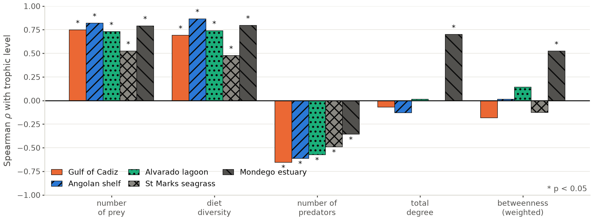

### compare_clustering_vs_density

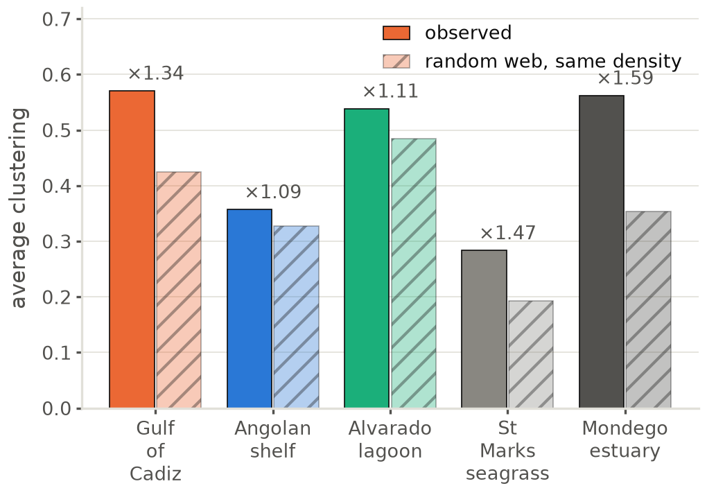

### compare_degree_unevenness

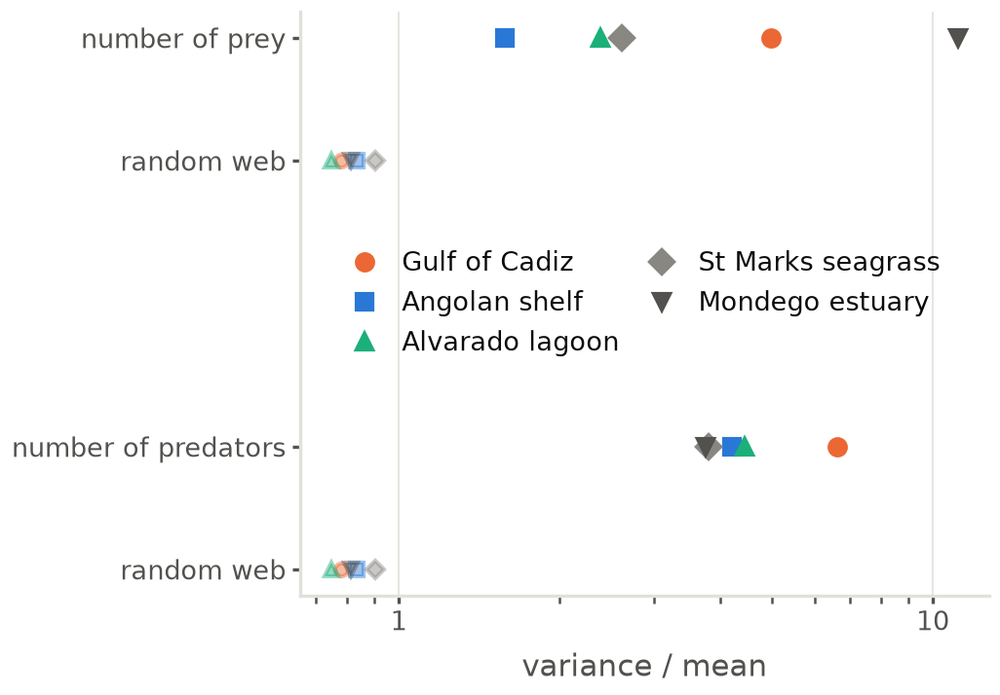

### compare_diet_concentration

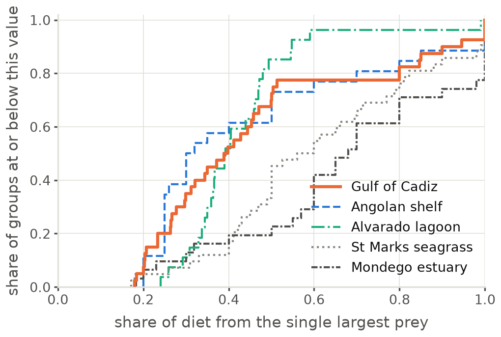

### compare_diet_diversity

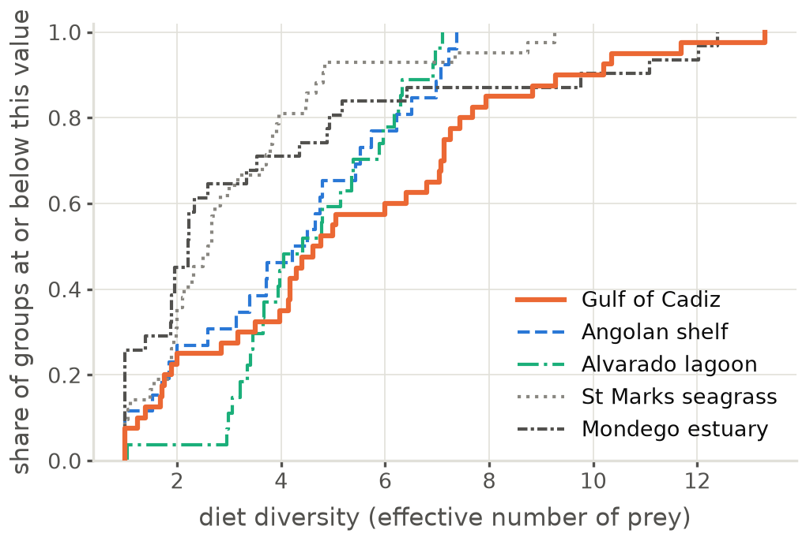

### compare_fragmentation

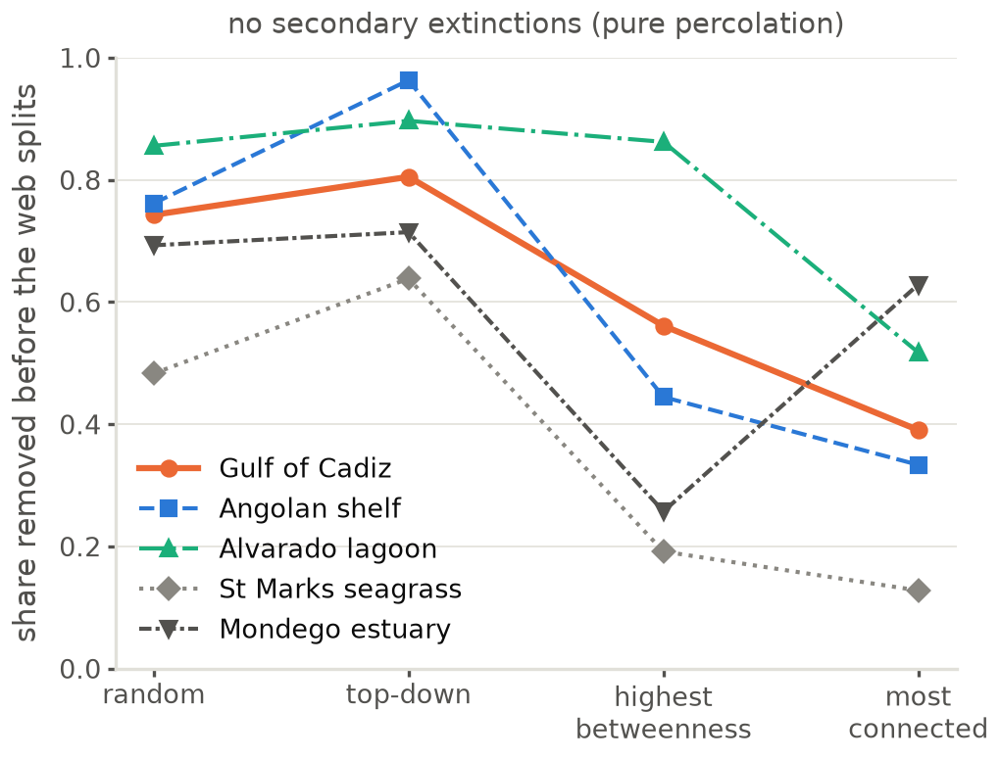

### compare_global_structure

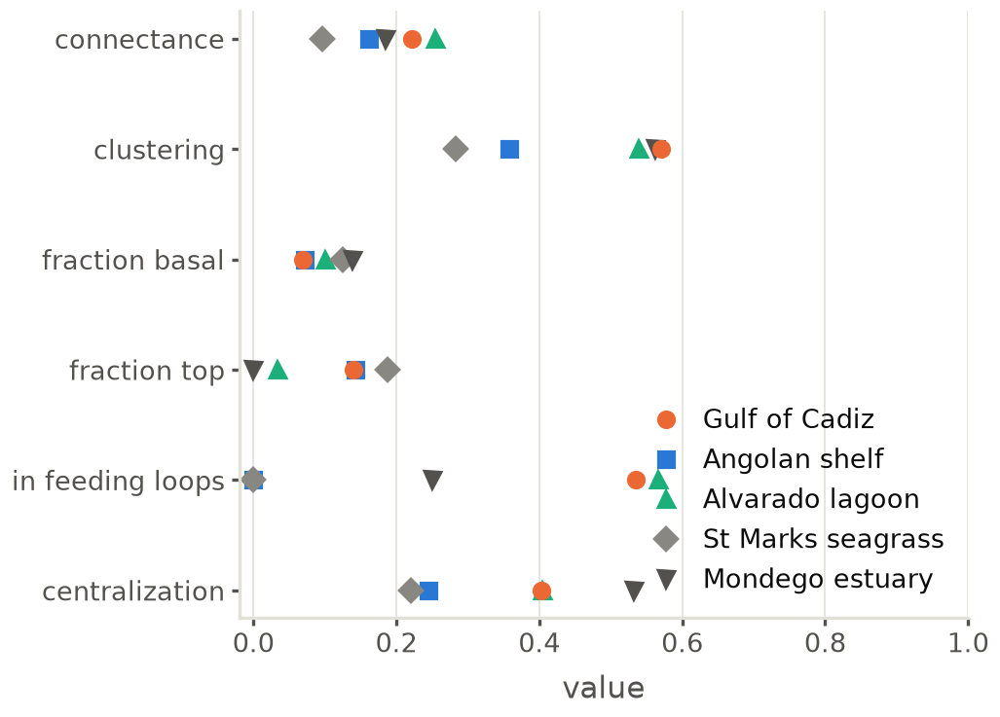

### compare_guild_removal

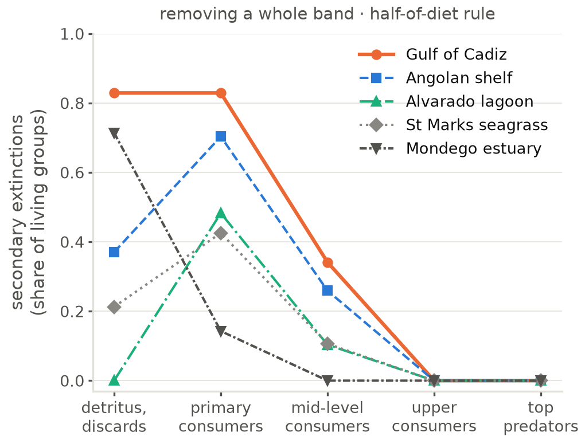

### compare_l50_link_strength

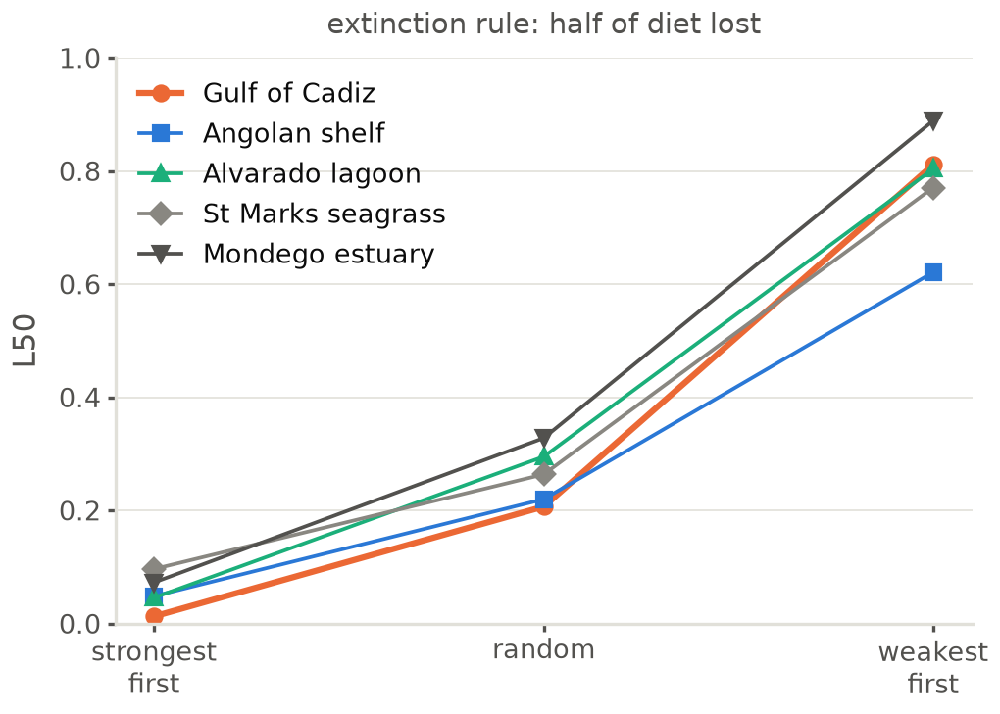

### compare_link_strength

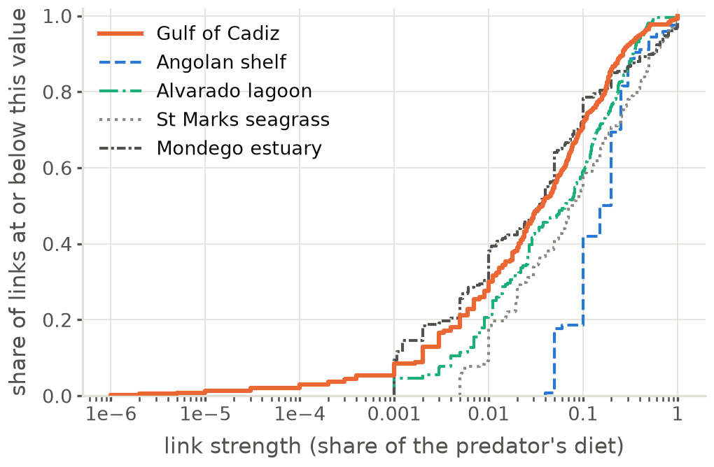

### compare_r50_all

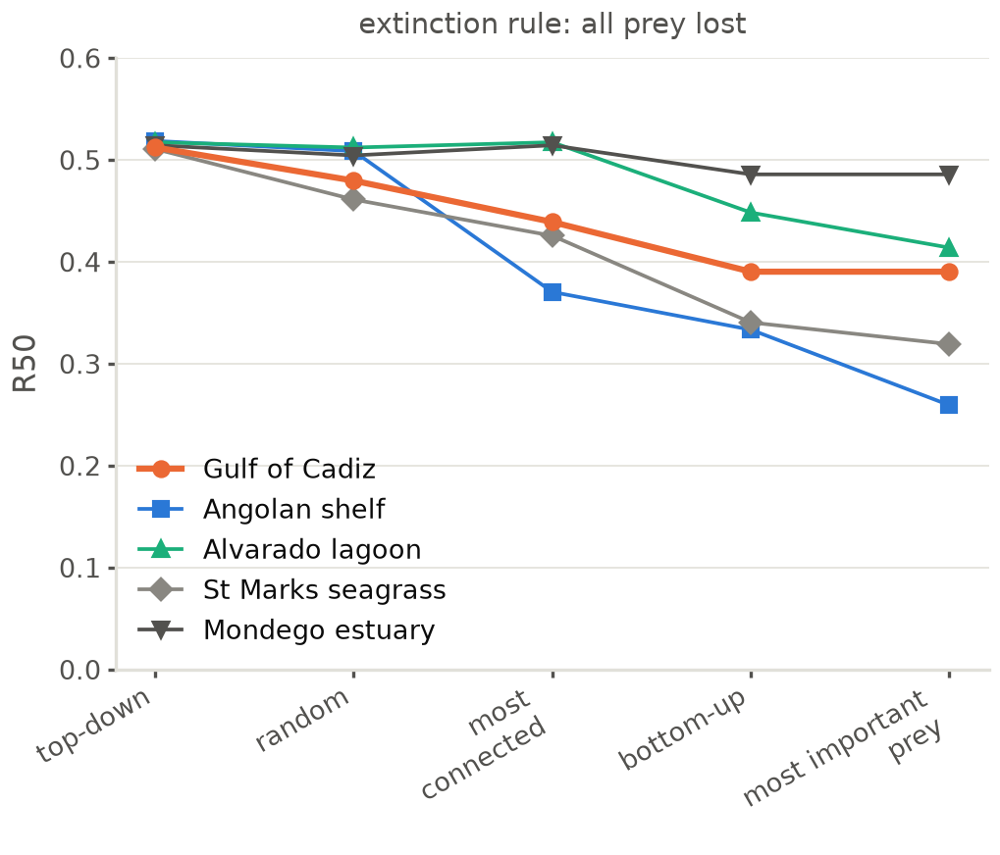

### compare_r50_half

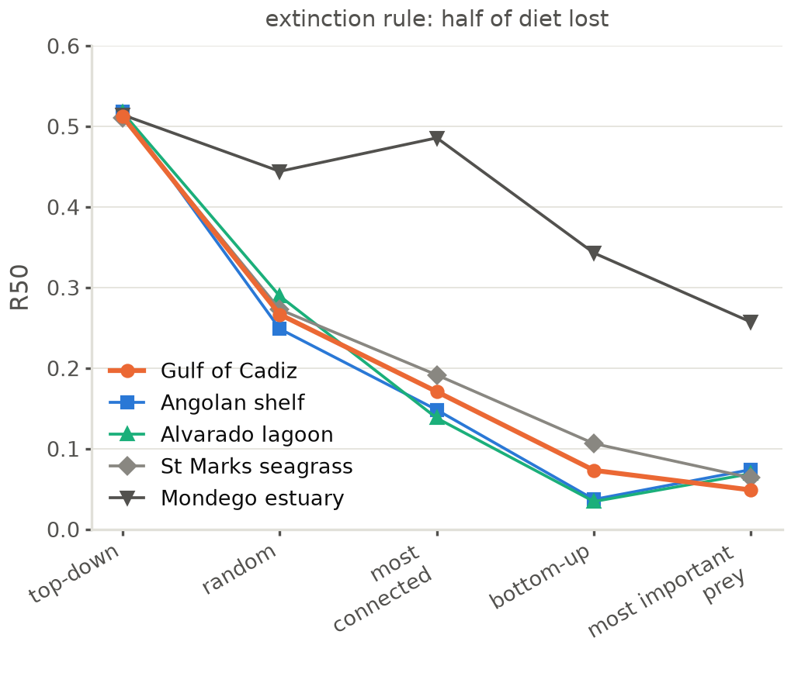

### compare_trophic_level

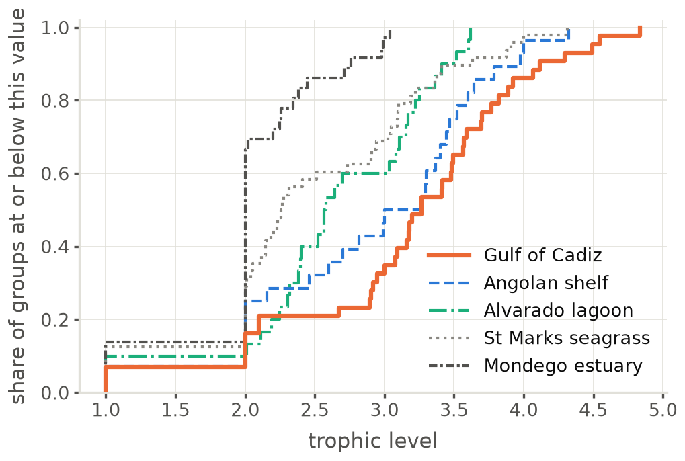
