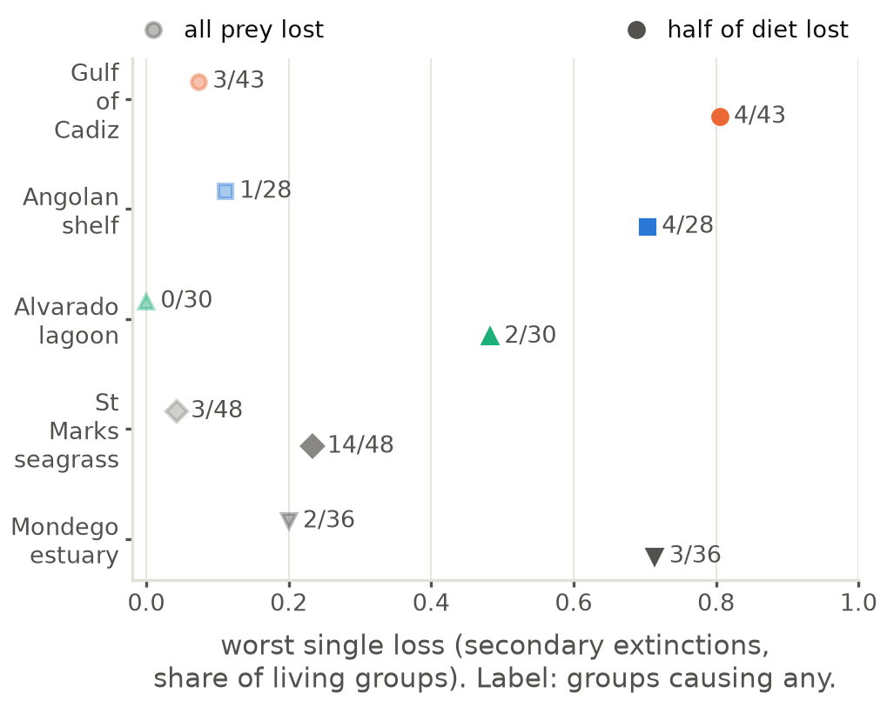

# Other ecosystems

Generated by `code/write_docs.py`. The figures are drawn by the code, so if one needs changing, change the code and not the image. Notes on these results: [`notes/`](../../notes/README.md) (cross-ecosystem).

| figure | what it shows |
|---|---|
| [`compare_centrality_vs_tl`](compare_centrality_vs_tl.png) · [pdf](compare_centrality_vs_tl.pdf) | **Paper figures 4 and 5, across the five webs.** Spearman correlation between trophic level and five measures of a group's position. **Full text width (7 in).** |
| [`compare_degree_unevenness`](compare_degree_unevenness.png) · [pdf](compare_degree_unevenness.pdf) | **Paper figure 2, across the five webs.** Dispersion (variance/mean) of total degree, number of prey and number of predators, against what a random web of the same size and density gives. |
| [`compare_knockouts`](compare_knockouts.png) · [pdf](compare_knockouts.pdf) | **Paper figure 6, across the five webs.** The worst single-group loss in each web, and how many groups cause any secondary extinction at all. |
| [`compare_l50_link_strength`](compare_l50_link_strength.png) · [pdf](compare_l50_link_strength.pdf) | **Paper figures 9 and 10, across the five webs.** L50 for cutting the strongest, random and weakest links first, half-of-diet rule. |
| [`compare_link_strength`](compare_link_strength.png) · [pdf](compare_link_strength.pdf) | **Paper figure 3, across the five webs.** Cumulative distribution of link strength (share of the predator's diet), log axis. |
| [`compare_r50_all`](compare_r50_all.png) · [pdf](compare_r50_all.pdf) | **Paper figures 7 and 8, across the five webs.** R50 by removal order, all-prey rule. |
| [`compare_r50_half`](compare_r50_half.png) · [pdf](compare_r50_half.pdf) | **Paper figures 7 and 8, across the five webs.** R50 by removal order, half-of-diet rule. |

### compare_centrality_vs_tl

### compare_degree_unevenness

### compare_knockouts

### compare_l50_link_strength

### compare_link_strength

### compare_r50_all

### compare_r50_half

