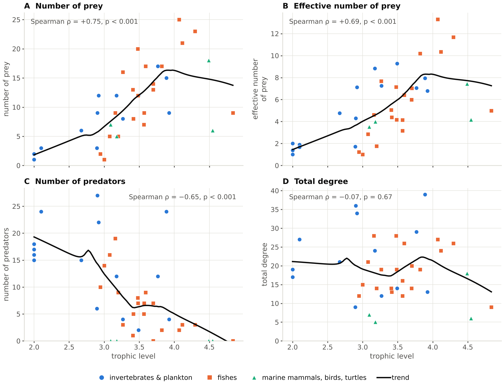

# Connectivity and diet diversity against trophic level

One four-panel figure, drawn by [`make_tl_scatter_panels.py`](make_tl_scatter_panels.py). It asks whether groups higher in the web are more connected, and shows that the answer depends on which measure of "connectedness" is used.

| file | what it is |
|---|---|
| [`tl_vs_connectivity.png`](tl_vs_connectivity.png) · [pdf](tl_vs_connectivity.pdf) | Trophic level (x) against four connectivity measures (y), one panel each, with Spearman ρ and a trend line |
| [`make_tl_scatter_panels.py`](make_tl_scatter_panels.py) | The script that draws it |



## The four panels

All four use the same 40 consumers, which are the groups with at least one prey. The three basal groups (Phytoplankton, Detritus, Discard) have no diet, so diet diversity is undefined for them and they are left out of every panel. Each point is one group, coloured by type: invertebrates and plankton (16), fishes (20), and marine mammals, birds and turtles (4).

| panel | y-axis | Spearman ρ | p |
|---|---|---|---|
| A | Number of prey (in-degree) | +0.75 | 2.9e-08 |
| B | Effective number of prey, exp(Shannon entropy) of the diet | +0.69 | 7.8e-07 |
| C | Number of predators (out-degree) | −0.65 | 4.7e-06 |
| D | Total degree (prey + predators) | −0.07 | 0.67 |

Groups higher in the web eat more kinds of prey (A) and spread their diet more evenly across them (B), but they have fewer predators (C). The two effects cancel in total degree (D), which shows no monotonic trend. This is why "connectedness" cannot be treated as one measure.

Effective number of prey is the diet diversity defined in [`code/README.md`](../../code/README.md): `exp(−Σ p_j ln p_j)`, where `p_j` is each prey's share of the diet after removing cannibalism and rescaling to sum to 1.

## How to read the figure

- **ρ and p** are Spearman rank correlations across the 40 consumers. That is the test; it uses ranks, so it needs a monotonic relationship, not a straight line.
- **The black "trend" line** is a LOWESS smoother (local linear fit, tricube weights, nearest 67% of points). It is drawn only to help the eye follow the pattern. It is not part of the test, and no slope or R² is reported.
- With only 40 groups, small wiggles in the trend line, especially at the highest trophic levels where there are few groups, should not be read as structure.

## Reproducing it

The script reads only `output/cadiz_node_traits.csv`, so run `python code/run_all.py` first if `output/` is missing. Then, from the repository root:

```bash
python "figures/09_connectivity&diet_diversity/make_tl_scatter_panels.py" . "figures/09_connectivity&diet_diversity"
```

It writes the PDF (for LaTeX) and a 300 dpi PNG at 7 in wide, the full text width, with no text smaller than 6.5 pt. It also prints ρ, p and n for each panel.

This folder is not part of `code/run_all.py` and is not covered by `code/write_docs.py`, so this README is written by hand and will not be regenerated.
