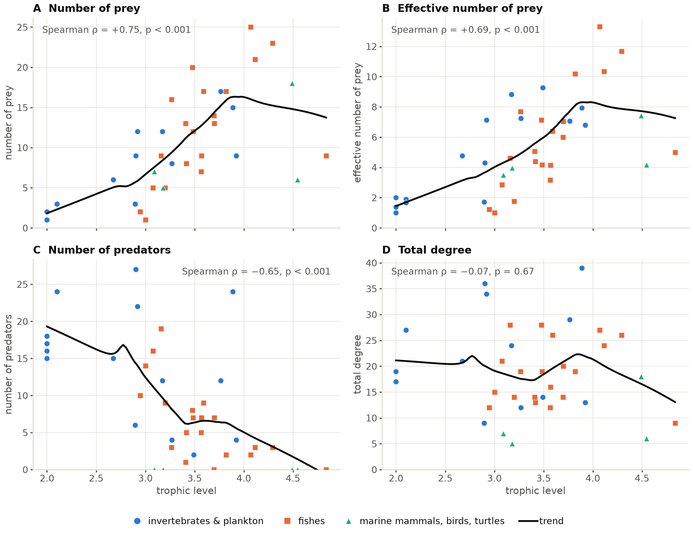

# Connectivity and diet diversity against trophic level

Drawn by [`code/connectivity_panels.py`](../../code/connectivity_panels.py) from `output/cadiz_node_traits.csv`, at the full text width (7 in). The numbers behind this figure are in [`notes/04_centrality.md`](../../notes/04_centrality.md).

| Figure | What it shows |
|---|---|
| [`tl_vs_connectivity`](tl_vs_connectivity.png) · [pdf](tl_vs_connectivity.pdf) | Number of prey (ρ = +0.75), effective number of prey (+0.69), number of predators (−0.65) and total degree (−0.07, p = 0.67) against trophic level for the 40 consumers, with Spearman ρ and a trend line. Higher groups eat more kinds of prey but have fewer predators, so total degree is flat. |

### tl_vs_connectivity

