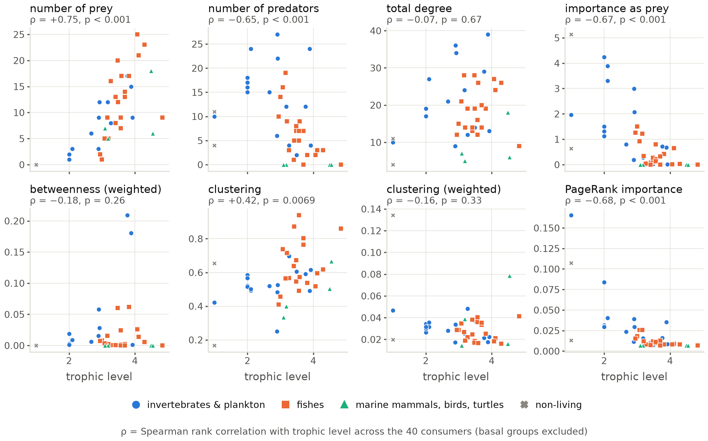
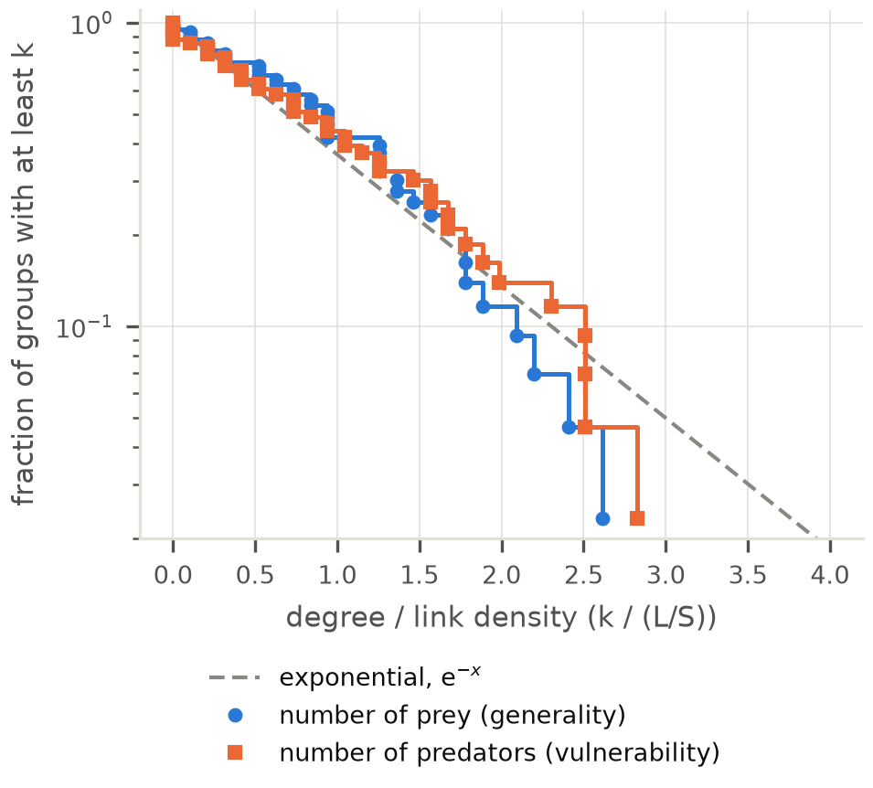
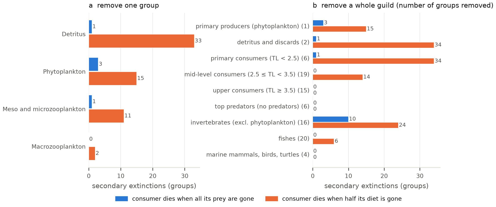
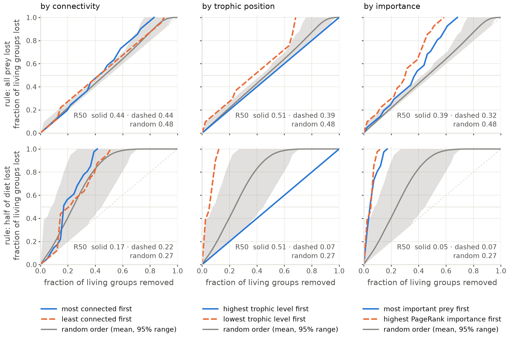
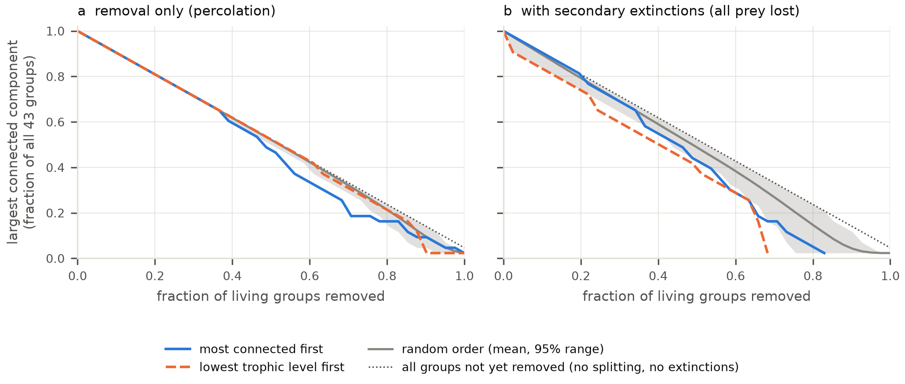

# Figures

This folder contains the figures in the manuscript. Both are drawn by [`code/build_network.py`](../code/build_network.py). To change a figure, edit the code and rerun it; don't edit the image files.

## Which file to use

Each figure is saved twice, from the same drawing:

| Format | Use it for |
|---|---|
| `.pdf` (vector) | **LaTeX / Overleaf.** Text stays sharp at any zoom. |
| `.png` (300 dpi) | Word, Google Docs, slides, GitHub |

Every figure is drawn at its **printed size**. Most are 7 in wide, the full text width of the two-column article template (`figure*`, `width=\textwidth`). `cadiz_degree_distributions` is 3.4 in, one column (`figure`, `width=\columnwidth`). At those sizes no text is smaller than 6.5 pt.

**Insert them at full width, never smaller.** Shrinking a figure shrinks its text with it. That is what made Figure 1 of the proposal unreadable: the earlier 12-inch version of the food web was scaled down to 5.3 in, which left its labels at about 3 pt.

In the LaTeX template, use the two-column-wide float:

```latex
\begin{figure*}
  \includegraphics[width=\textwidth]{cadiz_foodweb.pdf}
  \caption{...}
  \label{fig:foodweb}
\end{figure*}
```

In Word or Google Docs, insert the PNG at the full page width (6.5 in with 1-inch margins).

## Contents

| Files | What it shows | Used in |
|---|---|---|
| `cadiz_foodweb.pdf` / `.png` | The food web, with height = trophic level. Node colour = broad category; node size = importance as prey (summed diet share); arrow width = diet share (prey → predator); ring = cannibalism. Edges below 0.01 are drawn faint. | Proposal, Figure 1 (old 12-inch version) |
| `cadiz_diet_matrix.pdf` / `.png` | The culled 43 × 43 diet matrix as a heatmap on a log colour scale, with both axes ordered by trophic level. Category strips run along the axes, and cannibalism cells are outlined. | not yet |
| `cadiz_centrality_vs_tl.pdf` / `.png` | Eight centralities (degree, importance as prey, weighted betweenness, clustering, PageRank importance) plotted against trophic level, each with its Spearman ρ across the 40 consumers. Colour and marker shape = broad category. | not yet |
| `cadiz_degree_distributions.pdf` / `.png` | Cumulative distributions of number of prey and number of predators, divided by link density, against the exponential that random assembly predicts (Camacho et al. 2002). One column wide. | not yet |
| `cadiz_removal_effects.pdf` / `.png` | Secondary extinctions (a) when single groups are removed (only groups whose loss causes any), and (b) when whole guilds are removed, under both extinction rules | not yet |
| `cadiz_robustness.pdf` / `.png` | Fraction of living groups lost as groups are removed in different orders. Rows: extinction rule; columns: pairs of removal orders; grey: 1000 random orders. R50 in each panel. | not yet |
| `cadiz_giant_component.pdf` / `.png` | Size of the largest connected component during removal, (a) removal only, as in Lab 7, and (b) with secondary extinctions. The dotted line marks "all remaining groups still in one piece". | not yet |

### `cadiz_foodweb`


### `cadiz_diet_matrix`


### `cadiz_centrality_vs_tl`



### `cadiz_degree_distributions`



### `cadiz_removal_effects`



### `cadiz_robustness`



### `cadiz_giant_component`



